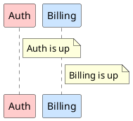

# Python in PlantUML: interpreter and preprocessor design

This document describes two things that live in this repository:

1. **The Python interpreter** (`org.luaj.vm2.python`): an interpreter for a
   *subset of Python 3*, written in pure Java. It exists and is tested.
2. **How it will be used from PlantUML** (a "Python preprocessor" that partly
   replaces the legacy text preprocessor, and an "engine" mode that drives
   PlantUML from a script). The design is decided; **none of it is implemented
   yet**.

The interpreter started as a proof of concept in separate repositories (a fork
of LuaJ, then a standalone "PicoPy" project). Those repositories are gone:
everything now lives here. The Java package keeps the historical name
`org.luaj.vm2.python` and will not be renamed. The notes written in the
proof-of-concept repositories were checked against the code and are superseded
by this document.

## 0. Conventions used in this document

Each statement carries a status, either explicitly or by the section it is in.

| Tag | Meaning |
|---|---|
| **[implemented]** | Present in the code of this repository, checked against it. |
| **[decided]** | Design decision taken, not implemented yet. |
| **[open]** | Open to discussion; the text describes the current behaviour or the current leaning, not a commitment. |
| **[missing]** | Referred to by code or tests but not present in the repository. |

Sections 1 to 9 describe the interpreter (mostly **[implemented]**). Sections
10 to 14 describe the PlantUML integration (**[decided]**, not implemented).
Section 15 lists the open points.

## 1. Goals and constraints

PlantUML ships in several editions that must behave identically: the regular
JAR, a JavaScript build and a native C build, the last two produced with
[TeaVM](https://teavm.org). The interpreter is therefore written **in Java**
and compiled once to JVM bytecode, JavaScript and C. It is meant to:

- generate diagrams from Python code embedded in the diagram source, partly
  replacing the text preprocessor (loops, functions, data structures);
- drive PlantUML from a script (build a model, call layout/render functions,
  query the result).

Constraints that drive every decision:

- no reflection, no threads, no file system, no `Class.forName`;
- nothing that TeaVM cannot compile;
- no uncatchable failures: a `StackOverflowError` crashes a TeaVM/C binary, so
  call depth and instruction count are bounded;
- deterministic: same output on the JAR, JavaScript and C editions;
- the smallest possible surface: what is not needed is removed.

**[open]** A TeaVM build of the package (JavaScript and C) ran at some point in
the proof of concept and remains an objective. No TeaVM build of this package
is part of the repository today. Nothing in the package is expected to be
difficult for TeaVM.

## 2. Principles

- **A subset, not a dialect.** Every accepted program is valid Python 3 and
  gives the same result in CPython, except for the documented deviations
  (section 6). What is hard or useless here is removed (classes, generators,
  `finally`, ...), never changed.
- **CPython is the oracle.** The reference output of a test script is the one
  CPython prints (section 9).
- **Deterministic and bounded.** An instruction counter and a call depth limit
  bound every run.
- **The VM is ours.** A stack machine with its own instruction set
  (section 8). Nothing is kept from the Lua register machine of LuaJ.

## 3. The Python subset **[implemented]**

All the rejections below are `PySyntaxError`s with an explicit message, raised
by the parser (`PyParser`).

### 3.1 Statements

Accepted:

- expression statements;
- assignment: chained (`a = b = 1`), tuple/list unpacking, augmented
  (`+=`, ...); targets are a name, `a[i]`, `a[i:j]` or a tuple/list of those;
- `if` / `elif` / `else`;
- `while` and `for ... in`, with `break`, `continue` and an `else` clause on
  loops;
- `pass`;
- `def`: positional and keyword parameters, defaults, keyword-only parameters,
  `*args`, `**kwargs`;
- `return`;
- `global`, `nonlocal`;
- `assert`;
- `del name`, `del a[i]` (and a comma-separated list of those);
- `try` / `except` / `else`, and `raise` (including a bare `raise` inside an
  `except`);
- `import module` for builtin modules only (today: `math`). An unknown module
  raises `ModuleNotFoundError`.

### 3.2 Expressions

`None`, `True`, `False`; `int`, `float` and `str` literals (single, double and
triple quotes, escapes, raw strings, f-strings; number literals in decimal,
hexadecimal, octal, binary, with underscores); list, tuple and dict displays;
list and dict comprehensions; conditional expressions (`a if c else b`);
`lambda`; `and`, `or`, `not`; chained comparisons; `in` / `not in`;
`is` / `is not`; arithmetic and bitwise operators; slicing; calls with `*` and
`**` unpacking and keyword arguments; attribute access on builtin values
(method calls, `e.args`).

### 3.3 Rejected (syntax error)

`class`, `finally`, `with`, `yield` and generators, `async` / `await`,
decorators, `from ... import`, `import` of user modules, `set` displays and set
comprehensions (`{a, b}`), generator expressions (`f(x for x in y)`), `bytes`,
complex numbers (`1j`), `...`, the walrus operator `:=`, `match`, `@` operator,
type annotations (variables, parameters, return), positional-only parameters
(`/`), dictionary unpacking in displays (`{**a}`), starred expressions outside
calls and parameters (`[*a]`, `a, *b = c`), `except*`, `\N{...}` escapes, the
`=` specifier of f-strings (`f'{x=}'`).

`print(..., file=...)` is also rejected, at run time: `print` accepts only the
keywords `sep`, `end` and `flush`. `exec` and `eval` do not exist.

Other limits of the parser:

- nesting is limited to 200 levels: a hostile input gives a syntax error, never
  a stack overflow;
- tabs in indentation are rejected;
- some errors are not detected at parse time but by the resolver or the code
  generator: duplicate parameter names, `break` / `continue` outside a loop,
  `return` outside a function, `global` / `nonlocal` misuse, integer literals
  outside 32 bits. They are reported as `PySyntaxError` too.

## 4. Values and builtins **[implemented]**

### 4.1 Types

`NoneType`, `bool`, `int`, `float`, `str`, `list`, `tuple`, `dict`, `range`,
`slice`, functions, builtin functions, bound methods, modules, and the dict
views (`dict_keys`, `dict_values`, `dict_items`).

The types `int`, `float`, `str`, `bool`, `list`, `tuple`, `dict`, `range` and
the exception classes are values: they can be called, compared with `type(x)`
and given to `isinstance`.

At run time the values are plain Java objects: `Integer`, `Double`, `Boolean`,
`String`, a singleton for `None`, and small classes for list, tuple, dict, range,
slice, views, functions and types. An iterator signals its end with a Java
`null`.

- **Truthiness** is Python's: `0`, `0.0`, `""`, `[]`, `()`, `{}`, `None` and
  `False` are false.
- **Equality** is structural for lists, tuples and dicts; `1 == 1.0`.
- **Integers** are 32-bit (section 6). `/` is true division, `//` and `%`
  floor, `**` with a negative exponent gives a float.
- **Strings** are sequences of Unicode code points. A string is a Java `String`;
  when it only contains BMP characters, indexing and length are O(1),
  otherwise the code points are scanned.
- **dict** keeps insertion order. Keys are normalised so that `True`, `1` and
  `1.0` are one key.
- **Functions** return one value; `return a, b` returns a tuple.
- `map`, `filter`, `zip`, `enumerate` and `reversed` may return lists instead
  of lazy iterators; the tests always consume them with `list()` or a `for`
  loop.

### 4.2 Builtin functions

`print len repr format abs min max sum sorted reversed enumerate zip map filter
any all isinstance type round divmod pow ord chr hex oct bin callable`, plus the
types used as constructors (`int float str bool list tuple dict range`).

`print` accepts `sep`, `end`, `flush`. `min` / `max` accept `key` and `default`.
`sorted` accepts `key` and `reverse`.

Not provided: `hash`, `id`, `input`, `open`, `getattr` / `setattr` /
`hasattr`, `set`, `frozenset`, `iter` / `next`, `exec`, `eval`.
(`open` is planned for the engine flavor only, section 13.)

### 4.3 Methods

- `str`: `upper lower title capitalize swapcase strip lstrip rstrip split rsplit
  join replace count startswith endswith find rfind index rindex partition
  rpartition removeprefix removesuffix isdigit isalpha isalnum isspace isupper
  islower ljust rjust center zfill splitlines format`.
- `list`: `append extend insert pop remove index count sort reverse clear copy`.
- `dict`: `get keys values items pop update setdefault clear copy`.
- `tuple`: `index count`.

The `%` operator on strings and f-strings are supported with the usual
conversions (`s r d i x X o f e g c %`, width, precision, flags), as is
`str.format` and the `format` builtin.

### 4.4 Module `math`

`sqrt floor ceil fabs fmod sin cos tan asin acos atan atan2 sinh cosh tanh exp
expm1 log log10 log1p log2 pow hypot copysign trunc gcd factorial fsum isclose
degrees radians isnan isinf isfinite` and the constants `pi e tau inf nan`.

### 4.5 Exceptions

```
BaseException
 └ Exception
    ├ ArithmeticError ─ ZeroDivisionError, OverflowError
    ├ LookupError ─ KeyError, IndexError
    ├ ValueError
    ├ TypeError
    ├ AssertionError
    ├ AttributeError
    ├ NameError ─ UnboundLocalError
    ├ RuntimeError ─ RecursionError, NotImplementedError
    ├ MemoryError
    └ ImportError ─ ModuleNotFoundError
```

`str(e)` and `e.args` work. There are no user-defined exception classes (no
`class`). Exceeding the call depth raises `RecursionError`, which can be caught.
Running out of instructions raises `ExecutionLimitError`, which is *not* a
Python exception: `except` (even a bare one) cannot catch it, so a `try` around
an endless loop does not defeat the limit.

## 5. Limits **[implemented]**

| Limit | Default | Setter | Behaviour |
|---|---|---|---|
| Call depth | 1000 | `Interp.setMaxDepth(int)` | catchable `RecursionError` |
| Instruction count | 200 000 000 | `Interp.setMaxSteps(long)` | `ExecutionLimitError`, not catchable by the script |
| Parser nesting | 200 | (constant) | `PySyntaxError` |

The values in the examples of the sources (`setMaxDepth(200)`,
`setMaxSteps(10_000_000)`) are illustrations, not defaults.

The **instruction counter** is incremented on backward jumps, on every call
(Python function or builtin) and inside the long loops of builtins (`sum`,
`sorted`, `min`, ...). `Interp.getSteps()` returns its value.

The **call depth** counter is checked on entry of every Python function. In
addition a Java `StackOverflowError` is turned into the same `RecursionError`.

## 6. Deviations from CPython **[implemented]**

Scripts that exercise these live in `src/test/resources/python/deviations/` and
are not run under CPython.

- `int` is 32-bit. Any result outside `[-2147483648, 2147483647]` raises
  `OverflowError` (`top + 1`, `2 ** 31`, `1 << 31`, `abs(-2**31)`,
  `int("2147483648")`, `int(3e9)`, ...). This is mainly dictated by TeaVM's
  JavaScript target, where a 64-bit integer is expensive. Integer literals
  outside 32 bits are syntax errors.
- Call depth and instruction limits (section 5).
- Error messages differ from CPython. Tests compare the exception type, not the
  text.
- `dict.keys()` and the other views are live but support no set operations.
- A list that contains itself raises `RecursionError` in `repr` instead of
  printing `[...]`.
- `hash` and `id` are not provided.
- `sum` of floats is a plain left-to-right sum (CPython 3.12+ compensates); the
  tests avoid cases where this shows.
- `map`, `filter`, `zip`, `enumerate`, `reversed` may be eager.

## 7. Pipeline **[implemented]**

```
source -> PyLexer -> PyParser -> AST (Node) -> Resolver -> CodeGen -> Code -> Interp
```

- **`PyLexer` / `Token`**: INDENT / DEDENT tokens, no newline inside brackets,
  continuation lines, triple quotes, string prefixes (`r f u rf fr`), number
  literals. Tabs are rejected.
- **`PyParser`**: recursive descent into an AST shaped exactly like CPython's
  `ast` (same node names, same fields, same order). Integers are `Long` and
  floats `Double` in the tree, `None` is `null`. This is only the tree: values
  at run time are `Integer`. It is not a single pass: a conditional expression
  or a comprehension puts an expression before the part that decides how to
  compile it, and a nested function may refer to a local assigned later in the
  enclosing function.
- **`AstDump`**: text form of a tree, used to compare with CPython (section 9).
- **`Resolver` / `Scope`**: one pass over the tree. A name bound anywhere in a
  function is local (unless declared `global` / `nonlocal`); names bound at the
  top level are globals. A local used by an inner function becomes a *cell*;
  the inner function receives it as a *free* variable. Comprehensions and
  lambdas are scopes of their own. It reports scope errors.
- **`CodeGen`**: one `Code` per function. It tracks the stack depth of every
  instruction (so `maxStack` is exact and a mismatch is an internal error), and
  builds labels, a line table, a constant table and the exception table.
  Unreachable statements emit nothing. `Code.disassemble()` lists the result.
- **`Interp`**: the loop; holds the globals, the builtins, the modules, the
  output sink and the limits. One `Interp` is one program state.

Closures are CPython's cells. The slots of a frame are, in this order:
positional parameters, keyword-only parameters, `*args`, `**kwargs`, other
locals, the free variables received from the closure, then temporaries. The
prologue wraps captured variables with `MAKE_CELL`.

## 8. The virtual machine **[implemented]**

One `int` per instruction: opcode in the low 8 bits, unsigned 24-bit argument
above it. Operands live on a stack; locals are slots of the frame; a Java
`null` in a slot means "unbound". Jump targets are absolute.

| Group | Instructions |
|---|---|
| stack | `NOP POP DUP DUP2 ROT2 ROT3` |
| variables | `LOAD_CONST LOAD_FAST STORE_FAST DELETE_FAST LOAD_CELL STORE_CELL DELETE_CELL LOAD_CLOSURE MAKE_CELL LOAD_GLOBAL STORE_GLOBAL DELETE_GLOBAL LOAD_ATTR` |
| operators | `BINARY_OP` (operator `BIN_*` in the argument, `INPLACE` bit for `+=`), `UNARY_NEG UNARY_POS UNARY_INVERT UNARY_NOT`, `COMPARE_OP` (`CMP_*`), `IS_OP`, `CONTAINS_OP` |
| containers | `GETITEM SETITEM DELITEM BUILD_SLICE BUILD_LIST BUILD_TUPLE BUILD_DICT BUILD_STRING LIST_APPEND LIST_EXTEND MAP_ADD DICT_ADD_KW DICT_MERGE_KW UNPACK` |
| control | `JUMP JUMP_IF_FALSE JUMP_IF_TRUE JUMP_IF_FALSE_KEEP JUMP_IF_TRUE_KEEP GET_ITER FOR_ITER` |
| calls | `CALL`, `CALL_KW` (names tuple on top), `CALL_EX` (list and optional dict), `MAKE_FUNCTION` (flags: defaults, keyword-only defaults, closure), `RETURN` |
| exceptions | `RAISE RERAISE EXC_MATCH` |
| other | `IMPORT FORMAT_VALUE` (f-strings) |

Binary operators: `ADD SUB MUL DIV FLOORDIV MOD POW LSHIFT RSHIFT AND OR XOR`.
Comparisons: `EQ NE LT LE GT GE`.

**Exceptions** use a static table in each `Code`:
`[start, end) -> handler, stack depth`. When a Python exception reaches the
loop, the loop looks for the first entry covering the faulting instruction
(inner `try` statements come first), cuts the stack to the recorded depth,
pushes the exception and jumps to the handler. A `try` costs nothing when
nothing is thrown. `except` clauses are compiled to `EXC_MATCH` tests; the
exception is kept in a hidden slot so that a bare `raise` re-raises it. Only
`try/except/else` and `raise` exist: `finally` and `with` would need code
duplication at every exit and are out of scope.

**TeaVM C constraint.** Entering a `try` block is slow on TeaVM C, so the
interpreter loop (the private `Interp.run(code, frame, globals, pc, sp, depth)`)
contains none. `Interp.execute` holds the only `try` of a call: it runs the
loop, and on a `PyError` (or a `StackOverflowError`) looks for a handler and
re-enters the loop at its address. `Interp.run(String, String)` and
`Interp.run(Code)` are the public entry points and are unrelated to that
private loop.

## 9. Java API and error reporting **[implemented, open]**

```java
Interp in = new Interp(text -> System.out.print(text)); // output sink
in.setMaxSteps(10_000_000);   // optional
in.setMaxDepth(200);          // optional
in.run("print(sum([i * i for i in range(10)]))", "demo.py");
```

- `Interp.compile(source, filename)` returns a `Code` that can be run later with
  `Interp.run(Code)`.
- `Interp.getGlobalAsString(name)` reads a global converted for display.
- `Code.disassemble()` gives a listing of the instructions.

Errors reach the host as unchecked exceptions:

| Exception | When | Useful members |
|---|---|---|
| `PySyntaxError` | compile time | `line`, `col`; the message ends with `(line L, column C)` |
| `PyError` | an uncaught Python exception | `typeName()`, `text()`, `getMessage()` (a CPython-like traceback: `File "name", line N, in function`, at most 50 frames) |
| `ExecutionLimitError` | instruction limit reached | not a `PyError`: cannot be caught by the script |

**[open]** This is what the code does today. How these errors are surfaced to
PlantUML (line mapping to the diagram, the message format, which errors the host
may recover from) will be decided with the integration, section 10 and later.

## 10. Tests **[implemented]** and tooling **[missing]**

### 10.1 Layout

- `src/test/resources/python/`: Python test scripts.
  - `language/`, `builtins/`, `errors/`, `regressions/`, `perf/`: the main
    groups. Some are inherited from the Lua tests and rewritten as Python
    (`lua5.2.1-tests/`, `luaj3.0-tests/`, and the `errors/*libargs.py` files
    whose names still refer to Lua libraries); they are kept.
  - `deviations/`: scripts that do not run under CPython (section 6).
  - `language/limits.py`: a stress test of the compiler and the VM (many
    locals, constants, upvalues, parameters, long jumps, deep nesting),
    generated once and then checked in.
  - `README.md`: placeholder.
- `src/test/resources/python-ast/`: small syntax files (`statements`,
  `expressions`, `strings`, `numbers`, `layout`) and the reference tree dumps
  (`*.ast`) made by CPython.
- `src/test/java/org/luaj/vm2/python/`: `PyParserTest`, `PyScriptsTest`,
  `PyUnitTest`.

### 10.2 What the tests do

- **`PyParserTest`**
  - compares `AstDump.dump(PyParser.parse(...))` with the stored `.ast`
    reference for every syntax file;
  - when `python3` is available *and* `tools/dump_ast.py` is found, compares
    the tree with the one CPython produces on the fly for every script of
    `src/test/resources/python` (the test is skipped otherwise);
  - checks that unsupported constructs and invalid programs raise
    `PySyntaxError` and that damaged input never produces another exception.
- **`PyScriptsTest`** runs every script of `python/` (except `deviations/`) on
  `Interp`. A script with a `.out` file must print exactly its content; a
  script without one must simply finish without exception.
- **`PyUnitTest`** runs small programs on the runtime (lists, dicts, tuples,
  strings, numbers, builtins, comprehensions, closures) and compares with the
  output CPython gave.

Line endings are normalised to LF (`core.autocrlf`).

**Known gap.** The tests for the deviations (integer overflow, uncatchable
instruction limit, catchable recursion, error reports, syntax errors, the
disassembler) exist in `PyScriptsTest` but are commented out. The scripts of
`deviations/` are therefore not exercised today.

### 10.3 Tools **[missing]**

The tests and this document rely on small Python tools in `tools/` that are
**not in the repository yet**. They have to be added. Their contract:

- **`tools/dump_ast.py <script.py>`**
  Parses the script with CPython's `ast` module and prints the tree in the
  exact format of `AstDump`: one node per line when all its fields are scalars,
  otherwise one field per line (children indented by two spaces); lists in
  brackets; operators and contexts as bare names (`Add`, `Load`, ...); strings
  escaped as a backslash, `u` and the code point in braces for anything outside
  printable ASCII; floats as `float:<IEEE 754 bits>`; line endings are LF. It
  is run as `python3 -I tools/dump_ast.py <script>` from the project root and
  must exit with status 0. It is also used to (re)generate the `.ast` files of
  `python-ast/`.
- **`tools/cpython_check.py [--update]`**
  Runs each script of `src/test/resources/python` (except `deviations/`) with
  CPython. A script that prints has its output stored in `<name>.out`
  (`--update` writes it); a script that only asserts must exit with status 0.
  This keeps the reference outputs honest: CPython is the oracle.
- **`tools/gen_limits.py`**
  Generates `src/test/resources/python/language/limits.py`.

Until these files are added, `PyParserTest` skips the CPython comparison, and
the `.out` files can only be regenerated by hand.

## 11. Python in a diagram: the syntax **[decided, not implemented]**

Lines starting with `!` followed directly by Python code (`!def`, `!for`,
`!x = 1`, ...) are Python. `${expr}` interpolates a Python value into a PlantUML
line. The `!` is the same character that introduces the legacy preprocessor
directives (`!include`, `!theme`, ...): the preprocessor tells the two apart by
the rules of section 11.4, not by a marker.

Python blocks are defined by indentation, so there is no `end` to write and no
prefix to repeat on every line of a block. A diagram is read as one virtual
Python file in which the `!` prefix is a **one-column gutter**.

### 11.1 The gutter rule

- the Python code of a `!` line starts at column 1 and its indentation is
  counted from there;
- a line **without** `!` is PlantUML text. It belongs to the innermost open
  Python block if it is indented deeper than the line that opened the block,
  and it is emitted (with `${}` interpolation) each time the block runs;
- a line indented less than the block closes it, as in Python; a text line at
  column 0 is always at top level;
- blank lines are ignored; tabs are not allowed in the indentation.

```plantuml
@startuml
!services = ["Auth", "Billing", "Catalog", "Search"]

!def color(name):
!    if name == "Auth":
!        return "#FFCCCC"
!    return "#CCE5FF"

actor User

!for s in services:
    participant "${s}" as ${s} ${color(s)}

!for i, s in enumerate(services):
    User -> ${s} : request ${i}
@enduml
```

The text lines of the two loops are indented, so they belong to the loop above
them; the blank line and the next `!` line close it. Python's own indentation
rules apply after the `!`, so `if` and `return` are nested exactly as in a `.py`
file.

### 11.2 The `!python` / `!endpy` block

The prefix is heavy for a long block of pure Python, so a delimited form exists
too. A `!python` line opens a multi-line Python block and `!endpy` closes it
(indentation counted from column 0, no gutter), in the style of `!procedure` /
`!endprocedure`. The `!` prefix stays for single lines and for blocks that
surround PlantUML text. The two notations can coexist:

```plantuml
@startuml
!services = ["Auth", "Billing", "Catalog", "Search"]

!python
def color(name):
    if name == "Auth":
        return "#FFCCCC"
    return "#CCE5FF"
!endpy

actor User

!for s in services:
    participant "${s}" as ${s} ${color(s)}
@enduml
```

Inside a `!python` block everything is Python; PlantUML text is produced with
`emit` (section 12.1). Mixing text lines into such a block is not possible
today **[open]**.

### 11.3 Procedures

In the legacy preprocessor a *function* returns a value and a *procedure* emits
PlantUML lines:



Python has no such distinction and the interpreter will not add a keyword for
it. Two mechanisms are available, and both follow from the rules above:

**A. A plain function calling `emit()`.** The body is ordinary Python and
`emit` appends a line to the generated text.

```plantuml
@startuml
!def service(name, color):
!    emit("participant " + name + " " + color)
!    emit(f"note right of {name} : {name} is up")

!service("Auth", "#FFCCCC")
!service("Billing", "#CCE5FF")
@enduml
```

**B. A `def` whose body contains text lines.** The gutter rule makes PlantUML
text lines valid statements inside any block, and a text line in a function body
emits when the function is called. A function that contains text lines is, in
practice, a procedure, and one without is a function.

```plantuml
@startuml
!def service(name, color):
    participant ${name} ${color}
    note right of ${name} : ${name} is up

!service("Auth", "#FFCCCC")
!service("Billing", "#CCE5FF")
@enduml
```

A procedure may mix both kinds of lines, call other procedures and loop:

```plantuml
@startuml
!def stack(names):
!    for i, n in enumerate(names):
         participant ${n}
!        if i > 0:
             ${names[i - 1]} -> ${n}

!stack(["Web", "API", "DB"])
@enduml
```

Compared with `!procedure`: arguments are real Python values (numbers, lists,
dicts, booleans) rather than text, so there are no `$name` substitution rules
and no quoting problems; recursion is allowed, up to the call depth limit
(`Interp.setMaxDepth`), beyond which a catchable `RecursionError` is raised.

### 11.4 Python or directive?

Since `!` has no marker after it, a line starting with `!` is classified by what
follows, in this order:

1. `!python` and `!endpy` open and close a Python block; inside it nothing is a
   directive.
2. A line whose first word is a legacy directive that has no Python counterpart
   (`!include`, `!includesub`, `!theme`, `!pragma`, `!startsub`, `!endsub`,
   `!define`, `!function`, `!procedure`, `!endfunction`, ...) is a directive.
   Legacy variables are written `!$x = 1`, with the `$`, which Python never
   does.
3. A line starting with `def`, `for`, `try`, `pass`, `lambda`, `del`, `raise`,
   `global`, `nonlocal`, `elif`, `except` or any other Python-only word is
   Python.
4. A few words exist in both languages, and the line is told by its shape:
   - `!if`, `!while`, `!else`: a Python block opener ends with a colon
     (`!if x == 1:`, `!else:`), a legacy one does not (`!if %x() == 1`,
     `!else`);
   - `!return`: Python inside a Python `def`, legacy inside a legacy
     `!function`, which the preprocessor always knows from the enclosing block;
   - `!import` and `!assert`: to be checked against real code, since they are
     rare.
5. Anything else (`!x = 1`, `!service("Auth")`, `!names.append(n)`) is Python.

The main risk is a typo: `!if x == 1` without the colon is read as legacy, and
the resulting error would be confusing. The error message should hint at Python
("looks like Python, is the `:` missing?") when the legacy parse fails on a line
that parses as a Python block opener.

## 12. Order with the legacy preprocessor **[decided]**

The **reduced preprocessor runs first, then text Python**.

- The legacy preprocessor keeps the text assembly only: `!include`,
  `!includesub`, `!theme`, `!pragma`, `!startsub`. Its logic (variables, `!if`,
  `!while`, `!function`, `!procedure`, and the `%` builtin functions of the
  current preprocessor) is deprecated in favor of Python.
- Python lines (`!` followed by Python code) and the lines of a `!python` /
  `!endpy` block pass through the preprocessor untouched: they are not
  directives, and no `$variable` substitution or `%` handling happens inside a
  Python line or block.
- Because `!include` is already flattened when Python starts, the Python code of
  included files is in the stream, and one set of globals per diagram is shared
  naturally.
- The text produced by Python is **not** sent back to the preprocessor, so
  `!include` and `!theme` are written outside Python, never through `emit`.
- A diagram without any Python line pays nothing: no interpreter instance, no
  builtin module loading, no interpreter class loaded (the entry point sits
  behind a holder class). The only cost is the classification of the lines
  starting with `!`, which the preprocessor already looks at. The interpreter is
  created at the first Python line, not before.
- `${expr}` is interpolated only in a diagram that has Python lines.

Legacy diagrams keep the old preprocessor unchanged, frozen. The two worlds can
be mixed in one diagram, and even in one file: the standard library (C4 and
others) is written with the legacy directives, so a Python diagram must be able
to `!include` it. Legacy logic directives are therefore not an error in a
diagram that contains Python lines; they just keep their legacy meaning.

## 13. Two flavors of Python **[decided]**

There are **two different uses of Python in PlantUML**. They share the same
interpreter (the `org.luaj.vm2.python` package) but are configured differently,
run independently, and never see each other's API.

| | **Text Python** (inside a diagram) | **Engine Python** (driving the engine) |
|---|---|---|
| Purpose | generate or transform PlantUML source text, replacing much of the preprocessor | run PlantUML as a library: parse, lay out, render, many diagrams per run |
| Where it lives | in the `.puml` file, on `!` lines and `!python` / `!endpy` blocks | in a standalone `.py` script given to the executable |
| Editions | all: JAR, JavaScript, C | **JAR and C only**, never in the browser |
| Lifetime | one fresh interpreter state per diagram, thrown away afterwards | long-lived, serves many diagrams |
| I/O | none; resources only through the finder, under PlantUML's security profile | decided by the host: files, console, exit code |
| Determinism | mandatory (same output on every edition) | not required |
| Limits | strict (call depth and instruction count) | looser |
| Errors | reported on the diagram line, like preprocessor errors | traceback on the console |
| Main API | `puml.*` | `plantuml.*` |

The two compose in one direction only: engine Python calls `plantuml.render`,
which starts a fresh text Python for each diagram it renders. Text Python can
never call `render`, so a diagram cannot start renders of its own, and the two
states never share anything except the data the engine passes in (`args`). On a
server, only the text flavor is exposed.

The interpreter library stays generic (a Python subset interpreter and its
builtin modules). The `puml`, `plantuml` and `json` modules belong to the
PlantUML code base, which hands a configured `Interp` to the library.

### 13.1 Text Python: the `puml` API

Values exchanged are plain Python values (strings, numbers, booleans, lists,
dicts). No Java objects are exposed. `puml` is available without an `import`
(`import puml` is accepted too, as for any builtin module).

Level 0, generate text (essential):

- `puml.emit(line)` appends a line to the generated source; `emit` may also
  exist as a global alias.
- `puml.quote(s)` quotes and escapes a string.
- `puml.id(s)` builds a valid PlantUML identifier from any string (accents,
  spaces, dashes).
- `puml.error(msg)` raises an error attached to the current diagram line. Plain
  Python exceptions also carry the right line number.

Level 1, read the environment:

- `puml.version`, `puml.edition` (`"jar"`, `"js"` or `"c"`).
- `puml.args`: the variables given on the command line, as a dict (and, for the
  engine, the `args` passed to `plantuml.render`).

Level 2, data:

- `json.loads` / `json.dumps` from a builtin `json` module (`%load_json` is a
  common use of the current preprocessor).
- `puml.read(name)` loads a text or JSON resource through the finder, with the
  same rules and security profile as `!include`. There is no direct disk access
  from text Python.
- Reuse of Python code across files goes through `!include` of a file that
  contains `!` lines: user modules cannot be imported, only builtin modules can.

Other rules: one interpreter state per diagram, shared with its `!include`d
files; no clock and no `random` module, so a diagram renders the same on every
edition; integers are 32-bit, identical on all editions; a runaway diagram is
stopped by the instruction counter.

Not planned: introspecting the laid-out model (positions, sizes of
participants). It would freeze PlantUML's internals into a public API.

### 13.2 Engine Python: the `plantuml` API

The host provides files, rendering and arguments:

- `plantuml.render(source, **options)` returns the result (a string for SVG and
  text formats, bytes for PNG) or raises an exception with details. Keyword
  options: `format`, `theme`, `args` (passed to the text Python of that
  diagram).
- `plantuml.read(path)`, `plantuml.write(path, data)`, `plantuml.glob(pattern)`,
  `plantuml.list(dir)`, `plantuml.mtime(path)` (`None` when the file does not
  exist). `read` and `write` are shortcuts for whole files; they are not the
  only way to reach a file (see below).
- `plantuml.args`: command line arguments of the script.
- `plantuml.exit(code)` to exit with a status code, and `print` to the console.

The engine flavor also gets a small **`open`** builtin and a small **`os`**
module, both provided by the host. The interpreter has no file access of its
own: the host implements a minimal interface and installs them in the engine
globals. **Text Python never gets them**, so its sandbox does not change.

- `open(path, mode)`: modes `r`, `w`, `a`, text or binary. A file object has
  `read`, `readline`, `write`, `close`, and can be iterated line by line. The
  subset has no `with`, so files are closed explicitly. Standard streams are
  `plantuml.stdin`, `plantuml.stdout` and `plantuml.stderr` (there is no `sys`
  module, and `print(..., file=...)` is rejected).
- `os`: `os.getenv`, `os.clock`, `os.time`, `os.exit`.
- Not provided at first: subprocesses, temporary files, `seek`.

Why not `plantuml.*` alone: standard input and output (`cat x.puml | plantuml
script.py`, or a script that writes a stream on stdout), reading a large file
line by line instead of loading it whole, and existing Python code (parsers,
helpers) that expects `open`. The file policy (working directory, allowed paths,
security profile) stays in one place, the host.

### 13.3 Engine examples (sketches)

**Batch rendering of a folder.** One startup instead of one JVM per file:

```python
for f in plantuml.glob("docs/**/*.puml"):
    out = f[:-len(".puml")] + ".svg"
    plantuml.write(out, plantuml.render(plantuml.read(f), format="svg"))
    print("ok", out)
```

**Incremental rendering**, only what changed:

```python
for f in plantuml.glob("docs/**/*.puml"):
    out = f[:-len(".puml")] + ".png"
    if plantuml.mtime(f) > (plantuml.mtime(out) or 0):
        plantuml.write(out, plantuml.render(plantuml.read(f), format="png"))
```

**One diagram, several variants:**

```python
src = plantuml.read("architecture.puml")
for theme in ["plain", "cerulean", "sketchy"]:
    plantuml.write("out/architecture-" + theme + ".svg",
                   plantuml.render(src, format="svg", theme=theme))
```

**Passing parameters to the text Python of a diagram.** The engine script
prepares values that the diagram's own `!` lines read from `puml.args`:

```python
envs = {"prod": ["web", "api", "db"], "staging": ["web", "api"]}
for name, services in envs.items():
    plantuml.write("out/" + name + ".svg",
                   plantuml.render(plantuml.read("deploy.puml"),
                                   format="svg",
                                   args={"env": name, "services": services}))
```

and in `deploy.puml`:

```plantuml
@startuml
!for s in puml.args["services"]:
    node "${s}"
@enduml
```

**Documentation pipeline.** Extract the diagram blocks of a Markdown file,
render them and replace each block by an image link. There is no regular
expression module, so the file is cut with string methods:

```python
md = plantuml.read("guide.md")
fence = "`" * 3
parts = md.split(fence + "plantuml\n")
out = [parts[0]]
for n in range(1, len(parts)):
    code, _, rest = parts[n].partition(fence)
    name = f"img/guide-{n}.svg"
    plantuml.write(name, plantuml.render(code, format="svg"))
    out.append(f"" + rest)
plantuml.write("guide.out.md", "".join(out))
```

**Regression tests:**

```python
failed = 0
for f in plantuml.glob("tests/*.puml"):
    svg = plantuml.render(plantuml.read(f), format="svg")
    ref = f[:-len(".puml")] + ".svg"
    if svg != plantuml.read(ref):
        failed += 1
        print("DIFF", f)
plantuml.exit(0 if failed == 0 else 1)
```

**A diagram built from the state of the file system.** Here the engine builds
the source text itself, which text Python would do with `emit`:

```python
lines = ["@startuml"]
for d in plantuml.list("src"):
    lines.append(f'package "{d}" {{\n}}')
lines.append("@enduml")
plantuml.write("structure.svg",
               plantuml.render("\n".join(lines), format="svg"))
```

**A project file.** A `plantuml.py` at the root of a project could list the
diagrams, their formats and a shared theme, and the engine script would build
everything, like a `Makefile` but in a language the user already knows.

Most of these are tasks people already do with shell scripts around PlantUML.
The gain would be one tool, one startup, and the same script on Windows and
Linux.

## 14. Consequences of the interpreter on the integration

- Only the subset of sections 3 to 6 is accepted. A diagram using a rejected
  feature (`class`, `with`, `finally`, decorators, generators, `set`, ...) gets
  a `PySyntaxError` reported on its line.
- 32-bit integers and the instruction counter are intentional deviations from
  CPython; the execution limit cannot be caught by the script.
- Output must be identical on the JVM, JavaScript and C editions.
- Compared with a Lua-based design (the first sketch of this feature): blocks
  are made by indentation, which is why the gutter rule exists and why there is
  no `end` line; lists and `enumerate` start at 0; `dict` and `list` replace
  tables, and dicts keep insertion order, which helps determinism; f-strings and
  `str` methods replace `..`, `string.format` and `gsub`; options are keyword
  arguments (`render(src, format="svg")`); there is no `io` library, a
  host-provided `open` instead.

## 15. Open points **[open]**

Interpreter:

- The error API towards the host (section 9): exception classes, message
  format, mapping to diagram lines, which errors are recoverable.
- The TeaVM builds (JavaScript and C) of the package: set up a build in this
  repository and run the test scripts on the three editions.
- Re-enable the commented-out tests of `PyScriptsTest` and add the `tools/`
  scripts (section 10).
- Additional builtins and methods as needs appear; speed (caching of globals, a
  `LOAD_METHOD` instruction, less boxing).
- Whether the `README.md` of the test resources and the leftovers of the Lua
  tests (naming of `errors/*libargs.py`) should be cleaned up.

Integration:

- Whether `${expr}` accepts a format spec (`${x:.2f}`) like an f-string.
- Whether `print` in text Python is an error, a log message, or an alias of
  `emit`. Current leaning: not an alias.
- Whether a mechanism for shipped Python modules is added (a resource-based
  `import`) or whether `!include` stays the only way to share code.
- Names of the engine entry points (`plantuml.render`, `plantuml.glob`, ...)
  and the exact set of `open` / `os` features. The modules `json`, `puml` and
  `plantuml` themselves are planned; the rest of the surface is not final.
- Whether `puml` and `plantuml` need an explicit `import` to stay coherent with
  CPython for tooling and editors.
- The classification rules of section 11.4, in particular the words that exist
  in both languages (`!if`, `!while`, `!else`, `!return`, `!import`, `!assert`),
  to be checked against the real standard library and the existing
  preprocessor tests, and the wording of the error hint when the colon is
  forgotten.
- Whether the `!python` / `!endpy` block needs a way to mix in text lines (it
  does not today: inside it, everything is Python and output goes through
  `emit`).
- The fate of each `%` builtin function of the legacy preprocessor (which one
  gets a Python equivalent, which one is simply dropped).
