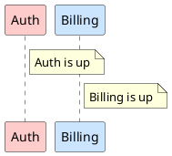

# Python in PlantUML: interpreter and preprocessor design

This document describes two things that live in this repository:

1. **The Python interpreter** (`org.luaj.vm2.python`): an interpreter for a
   *subset of Python 3*, written in pure Java. It exists and is tested.
2. **How it will be used from PlantUML** (a "Python preprocessor" that partly
   replaces the legacy text preprocessor, and an "engine" mode that drives
   PlantUML from a script). The design is decided; **none of it is implemented
   yet**.

The interpreter started as a proof of concept in separate repositories (a fork
of LuaJ, then a standalone "PicoPy" project). Those repositories are gone:
everything now lives here. The Java package keeps the historical name
`org.luaj.vm2.python` and will not be renamed. The notes written in the
proof-of-concept repositories were checked against the code and are superseded
by this document.

## 0. Conventions used in this document

Each statement carries a status, either explicitly or by the section it is in.

| Tag | Meaning |
|---|---|
| **[implemented]** | Present in the code of this repository, checked against it. |
| **[decided]** | Design decision taken, not implemented yet. |
| **[open]** | Open to discussion; the text describes the current behaviour or the current leaning, not a commitment. |
| **[missing]** | Referred to by code or tests but not present in the repository. |

Sections 1 to 9 describe the interpreter (mostly **[implemented]**). Sections
10 to 15 describe the PlantUML integration (**[decided]**, not implemented);
section 15 specifies Python modules. Section 16 lists the open points.

## 1. Goals and constraints

PlantUML ships in several editions that must behave identically: the regular
JAR, a JavaScript build and a native C build, the last two produced with
[TeaVM](https://teavm.org). The interpreter is therefore written **in Java**
and compiled once to JVM bytecode, JavaScript and C. It is meant to:

- generate diagrams from Python code embedded in the diagram source, partly
  replacing the text preprocessor (loops, functions, data structures);
- drive PlantUML from a script (build a model, call layout/render functions,
  query the result).

Constraints that drive every decision:

- no reflection, no threads, no file system, no `Class.forName`;
- nothing that TeaVM cannot compile;
- no uncatchable failures: a `StackOverflowError` crashes a TeaVM/C binary, so
  call depth and instruction count are bounded;
- deterministic: same output on the JAR, JavaScript and C editions;
- the smallest possible surface: what is not needed is removed.

**[open]** A TeaVM build of the package (JavaScript and C) ran at some point in
the proof of concept and remains an objective. No TeaVM build of this package
is part of the repository today. Nothing in the package is expected to be
difficult for TeaVM.

## 2. Principles

- **A subset, not a dialect.** Every accepted program is valid Python 3 and
  gives the same result in CPython, except for the documented deviations
  (section 6). What is hard or useless here is removed (generators,
  `finally`, the special methods of classes, ...), never changed.
- **CPython is the oracle.** The reference output of a test script is the one
  CPython prints (section 9).
- **Deterministic and bounded.** An instruction counter and a call depth limit
  bound every run.
- **The VM is ours.** A stack machine with its own instruction set
  (section 8). Nothing is kept from the Lua register machine of LuaJ.

## 3. The Python subset **[implemented]**

All the rejections below are `PySyntaxError`s with an explicit message, raised
by the parser (`PyParser`), or by the resolver for the restrictions on class
bodies (section 3.4).

### 3.1 Statements

Accepted:

- expression statements;
- assignment: chained (`a = b = 1`), tuple/list unpacking, augmented
  (`+=`, ...); targets are a name, `a[i]`, `a[i:j]`, an attribute `a.x` or a
  tuple/list of those;
- `if` / `elif` / `else`;
- `while` and `for ... in`, with `break`, `continue` and an `else` clause on
  loops;
- `pass`;
- `def`: positional and keyword parameters, defaults, keyword-only parameters,
  `*args`, `**kwargs`;
- `return`;
- `class`, with the restrictions of section 3.4;
- decorators on `def` and `class`, with the restrictions of section 3.5;
- `global`, `nonlocal`;
- `assert`;
- `del name`, `del a[i]`, `del a.x` (and a comma-separated list of those);
- `try` / `except` / `else`, and `raise` (including a bare `raise` inside an
  `except`);
- `import module` for builtin modules only (today: `math`, `json`, `time`, `datetime`, and in a diagram `puml` and `color`). An unknown module
  raises `ModuleNotFoundError`. Shipped modules written in Python are specified
  in section 15 and are not implemented.

### 3.2 Expressions

`None`, `True`, `False`; `int`, `float` and `str` literals (single, double and
triple quotes, escapes, raw strings, f-strings; number literals in decimal,
hexadecimal, octal, binary, with underscores); list, tuple and dict displays;
list and dict comprehensions; conditional expressions (`a if c else b`);
`lambda`; `and`, `or`, `not`; chained comparisons; `in` / `not in`;
`is` / `is not`; arithmetic and bitwise operators; slicing; calls with `*` and
`**` unpacking and keyword arguments; attribute access (method calls, `e.args`,
attributes of instances and classes).

### 3.3 Rejected (syntax error)

`finally`, `with`, `yield` and generators, `async` / `await`, the forms of
decorators listed in section 3.5, `from ... import`, `import` of user modules,
`set` displays and set comprehensions (`{a, b}`), generator expressions (`f(x
for x in y)`), `bytes`, complex numbers (`1j`), `...`, the walrus operator `:=`,
`match`, `@` operator, type annotations (variables, parameters, return),
positional-only parameters (`/`), dictionary unpacking in displays (`{**a}`),
starred expressions outside calls and parameters (`[*a]`, `a, *b = c`),
`except*`, `\N{...}` escapes, the `=` specifier of f-strings (`f'{x=}'`).

`print(..., file=...)` is also rejected, at run time: `print` accepts only the
keywords `sep`, `end` and `flush`. `exec` and `eval` do not exist.

Other limits of the parser:

- nesting is limited to 200 levels: a hostile input gives a syntax error, never
  a stack overflow;
- tabs in indentation are rejected;
- some errors are not detected at parse time but by the resolver or the code
  generator: duplicate parameter names, `break` / `continue` outside a loop,
  `return` outside a function, `global` / `nonlocal` misuse, integer literals
  outside 32 bits. They are reported as `PySyntaxError` too.

### 3.4 Classes

A first level of class support, written so that every accepted program still
behaves as in CPython.

Accepted:

- `class A:`, `class A():`, `class A(object):` and `class B(A):`, with **single
  inheritance**. The base is `object`, a class of the program or an exception
  class (`class MyError(ValueError):`), which gives user-defined exceptions;
- `__init__`, methods, bound methods (`m = obj.f; m()`), `A.f(obj)`;
- `__str__` and `__repr__` **[implemented]**: `str(x)`, `repr(x)`, f-strings
  (`{x}`, `{x!r}`), `format(x)`, `"%s"` and `"%r"`, `"{}".format(x)`, `!{x}` and
  the `repr` of a list, tuple or dict that holds `x` run them. A class without
  `__str__` has the text of its `__repr__` (CPython's `object.__str__`), and
  one with neither has `<module.Class object>` (CPython adds an address, which
  is not deterministic). What they return must be a `str` (`TypeError`
  otherwise). They are inherited and can be called (`x.__str__()`,
  `Base.__str__(self)`). The instance asks its class to run the method: a class
  holds the interpreter that ran its `class` statement (`PyType.interp`), so the
  static methods of `PyOps` need no interpreter at hand;
- `__lt__`, `__le__`, `__gt__` and `__ge__` **[implemented]**: `a < b` runs
  `a.__lt__(b)`; if `a` has no such method, or it returns `NotImplemented`
  (the builtin constant, a method says "I do not know this operand"), the
  reflected method of the right operand runs (`b.__gt__(a)`; `<=` and `>=` the
  same way), and when neither answers it is the `TypeError` of CPython.
  `sorted`, `list.sort`, `min` and `max` only use `<`, so `__lt__` is enough
  for them, as in CPython (there is no `functools.total_ordering`: `<=` and
  `>=` need their own method). **There is no `__eq__` and no `__hash__`**:
  `==`, `!=`, `in`, `list.index`, `.count`, `.remove` and the keys of a dict
  compare the instances by identity, as a class without `__eq__` does in
  CPython; compare an attribute (`a.key == b.key`) to compare values. Two
  objects that are neither smaller are not equal;
- instance attributes (`self.x = 1`, `self.x += 1`, `del self.x`) and class
  attributes, read through the instance or the class, and set on the class
  (`A.count += 1`);
- an explicit call to the base class: `Base.__init__(self, ...)`, including
  `Exception.__init__(self, msg)` and `object.__init__(self)`;
- private name mangling (`self.__x` is `self._A__x` inside class `A`);
- classes nested in a class or defined in a function (with closures);
- `type(x)`, `isinstance`, `callable`, `__name__`, `__qualname__`,
  `__module__` (the `__name__` of the globals the class is defined in:
  `"__main__"` in a diagram, the module name in a module), raising and catching
  instances or classes of user-defined exceptions.

The body of a class only accepts straight-line statements: `def`, nested
`class`, assignments (including augmented ones), expression statements
(docstrings) and `pass`. `if`, loops, `try`, `del`, `global`, `import`,
`return`, ... in a class body are syntax errors: every name the body binds is
then bound when the body ends, which keeps the compilation simple (the body is
compiled as a function that returns its locals as a dict).

Rejected (syntax error):

- special methods and attributes other than `__init__`, `__str__`, `__repr__`
  and the four ordering ones (`__eq__`, `__hash__`, `__add__`, `__len__`,
  `__slots__`, ...): they are rejected rather than silently ignored. The
  classes written in Java (section 3.6) are the only ones that may have
  `__eq__` and `__hash__`;
- `super()`: call the base class explicitly instead, `Base.f(self, ...)`;
- multiple inheritance, keyword arguments in the bases (`metaclass=`);
- `@staticmethod`, `@classmethod`, `@property` (section 3.5);
- a class attribute with the name of a variable of an enclosing function that
  a method of the class uses (CPython resolves it with a special instruction;
  rename one of them).

At run time, subclassing a builtin type other than `object` and the exception
classes (`class L(list):`) raises `TypeError`.

### 3.5 Decorators **[implemented]**

A decorator is written on the lines before a `def` or a `class`, as in CPython:

```python
@log("outer")
@log("inner")
def target():
    ...
```

- The decorator expressions are evaluated from top to bottom, in the enclosing
  scope, before the default values of the parameters; the function (or the
  class) is then created, and the decorators are applied from bottom to top:
  `target = log("outer")(log("inner")(target))`. What the last one returns is
  bound to the name, function or not.
- A decorator is a **name**, an **attribute** or a **call** of one of those:
  `@macro`, `@puml.macro`, `@macro("$color")`, `@tools.mark`. Other
  expressions (`@(lambda f: f)`, `@decorators[0]`, `@make()()`), valid since
  Python 3.9, are syntax errors.
- `@staticmethod`, `@classmethod` and `@property` are syntax errors: they need
  descriptors, which the interpreter does not have.
- Decorators may be used on methods and on classes nested anywhere.

The main use planned is `@macro` (section 11.5).

### 3.6 Native classes **[implemented]**

A class can also be written in Java (`datetime.date` and `datetime.datetime`
today; `PyType.nativeClass`). For a program it is a class like the others
(`isinstance`, `type(x).__name__`, `repr` gives `datetime.date(2026, 11, 8)`),
with these rules, which are those of CPython's classes written in C:

- its methods are builtins bound to the instance (`d.weekday()`): a Java
  function marked as a method (`Builtin.isMethod`) is bound when it is read
  through an instance, as the function of a class of the program is. A plain
  builtin stored in a class (`date.today`, called through the class) is not;
- its constructor is a Java method too (`instantiate` accepts it, with keyword
  arguments: `datetime.datetime(2026, 11, 8, minute=5)`);
- its instances cannot be modified (`d.year = 3`, `d.x = 1` and `del d.year` are
  an `AttributeError`) and the class cannot (`datetime.date.x = 1` is a
  `TypeError`), and it cannot be subclassed (`class A(datetime.date)` is a
  `TypeError`);
- **it is the only kind of class that may have `__eq__` and `__hash__`**.
  `a == b` runs `a.__eq__(b)`, then `b.__eq__(a)` when it is missing or
  returns `NotImplemented`, then compares the identity; `!=` is its negation.
  The instances are keys of a dict by value (`PyHashKey`: the hashes must be
  equal and the instances `==`), and `in`, `index`, `count` and `remove` use
  `==`. A class of the program may not define them (the Resolver rejects
  them, section 3.4): it keeps the identity, and the question of hashing
  stays closed for the programs. The ordering methods are the same for both.

## 4. Values and builtins **[implemented]**

### 4.1 Types

`object`, `NoneType`, `bool`, `int`, `float`, `str`, `list`, `tuple`, `dict`,
`range`, `slice`, functions, builtin functions, bound methods, modules, the dict
views (`dict_keys`, `dict_values`, `dict_items`), and the classes of the program
and their instances.

The types `object`, `int`, `float`, `str`, `bool`, `list`, `tuple`, `dict`,
`range`, the exception classes and the classes of the program are values: they
can be called, compared with `type(x)` and given to `isinstance`. Every type
derives from `object`.

At run time the values are plain Java objects: `Integer`, `Double`, `Boolean`,
`String`, a singleton for `None`, and small classes for list, tuple, dict, range,
slice, views, functions and types. A class of the program is a `PyType` that
carries a dict of attributes; its instances are `PyInstance` objects (or
`PyException` objects for an exception class). An iterator signals its end
with a Java `null`.

- **Truthiness** is Python's: `0`, `0.0`, `""`, `[]`, `()`, `{}`, `None` and
  `False` are false.
- **Equality** is structural for lists, tuples and dicts; `1 == 1.0`.
- **Integers** are 32-bit (section 6). `/` is true division, `//` and `%`
  floor, `**` with a negative exponent gives a float.
- **Strings** are sequences of Unicode code points. A string is a Java `String`;
  when it only contains BMP characters, indexing and length are O(1),
  otherwise the code points are scanned.
- **dict** keeps insertion order. Keys are normalised so that `True`, `1` and
  `1.0` are one key.
- **Functions** return one value; `return a, b` returns a tuple.
- `map`, `filter`, `zip`, `enumerate` and `reversed` may return lists instead
  of lazy iterators; the tests always consume them with `list()` or a `for`
  loop.

### 4.2 Builtin functions

`print len repr format abs min max sum sorted reversed enumerate zip map filter
any all isinstance type round divmod pow ord chr hex oct bin callable`, plus the
types used as constructors (`object int float str bool list tuple dict range`).

`print` accepts `sep`, `end`, `flush`. `min` / `max` accept `key` and `default`.
`sorted` accepts `key` and `reverse`.

Not provided: `hash`, `id`, `input`, `open`, `getattr` / `setattr` /
`hasattr`, `set`, `frozenset`, `iter` / `next`, `exec`, `eval`.
(`open` is planned for the engine flavor only, section 13.)

### 4.3 Methods

- `str`: `upper lower title capitalize swapcase strip lstrip rstrip split rsplit
  join replace count startswith endswith find rfind index rindex partition
  rpartition removeprefix removesuffix isdigit isalpha isalnum isspace isupper
  islower ljust rjust center zfill splitlines format`.
- `list`: `append extend insert pop remove index count sort reverse clear copy`.
- `dict`: `get keys values items pop update setdefault clear copy`.
- `tuple`: `index count`.

The `%` operator on strings and f-strings are supported with the usual
conversions (`s r d i x X o f e g c %`, width, precision, flags), as is
`str.format` and the `format` builtin.

### 4.4 Module `math`

`sqrt floor ceil fabs fmod sin cos tan asin acos atan atan2 sinh cosh tanh exp
expm1 log log10 log1p log2 pow hypot copysign trunc gcd factorial fsum isclose
degrees radians isnan isinf isfinite` and the constants `pi e tau inf nan`.

### 4.5 Exceptions

```
BaseException
 └ Exception
    ├ ArithmeticError ─ ZeroDivisionError, OverflowError
    ├ LookupError ─ KeyError, IndexError
    ├ ValueError
    ├ TypeError
    ├ AssertionError
    ├ AttributeError
    ├ NameError ─ UnboundLocalError
    ├ RuntimeError ─ RecursionError, NotImplementedError
    ├ MemoryError
    └ ImportError ─ ModuleNotFoundError
```

`str(e)` and `e.args` work. User-defined exception classes derive from one of
these (section 3.4); as in CPython, the arguments of the call become `args`
unless `__init__` calls `Exception.__init__(self, ...)` with others. Exceeding the call depth raises `RecursionError`, which can be caught.
Running out of instructions raises `ExecutionLimitError`, which is *not* a
Python exception: `except` (even a bare one) cannot catch it, so a `try` around
an endless loop does not defeat the limit.

### 4.6 Module `time` **[implemented]**

The functions of CPython's `time` that a diagram can use, with the same names
and the same results, **in UTC and in English** (`TimeLib`):

- `time()`: the seconds since the epoch, a float. The clock is the only
  thing in the module that is not the same from one run to the next.
- `gmtime([secs])` and `localtime([secs])`: the tuple of 9 integers (year,
  month, day, hour, minute, second, weekday with Monday 0, day of the year
  with January 1st 1, 0). `secs` is an int or a float (rounded down); without
  argument, the clock. `localtime` is `gmtime`: there is no local time zone, so
  the same diagram gives the same text on every machine. `timezone`,
  `altzone` and `daylight` are `0`, `tzname` is `("UTC", "UTC")`.
- `mktime(t)`: the inverse, as if `t` were UTC (it is what CPython gives when
  `TZ` is `UTC`). The fields out of range are carried over (month 13 is
  January of the next year, day 0 is the last day of the previous month).
- `strftime(fmt[, t])`, `asctime([t])`, `ctime([secs])`: the formatting of the
  C locale, computed here. The directives are those of C99: `%a %A %b %B %c %C
  %d %D %e %F %g %G %h %H %I %j %m %M %n %p %r %R %S %t %T %u %U %V %w %W %x
  %X %y %Y %z %Z %%`. The fields of the tuple are used as they are: the weekday
  and the day of the year are not recomputed, as in C. Tuples with a field out
  of range (month 13, hour 24...) are a `ValueError`, as in CPython.

Differences with CPython (also in section 6):

- the tuples are plain tuples, not `struct_time`: `t[0]` and not `t.tm_year`;
- there is no time zone: `localtime` is `gmtime`, `%Z` gives `UTC` (CPython
  gives `GMT` for a tuple of `gmtime`), `%z` gives `+0000`;
- the text is always English, the locale of the C library is not used;
- a directive that is not in the list (`%Q`, `%-d`, a lone `%`) is a
  `ValueError`: glibc passes it through, Windows refuses it, here it is the
  same everywhere. `%Y` is not padded (the year 999 is `999`, as glibc does);
- the timestamps are limited to the years 1 to 9999 (an `OverflowError`
  beyond), CPython goes further; an int is 32 bits, so a larger timestamp is
  written as a float (`4102444799.0`);
- `strptime`, `sleep`, `monotonic`, `perf_counter`, `time_ns` and
  `struct_time` do not exist.

The calendar is computed from the number of days (no `java.time`, no
`SimpleDateFormat`, no time zone database), so the module works the same on
the JAR, JavaScript and C editions. Tests: `python/builtins/time_gmtime_strftime`
(21 timestamps, nine format lines each, with the output of CPython) and
`vega/python/time`.

### 4.7 Module `datetime` **[implemented]**

The first version of CPython's `datetime`, written in Java as two native
classes (`DatetimeLib`, section 3.6): `datetime.date(year, month, day)` and
`datetime.datetime(year, month, day, hour=0, minute=0, second=0,
microsecond=0)`, `datetime.datetime` being a subclass of `datetime.date`, with
the constants `MINYEAR` and `MAXYEAR`. Objects are **naive and in UTC**, as in
`time`.

- Attributes: `year`, `month`, `day`; `hour`, `minute`, `second`,
  `microsecond` and `tzinfo` (always `None`) for a `datetime`.
- Methods of both: `weekday`, `isoweekday`, `isocalendar` (a tuple), `isoformat`,
  `strftime`, `ctime`, `timetuple` (a tuple, with `-1` for the last field as for
  a naive object), `toordinal`, `replace`, `__str__`, `__repr__`, `==`, `!=`, `<`,
  `<=`, `>`, `>=`, and the hash. `datetime` adds `timestamp`, `date`, the
  `sep` and `timespec` arguments of `isoformat`.
- Class methods: `date.today`, `fromordinal`, `fromtimestamp`, `fromisoformat`;
  `datetime.now`, `today`, `fromordinal`, `fromtimestamp`, `fromisoformat`; and
  `date.min`, `date.max`, `datetime.min`, `datetime.max`.
- `strftime` is the one of `time` (section 4.6); for a naive object `%Z` and
  `%z` are empty and `%f` is the microseconds on 6 digits, as in CPython.
- `fromisoformat` reads `YYYY-MM-DD`, and for a `datetime` an optional
  separator (any character) and `HH`, `HH:MM`, `HH:MM:SS` or `HH:MM:SS.ffffff`
  (any number of digits, the ones after the sixth are cut).
- The ordering and the equality are on the values; a `date` and a `datetime`
  are never equal and cannot be compared (`TypeError`), as in CPython.

**The arithmetic has no operator** (`+` and `-` are not defined on the
classes, and there is no `timedelta`). It is written, as in CPython, with
methods that exist:

```python
datetime.date.fromordinal(d.toordinal() + 7)          # a week later
b.toordinal() - a.toordinal()                         # the days between two dates
datetime.datetime.fromtimestamp(x.timestamp() + 3600) # an hour later
```

Differences with CPython (also in section 6):

- no `timedelta`, `time`, `timezone`, `strptime`, `combine`, `utcnow`,
  `fromisocalendar`; `tzinfo` must be `None`, and `now()` and `today()` give
  UTC (CPython gives local time: the same on a machine whose zone is UTC);
- `timestamp()` reads the object as UTC, `fromtimestamp` gives UTC; the first
  day of the year 1 is accepted (CPython says "year 0 is out of range");
- `isocalendar()` and `timetuple()` are plain tuples (no `.year`, `.tm_year`);
- `fromisoformat` does not read an offset (`+01:00`, `Z`: a `ValueError`),
  nor the forms without dashes (`20261108`) or with a week (`2026-W45-7`);
- a directive of `strftime` outside C99 and `%f` is a `ValueError` (see 4.6).

Tests: `python/builtins/datetime_date_datetime` and `datetime_timestamp`
(the second one with `TZ=UTC`) compare with the output of CPython (dates from
the year 1 to 9999, ISO weeks, equality, order, errors, `fromisoformat`), and
`vega/python/datetime`.

## 5. Limits **[implemented]**

| Limit | Default | Setter | Behaviour |
|---|---|---|---|
| Call depth | 1000 | `Interp.setMaxDepth(int)` | catchable `RecursionError` |
| Instruction count | 200 000 000 | `Interp.setMaxSteps(long)` | `ExecutionLimitError`, not catchable by the script |
| Parser nesting | 200 | (constant) | `PySyntaxError` |

The values in the examples of the sources (`setMaxDepth(200)`,
`setMaxSteps(10_000_000)`) are illustrations, not defaults.

The **instruction counter** is incremented on backward jumps, on every call
(Python function or builtin) and inside the long loops of builtins (`sum`,
`sorted`, `min`, ...). `Interp.getSteps()` returns its value.

The **call depth** counter is checked on entry of every Python function. In
addition a Java `StackOverflowError` is turned into the same `RecursionError`.

## 6. Deviations from CPython **[implemented]**

Scripts that exercise these live in `src/test/resources/python/deviations/` and
are not run under CPython.

- Ordering methods (section 3.4): the result of `<`, `<=`, `>` and `>=` is the
  truth value of what the method returns, not the object itself (a `__lt__`
  that returns `1` gives `True` here, `1` in CPython); the rule of CPython that
  tries first the right operand when its class is a subclass of the left one's
  and redefines the method is not applied; `==` and `!=` between instances are
  always identity.
- The module `datetime` (section 4.7) has its own list too: no `timedelta`, no
  operator, no time zone, and `==` and the dict keys are on the values only
  because its classes are native (section 3.6).
- The module `time` has its own list of differences (section 4.6): UTC only,
  English only, plain tuples, a strict list of `strftime` directives.
- `int` is 32-bit. Any result outside `[-2147483648, 2147483647]` raises
  `OverflowError` (`top + 1`, `2 ** 31`, `1 << 31`, `abs(-2**31)`,
  `int("2147483648")`, `int(3e9)`, ...). This is mainly dictated by TeaVM's
  JavaScript target, where a 64-bit integer is expensive. Integer literals
  outside 32 bits are syntax errors.
- Call depth and instruction limits (section 5).
- Error messages differ from CPython. Tests compare the exception type, not the
  text.
- `dict.keys()` and the other views are live but support no set operations.
- A list that contains itself raises `RecursionError` in `repr` instead of
  printing `[...]`.
- `hash` and `id` are not provided.
- `sum` of floats is a plain left-to-right sum (CPython 3.12+ compensates); the
  tests avoid cases where this shows.
- `map`, `filter`, `zip`, `enumerate`, `reversed` may be eager.
- The `repr` of an instance has no address: `<__main__.A object>` (CPython
  prints `<__main__.A object at 0x...>`, which is not deterministic). The same
  holds for bound methods.
- Subclassing a builtin type other than `object` and the exception classes
  raises `TypeError`.
- Assigning or deleting an attribute of a module (`math.pi = 3`,
  `del palette.color`) raises `AttributeError`; CPython allows it. This is the
  "read-only from outside" rule of section 15.4.

## 7. Pipeline **[implemented]**

```
source -> PyLexer -> PyParser -> AST (Node) -> Resolver -> CodeGen -> Code -> Interp
```

- **`PyLexer` / `Token`**: INDENT / DEDENT tokens, no newline inside brackets,
  continuation lines, triple quotes, string prefixes (`r f u rf fr`), number
  literals. Tabs are rejected.
- **`PyParser`**: recursive descent into an AST shaped exactly like CPython's
  `ast` (same node names, same fields, same order). Integers are `Long` and
  floats `Double` in the tree, `None` is `null`. This is only the tree: values
  at run time are `Integer`. It is not a single pass: a conditional expression
  or a comprehension puts an expression before the part that decides how to
  compile it, and a nested function may refer to a local assigned later in the
  enclosing function.
- **`AstDump`**: text form of a tree, used to compare with CPython (section 9).
- **`Resolver` / `Scope`**: one pass over the tree. A name bound anywhere in a
  function is local (unless declared `global` / `nonlocal`); names bound at the
  top level are globals. A local used by an inner function becomes a *cell*;
  the inner function receives it as a *free* variable. Comprehensions and
  lambdas are scopes of their own. A class body is a scope too, but its names
  are invisible to the functions nested in it (Python's rule). It reports scope
  errors and enforces the restrictions on class bodies.
- **`CodeGen`**: one `Code` per function. It tracks the stack depth of every
  instruction (so `maxStack` is exact and a mismatch is an internal error), and
  builds labels, a line table, a constant table and the exception table.
  Unreachable statements emit nothing. A class body is compiled as a function
  without parameters that returns its locals as a dict; the class statement
  calls a builtin that is not reachable by name, `__build_class__(body, name,
  qualname[, base])`, with it. Private names are mangled here.
  `Code.disassemble()` lists the result.
- **`Interp`**: the loop; holds the globals, the builtins, the modules, the
  output sink and the limits. One `Interp` is one program state.

Closures are CPython's cells. The slots of a frame are, in this order:
positional parameters, keyword-only parameters, `*args`, `**kwargs`, other
locals, the free variables received from the closure, then temporaries. The
prologue wraps captured variables with `MAKE_CELL`.

## 8. The virtual machine **[implemented]**

One `int` per instruction: opcode in the low 8 bits, unsigned 24-bit argument
above it. Operands live on a stack; locals are slots of the frame; a Java
`null` in a slot means "unbound". Jump targets are absolute.

| Group | Instructions |
|---|---|
| stack | `NOP POP DUP DUP2 ROT2 ROT3` |
| variables | `LOAD_CONST LOAD_FAST STORE_FAST DELETE_FAST LOAD_CELL STORE_CELL DELETE_CELL LOAD_CLOSURE MAKE_CELL LOAD_GLOBAL STORE_GLOBAL DELETE_GLOBAL LOAD_ATTR STORE_ATTR DELETE_ATTR` |
| operators | `BINARY_OP` (operator `BIN_*` in the argument, `INPLACE` bit for `+=`), `UNARY_NEG UNARY_POS UNARY_INVERT UNARY_NOT`, `COMPARE_OP` (`CMP_*`), `IS_OP`, `CONTAINS_OP` |
| containers | `GETITEM SETITEM DELITEM BUILD_SLICE BUILD_LIST BUILD_TUPLE BUILD_DICT BUILD_STRING LIST_APPEND LIST_EXTEND MAP_ADD DICT_ADD_KW DICT_MERGE_KW UNPACK` |
| control | `JUMP JUMP_IF_FALSE JUMP_IF_TRUE JUMP_IF_FALSE_KEEP JUMP_IF_TRUE_KEEP GET_ITER FOR_ITER` |
| calls | `CALL`, `CALL_KW` (names tuple on top), `CALL_EX` (list and optional dict), `MAKE_FUNCTION` (flags: defaults, keyword-only defaults, closure), `RETURN` |
| exceptions | `RAISE RERAISE EXC_MATCH` |
| other | `IMPORT FORMAT_VALUE` (f-strings) |

Binary operators: `ADD SUB MUL DIV FLOORDIV MOD POW LSHIFT RSHIFT AND OR XOR`.
Comparisons: `EQ NE LT LE GT GE`.

**Exceptions** use a static table in each `Code`:
`[start, end) -> handler, stack depth`. When a Python exception reaches the
loop, the loop looks for the first entry covering the faulting instruction
(inner `try` statements come first), cuts the stack to the recorded depth,
pushes the exception and jumps to the handler. A `try` costs nothing when
nothing is thrown. `except` clauses are compiled to `EXC_MATCH` tests; the
exception is kept in a hidden slot so that a bare `raise` re-raises it. Only
`try/except/else` and `raise` exist: `finally` and `with` would need code
duplication at every exit and are out of scope.

**TeaVM C constraint.** Entering a `try` block is slow on TeaVM C, so the
interpreter loop (the private `Interp.run(code, frame, globals, pc, sp, depth)`)
contains none. `Interp.execute` holds the only `try` of a call: it runs the
loop, and on a `PyError` (or a `StackOverflowError`) looks for a handler and
re-enters the loop at its address. `Interp.run(String, String)` and
`Interp.run(Code)` are the public entry points and are unrelated to that
private loop.

## 9. Java API and error reporting **[implemented, open]**

```java
Interp in = new Interp(text -> System.out.print(text)); // output sink
in.setMaxSteps(10_000_000);   // optional
in.setMaxDepth(200);          // optional
in.run("print(sum([i * i for i in range(10)]))", "demo.py");
```

- `Interp.compile(source, filename)` returns a `Code` that can be run later with
  `Interp.run(Code)`.
- `Interp.getGlobalAsString(name)` reads a global converted for display.
- `Code.disassemble()` gives a listing of the instructions.

Errors reach the host as unchecked exceptions:

| Exception | When | Useful members |
|---|---|---|
| `PySyntaxError` | compile time | `line`, `col`; the message ends with `(line L, column C)` |
| `PyError` | an uncaught Python exception | `typeName()` (qualified as in CPython's traceback: `ValueError`, `MyError` for a class of the diagram, `palette.MyError` for a class of a module), `text()`, `getMessage()` (a CPython-like traceback: `File "name", line N, in function`, at most 50 frames) |
| `ExecutionLimitError` | instruction limit reached | not a `PyError`: cannot be caught by the script |

**[implemented]** In a diagram, an error is reported on the diagram line that
caused it, the innermost Python frame, even when it happens in a function
defined by an earlier chunk (`PyError.getFile()` / `getLine()`; every chunk is
compiled under its own name and `PythonRunner` keeps the diagram line of each of
its code lines). The message is `Python error: <Type>: <text>`, or the plain text
for `puml.error`; a syntax error is `Python syntax error: <detail> (column C)`.
An instruction limit has no line and is reported on the first line of its chunk.

**[open]** Which errors the host may recover from.

## 10. Tests **[implemented]** and tooling **[partly missing]**

### 10.1 Layout

- `src/test/resources/python/`: Python test scripts.
  - `language/`, `builtins/`, `errors/`, `regressions/`, `perf/`: the main
    groups. Some are inherited from the Lua tests and rewritten as Python
    (`lua5.2.1-tests/`, `luaj3.0-tests/`, and the `errors/*libargs.py` files
    whose names still refer to Lua libraries); they are kept.
  - `deviations/`: scripts that do not run under CPython (section 6).
  - `language/limits.py`: a stress test of the compiler and the VM (many
    locals, constants, upvalues, parameters, long jumps, deep nesting),
    generated once and then checked in.
  - `README.md`: placeholder.
- `src/test/resources/python-ast/`: small syntax files (`statements`,
  `expressions`, `strings`, `numbers`, `layout`) and the reference tree dumps
  (`*.ast`) made by CPython.
- `src/test/java/org/luaj/vm2/python/`: `PyParserTest`, `PyScriptsTest`,
  `PyUnitTest`, `PyClassTest`.

### 10.2 What the tests do

- **`PyParserTest`**
  - compares `AstDump.dump(PyParser.parse(...))` with the stored `.ast`
    reference for every syntax file;
  - when `python3` is available *and* `tools/dump_ast.py` is found, compares
    the tree with the one CPython produces on the fly for every script of
    `src/test/resources/python` (the test is skipped otherwise);
  - checks that unsupported constructs and invalid programs raise
    `PySyntaxError` and that damaged input never produces another exception.
- **`PyScriptsTest`** runs every script of `python/` (except `deviations/`) on
  `Interp`. A script with a `.out` file must print exactly its content; a
  script without one must simply finish without exception.
- **`PyUnitTest`** runs small programs on the runtime (lists, dicts, tuples,
  strings, numbers, builtins, comprehensions, closures) and compares with the
  output CPython gave.
- **`PyClassTest`** checks what CPython cannot: the class constructs rejected
  at compile time and the deviations of section 6. The behaviour shared with
  CPython is in the scripts `language/classes.py`, `language/inheritance.py`
  and `errors/classes.py`.

Line endings are normalised to LF (`core.autocrlf`).

**Known gap.** The tests for the deviations (integer overflow, uncatchable
instruction limit, catchable recursion, error reports, syntax errors, the
disassembler) exist in `PyScriptsTest` but are commented out. The scripts of
`deviations/` are therefore not exercised today.

### 10.3 Tools **[partly missing]**

The tests and this document rely on small Python tools in `tools/`. Only
`dump_ast.py` is in the repository; the other two have to be added. Their
contract:

- **`tools/dump_ast.py <script.py>`** **[implemented]**
  Parses the script with CPython's `ast` module and prints the tree in the
  exact format of `AstDump`: one node per line when all its fields are scalars,
  otherwise one field per line (children indented by two spaces); lists in
  brackets; operators and contexts as bare names (`Add`, `Load`, ...); strings
  escaped as a backslash, `u` and the code point in braces for anything outside
  printable ASCII; floats as `float:<IEEE 754 bits>`; line endings are LF. It
  is run as `python3 -I tools/dump_ast.py <script>` from the project root and
  must exit with status 0. It is also used to (re)generate the `.ast` files of
  `python-ast/`. The fields `PyParser` does not build (`type_comment`,
  `type_params`, `type_ignores`, `kind`) are left out.
- **`tools/cpython_check.py [--update]`** **[missing]**
  Runs each script of `src/test/resources/python` (except `deviations/`) with
  CPython. A script that prints has its output stored in `<name>.out`
  (`--update` writes it); a script that only asserts must exit with status 0.
  This keeps the reference outputs honest: CPython is the oracle.
- **`tools/gen_limits.py`** **[missing]**
  Generates `src/test/resources/python/language/limits.py`.

With `dump_ast.py` present, `PyParserTest` compares the tree of every test
script with CPython's (when `python3` is available). Until `cpython_check.py`
is added, the `.out` files are regenerated by hand
(`python3 -I <script>.py > <script>.out`).

## 11. Python in a diagram: the syntax **[decided, not implemented]**

Lines starting with `!` followed directly by Python code (`!def`, `!for`,
`!x = 1`, ...) are Python. `!{expr}` interpolates a Python value into a PlantUML
line, and `!!{` gives a literal `!{`. The `!` marks Python everywhere: on a
line, in a block, inside a text line; the `$` stays the mark of the legacy
preprocessor (`$x`). The `!` is the same character that introduces the
legacy preprocessor directives (`!include`, `!theme`, ...): the preprocessor
tells the two apart by the rules of section 11.4, not by a marker.

Python blocks are defined by indentation, so there is no `end` to write and no
prefix to repeat on every line of a block. A diagram is read as one virtual
Python file in which the `!` prefix is a **one-column gutter**.

**Why `!{expr}` and not `${expr}`.** The first implementation used `${expr}`,
and was changed before any release:

- `${...}` is the syntax of many tools that diagrams talk about: shell
  (`${HOME}`), Maven, Gradle, Spring (`${server.port}`), Terraform,
  docker-compose (`image: app:${TAG}`), GitHub Actions (`${{ secrets.X }}`),
  JavaScript template strings. Such text ends up in notes, labels and
  `@startyaml` / `@startjson` diagrams, and it became an error as soon as the
  diagram got one Python line, anywhere. One of the regression tests of the
  repository (`jaws7`) is a real diagram with `${loadExtension(...)}` in a note.
  `!{` practically never appears in text.
- One mark for Python: `!` on a line, on a block and in a text line, while `$`
  stays the legacy variables. `${x}` looked like the legacy `$x`.
- A diagram full of `${TAG}` no longer creates the interpreter for nothing.

The cost is a classification rule: a line that starts with `!{` is a text line
(section 11.4).

### 11.1 The gutter rule

- the Python code of a `!` line starts at column 1 and its indentation is
  counted from there;
- a line **without** `!` is PlantUML text. It belongs to the innermost open
  Python block if it is indented deeper than the line that opened the block,
  and it is emitted (with `!{}` interpolation) each time the block runs;
- a line indented less than the block closes it, as in Python; a text line at
  column 0 is always at top level;
- blank lines are ignored; tabs are not allowed in the indentation;
- a text line may start with an interpolation, at column 0 or indented in a
  block: `!{a} -> !{b}` is text, not a Python line (section 11.4).

```plantuml
@startuml
!services = ["Auth", "Billing", "Catalog", "Search"]

!def color(name):
!    if name == "Auth":
!        return "#FFCCCC"
!    return "#CCE5FF"

actor User

!for s in services:
    participant "!{s}" as !{s} !{color(s)}

!for i, s in enumerate(services):
    User -> !{s} : request !{i}
@enduml
```

The text lines of the two loops are indented, so they belong to the loop above
them; the blank line and the next `!` line close it. Python's own indentation
rules apply after the `!`, so `if` and `return` are nested exactly as in a `.py`
file.

### 11.2 The `!python` / `!endpy` block

The prefix is heavy for a long block of pure Python, so a delimited form exists
too. A `!python` line opens a multi-line Python block and `!endpy` closes it
(indentation counted from column 0, no gutter), in the style of `!procedure` /
`!endprocedure`. The `!` prefix stays for single lines and for blocks that
surround PlantUML text. The two notations can coexist:

```plantuml
@startuml
!services = ["Auth", "Billing", "Catalog", "Search"]

!python
def color(name):
    if name == "Auth":
        return "#FFCCCC"
    return "#CCE5FF"
!endpy

actor User

!for s in services:
    participant "!{s}" as !{s} !{color(s)}
@enduml
```

Inside a `!python` block everything is Python; PlantUML text is produced with
`emit` (section 13.1). Mixing text lines into such a block is not possible
today **[open]**.

**[implemented]**

- The `!python` and `!endpy` lines may be indented. The indentation of the
  `!python` line is removed from every line of the block, so a block indented
  as a whole runs as if it started at column 0.
- A `!python` without its `!endpy` is an error reported on the `!python` line
  (`!python without !endpy`); the block no longer runs to the end of the text.
- An `!endpy` without a `!python` before it is an error reported on its line
  (`!endpy without !python`); it no longer goes into the diagram as text.

### 11.3 Procedures

In the legacy preprocessor a *function* returns a value and a *procedure* emits
PlantUML lines:



Python has no such distinction and the interpreter will not add a keyword for
it. Two mechanisms are available, and both follow from the rules above:

**A. A plain function calling `emit()`.** The body is ordinary Python and
`emit` appends a line to the generated text.

```plantuml
@startuml
!def service(name, color):
!    emit("participant " + name + " " + color)
!    emit(f"note right of {name} : {name} is up")

!service("Auth", "#FFCCCC")
!service("Billing", "#CCE5FF")
@enduml
```

**B. A `def` whose body contains text lines.** The gutter rule makes PlantUML
text lines valid statements inside any block, and a text line in a function body
emits when the function is called. A function that contains text lines is, in
practice, a procedure, and one without is a function.

```plantuml
@startuml
!def service(name, color):
    participant !{name} !{color}
    note right of !{name} : !{name} is up

!service("Auth", "#FFCCCC")
!service("Billing", "#CCE5FF")
@enduml
```

A procedure may mix both kinds of lines, call other procedures and loop:

```plantuml
@startuml
!def stack(names):
!    for i, n in enumerate(names):
         participant !{n}
!        if i > 0:
             !{names[i - 1]} -> !{n}

!stack(["Web", "API", "DB"])
@enduml
```

Compared with `!procedure`: arguments are real Python values (numbers, lists,
dicts, booleans) rather than text, so there are no `$name` substitution rules
and no quoting problems; recursion is allowed, up to the call depth limit
(`Interp.setMaxDepth`), beyond which a catchable `RecursionError` is raised.

The same holds for the methods of a class: a text line in a method emits when
the method is called. A text line directly in the body of a class is an error
(`RuntimeError: a text line cannot be directly in the body of a class: put it
in a method`, raised when the class statement runs and reported on the text
line): it would emit when the class is defined, which is never what is meant.
A class body only accepts the statements of section 3.4. **[implemented]**
The tests of classes in diagrams are in `vega/python/classes`.

### 11.4 Python or directive?

Since `!` has no marker after it, a line starting with `!` is classified by what
follows, in this order:

1. `!python` and `!endpy` open and close a Python block; inside it nothing is a
   directive.
2. A line that starts with `!{`, after optional blanks, is a PlantUML text line
   that starts with an interpolation (`!{a} -> !{b} : call`), never a directive
   nor a Python line. A Python statement that starts with `{` would be a dict
   display thrown away, which has no use. **[implemented]**
3. A line whose first word is a legacy directive that has no Python counterpart
   (`!include`, `!includesub`, `!theme`, `!pragma`, `!startsub`, `!endsub`,
   `!define`, `!function`, `!procedure`, `!endfunction`, ...) is a directive.
   Legacy variables are written `!$x = 1`, with the `$`, which Python never
   does.
4. A line starting with `def`, `class`, `for`, `try`, `pass`, `lambda`, `del`,
   `raise`, `global`, `nonlocal`, `elif`, `except` or any other Python-only
   word is Python, and so is a decorator line, `!@macro` (**[implemented]**
   for `class` and the decorators).
5. A few words exist in both languages, and the line is told by its shape:
   - `!if`, `!while`, `!else`: a Python block opener ends with a colon
     (`!if x == 1:`, `!else:`), a legacy one does not (`!if %x() == 1`,
     `!else`);
   - `!return`: Python inside a Python `def`, legacy inside a legacy
     `!function`, which the preprocessor always knows from the enclosing block;
   - `!import` and `!assert`: to be checked against real code, since they are
     rare. For `!import`, section 15.9 gives the rule: a bare identifier is
     Python, anything else is the legacy directive.
6. Otherwise, a `!` followed, after optional blanks, by a letter or `_` (the
   start of an identifier), a digit, `(` or `[` is Python: `!x = 1`, `!x == 1`,
   `!service("Auth")`, `!names.append(n)`, `!1 + 1`, `!(a, b) = c`, `![1, 2]`.
   With blanks, the code is indented by the gutter rule (section 11.1):
   `!    return x` continues a block, and `! x = 1` at the top level is an
   indentation error (`unexpected indent`).
   The words of the legacy directives and of the diagram commands are
   excluded, even when their legacy pattern did not match the line:
   `python`, `endpy`, `define`, `definelong`, `enddefinelong`, `undef`,
   `ifdef`, `ifndef`, `if`, `elseif`, `else`, `endif`, `while`, `endwhile`,
   `foreach`, `endfor`, `function`, `procedure`, `unquoted`, `final`, `end`,
   `endfunction`, `endprocedure`, `return`, `include`, `includeurl`,
   `include_many`, `include_once`, `include_sprites`, `includedef`,
   `includesub`, `import`, `startsub`, `endsub`, `theme`, `log`, `dump_memory`,
   `option`, `assert`, `local`, `pragma`, `assume`, `exit` (for instance
   `!define 4K(...)`, whose name starts with a digit, or `!pragma teoz true`,
   which the diagram reads). Anything else (`!$x`, `!{a}`, `!!text`,
   `!"text"`) is a text line. **[implemented]** (`PythonLine.isStatementLine`)

   A text line that starts with `!` and a word is therefore Python, even in a
   note: this is a deliberate incompatibility with the legacy preprocessor,
   and such a text is written with the escape `!!` (section 12.1).

   A consequence: a typo in a directive (`!inclde foo.puml`) is read as Python
   and gives a Python error, instead of passing into the diagram. Checked on
   the whole standard library: none of its 463,812 lines that start with `!`
   changes classification with this rule.

   One exception is decided when the lines run, not when they are classified:
   a `!name(...)` line where `name` is a legacy function or procedure declared
   in the diagram is a plain line, as before Python (the legacy preprocessor
   calls the function and the `!` stays in the text, which is what the
   standard library expects: `!__attr_line()` in adaml). It applies to a run
   of Python lines made only of such calls; a run that mixes them with real
   Python is Python. **[implemented]** (`TContext.legacyCalls`; tests
   `legacy/procedure_called_with_bang` and `legacy/adaml_constant`)

The main risk is a typo: `!if x == 1` without the colon is read as legacy, and
the resulting error would be confusing. **[implemented]** When the legacy
preprocessor fails on a `!if`, `!while` or `!else` line, in a diagram that has
Python, and the line parses as a Python block opener once a colon is added, the
message ends with ` (looks like Python, is the ':' missing?)` (`PythonHint`).
A legacy-only diagram never gets it. A `!if x == 1` without colon whose legacy
evaluation does not fail opens a legacy `!if` whose condition is false: the
lines after it are skipped, and since a Python block has no `!endif`, the
diagram ends with the error `!if without !endif` on that line, with the same
hint (see section 12).

### 11.5 Macros **[implemented]**

A macro is a Python function that the text lines of a diagram call by name,
without `!{...}`, the way the legacy `!define`, `!function` and
`!unquoted procedure` are called. Its purpose is the transition of the standard
library: once a library such as C4 is written in Python, the diagrams that use
it must keep working without a change, `Person(user, "Customer")` included.

```plantuml
@startuml
!python
@macro
def color(n):
    return "#FFCCCC"

@macro("$box")
def box(alias, label, tags=""):
    emit(f'rectangle "{label}" as {alias}')
!endpy

participant P color(P)
$box(db, "Database", $tags="v1")
@enduml
```

**Declaration.**

- `macro` is a builtin of text Python, available as `macro` and as
  `puml.macro` (like `emit` and `puml.emit`). It registers the function as a
  macro and returns it unchanged: the function stays an ordinary Python
  function, callable from Python and from `!{...}`, and a script using it runs
  under CPython with a stub `macro`.
- `@macro` names the macro after the function. `@macro("name")` gives it an
  explicit name: an identifier, optionally preceded by `$` (`"$color"`,
  `"Person"`). This is how a library keeps the exact name of the legacy
  function or procedure it replaces, including a `$` name that is not a valid
  Python name. `%` stays reserved for the legacy builtins.
- Macros belong to the Python state of the diagram. A macro must be declared
  before the text lines that use it, as in the legacy preprocessor. A shipped
  module (section 15) declares macros in the diagram that imports it.
- Declaring a name twice is an error (`ValueError: macro 'color' is already
  declared`). A macro and a legacy `!define`, `!function` or `!procedure` of
  the diagram may not share a name, whichever comes first: the legacy
  preprocessor runs first and would silently win. A macro declared after the
  legacy function is a `ValueError`; a legacy function declared after the
  macro is a preprocessor error (`'color' is already a Python macro of the
  diagram`).

**Call.**

- In a text line, a declared name followed directly by `(` is a call, up to the
  matching `)`, as with `!define`: `color (P)` and `mycolor(P)` are not calls
  of `color`, and a call inside a double-quoted string of the text line is
  replaced (`participant "color(P)" as P`), which is the legacy rule. The
  arguments are text, as with `!unquoted`: they are split on the commas that
  are outside double quotes and parentheses; a double-quoted argument is
  passed without its quotes, a bare one as written, trimmed (`f()` has no
  argument). Every argument is a `str`.
- `name=value` and `$name=value` are keyword arguments: `$tags="v1"` (the
  form of C4) is passed as `tags="v1"`. Missing arguments take the default
  values of the `def`; too many or unknown ones are a `TypeError` reported on
  the line.
- `!{...}` is interpolated first, so a Python value can be passed:
  `color(!{name})`.
- The call is replaced by what the function emits (`emit`, or the text lines of
  its body), followed by `str()` of its return value when that is not `None`.
  A function that returns a value behaves like `!define` (inline), one that
  emits behaves like `!procedure` (lines). A text with several lines replaces
  the call line by several lines.
- The result is not scanned again for macros: the output of Python is never
  sent back to a preprocessor (section 12). A macro that needs another one
  calls it as a Python function.
- A diagram that declares no macro pays nothing; otherwise each text line is
  scanned for an identifier (or a `$` name) followed by `(`, looked up in a
  table.

**Known limits.**

- As with `!define`, a macro name is replaced wherever it is followed by `(` in
  a text line: with a macro `Contact`, the text `Contact(s)` of a note is a
  call. Library authors choose names accordingly; a `$` name lowers the risk.
- Macros are called from text lines: the text lines of the diagram, of a
  Python block (a `def`, a `!for`, ...) and of a legacy `!procedure`. Not from
  directives, not from Python code (which calls the function directly).
- There is no escape for a double quote inside a quoted argument, as in the
  legacy preprocessor.

**Implementation.** `PythonMacros` (`net.sourceforge.plantuml.tim`) holds the
table, finds the calls and splits the arguments. The interpreter gives the
host `Interp.callFunction`, `Interp.isCallable`, `Interp.functionName` and
`Builtin.of`. A text line of a Python block is compiled to
`puml._text(...)`, which expands its macros then emits it. The tests are in
`vega/python/macro`.

## 12. Order with the legacy preprocessor **[decided]**

The **reduced preprocessor runs first, then text Python**.

- The legacy preprocessor keeps the text assembly only: `!include`,
  `!includesub`, `!theme`, `!pragma`, `!startsub`. Its logic (variables, `!if`,
  `!while`, `!function`, `!procedure`, and the `%` builtin functions of the
  current preprocessor) is deprecated in favor of Python.
- Python lines (`!` followed by Python code) and the lines of a `!python` /
  `!endpy` block pass through the preprocessor untouched: they are not
  directives, and no `$variable` substitution or `%` handling happens inside a
  Python line or block.
- Because `!include` is already flattened when Python starts, the Python code of
  included files is in the stream, and one set of globals per diagram is shared
  naturally.
- The text produced by Python is **not** sent back to the preprocessor, so
  `!include` and `!theme` are written outside Python, never through `emit`.
- A diagram without any Python line pays nothing: no interpreter instance, no
  builtin module loading, no interpreter class loaded (the entry point sits
  behind a holder class). The only cost is the classification of the lines
  starting with `!`, which the preprocessor already looks at. The interpreter is
  created at the first Python line, not before.
- `!{expr}` is interpolated in every text line, with or without Python lines:
  the first `!{` of a diagram creates the interpreter (**[implemented]**; this
  replaces the earlier rule "only in a diagram that has Python lines", chosen
  on the `master-p6` branch for the ergonomics). `!!{` gives a literal `!{`,
  in a text line at the top level as in a text line of a Python block.
  In a diagram that contains no Python code (no `!python` block and no Python
  line), an expression that fails (`NameError`, syntax error...) is not an error:
  it stays as written, `!{toto}`, while the other expressions of the line are
  replaced, so a legacy text with a literal `!{` is unchanged. As soon as the
  diagram has Python code, the same failure is an error, even on a line before
  the first Python line.
- `${` has no meaning: it is plain text, in every diagram.
- As a field of an f-string, an interpolation may have a conversion and a
  format spec **[implemented]**: `!{x!r}` (`repr`), `!{x!s}` (`str`),
  `!{pi:.2f}`, `!{n:05d}`, `!{name:>8}`, `!{name!r:>8}`; the spec is the one of
  `format()`. As in CPython, the `!` and the `:` count at the top level only:
  `!{l[1:3]}`, `!{d["a:b"]}`, `!{ {"k": 2}["k"] }` and `!{a != b}` are plain
  expressions, and a lambda must be parenthesized,
  `!{(lambda x: x * 2)(3)}`. Not supported: nested specs (`!{x:{width}}`) and
  the conversion `!a`; both are errors reported on the line. The same holds in
  the text lines of a Python block. Tests: `vega/python/interpolation`
  (`format_spec*`, `conversion_r_s`, `colon_and_bang_inside_expressions`).

Legacy diagrams keep the old preprocessor unchanged, frozen, with one
exception **[implemented]**: a `!if`, `!ifdef` or `!ifndef` without its
`!endif`, a `!while` without its `!endwhile` and a `!foreach` without its
`!endfor` are errors, reported on the line left open (`!if without !endif`,
...), in every diagram, with or without Python. They used to skip the rest of
the text silently, which gave an empty or truncated diagram. Each body is
checked on its own: the main text, an included file (an `!if` of the diagram
still open around an `!include` is fine), the body of a legacy function or
procedure. No file of the standard library is affected.

The two worlds can be mixed in one diagram, and even in one file: the standard
library (C4 and others) is written with the legacy directives, so a Python
diagram must be able to `!include` it. Legacy logic directives are therefore not
an error in a diagram that contains Python lines; they just keep their legacy
meaning.

### 12.1 Compatibility with legacy diagrams **[decided, implemented]**

The preprocessor of this branch reads a legacy diagram as the legacy
preprocessor does, with a few **deliberate** exceptions, listed here. They
apply to every diagram, whether it contains Python or not. Each one has a way
to write the legacy text so that it gives the same result as before.

| Legacy text | Before | Now | To keep the legacy result |
|---|---|---|---|
| A text line that starts with `!` and a letter, `_`, a digit, `(` or `[` (`!important`, `!Warning: read this`, `!123 items`), for instance in a note | text | Python (section 11.4, rule 6), so usually an error | write `!!important` |
| A text line that starts with `!` then blanks then such a character (`! spaced`) | text | Python indented by the gutter, so an indentation error | write `!! spaced` |
| A text line that starts with `!!` (`!!double`) | text, as written | the escape: one `!` is removed (`!double`) | write `!!!double` |
| `!{expr}` in a text line, where `expr` is valid Python (`!{1+1}`) | text | the value of `expr` (`2`); an expression that fails stays as written in a diagram without Python code (section 12) | write `!!{1+1}` |
| A line `!python` or `!endpy` | text | the Python block markers; a lone `!endpy` is an error | none needed in practice |
| A `!if` (`!ifdef`, `!ifndef`) without `!endif`, a `!while` without `!endwhile`, a `!foreach` without `!endfor` | the rest of the text skipped silently | an error on the line left open (section 12) | close the block |

**The escape `!!`.** A text line whose first non-blank characters are `!!` is a
text line, and one `!` is removed: `!!important` gives `!important`, a line `!!`
gives `!`. It applies to every text line: at the top level, in a note or any
multi-line text of a diagram, in a text line of a Python block (where it belongs
to the block like any text line), and in the body of a legacy `!procedure`. It
does not apply in a `!python` block, where everything is Python code. `!!{`
stays the escape of an interpolation, so a line that starts with `!!{x}` gives
`!{x}`. **[implemented]** (`PythonLine.unescapeBang`; tests
`vega/python/classify/bang_escape_in_note`, `bang_escape_in_block`,
`bang_escape_in_procedure`, and `bang_word_in_note_is_python` for the error
without the escape)

**Why.** The alternative was to keep every `!word` line that is not certainly
Python as text, which needs a narrower rule (only an assignment, a call, an
attribute or an index after the word: `!x == 1` would not be Python) or a
guess at run time. A line that starts with `!` and a word is rare in a text,
and the escape gives a simple and explicit way out. The decision is to accept
this incompatibility with the legacy preprocessor.

**Checked.** None of the 463,812 lines that start with `!` in the standard
library starts with `!!`, and none changes classification with rule 6 of
section 11.4. The tests of `vega/stdlib2` are diagrams of the standard
library; they give the same result with the legacy preprocessor and with this
one, and are meant to be run on both branches. The exceptions of this section
are never used in them.

## 13. Two flavors of Python **[decided]**

There are **two different uses of Python in PlantUML**. They share the same
interpreter (the `org.luaj.vm2.python` package) but are configured differently,
run independently, and never see each other's API.

| | **Text Python** (inside a diagram) | **Engine Python** (driving the engine) |
|---|---|---|
| Purpose | generate or transform PlantUML source text, replacing much of the preprocessor | run PlantUML as a library: parse, lay out, render, many diagrams per run |
| Where it lives | in the `.puml` file, on `!` lines and `!python` / `!endpy` blocks | in a standalone `.py` script given to the executable |
| Editions | all: JAR, JavaScript, C | **JAR and C only**, never in the browser |
| Lifetime | one fresh interpreter state per diagram, thrown away afterwards | long-lived, serves many diagrams |
| I/O | none; resources only through the finder, under PlantUML's security profile | decided by the host: files, console, exit code |
| Determinism | mandatory (same output on every edition) | not required |
| Limits | strict (call depth and instruction count) | looser |
| Errors | reported on the diagram line, like preprocessor errors | traceback on the console |
| Main API | `puml.*` | `plantuml.*` |

The two compose in one direction only: engine Python calls `plantuml.render`,
which starts a fresh text Python for each diagram it renders. Text Python can
never call `render`, so a diagram cannot start renders of its own, and the two
states never share anything except the data the engine passes in (`args`). On a
server, only the text flavor is exposed.

The interpreter library stays generic (a Python subset interpreter and its
builtin modules). The `puml`, `plantuml` and `json` modules belong to the
PlantUML code base, which hands a configured `Interp` to the library.

### 13.1 Text Python: the `puml` API

Values exchanged are plain Python values (strings, numbers, booleans, lists,
dicts). No Java objects are exposed. `puml` is available without an `import`
(`import puml` is accepted too, as for any builtin module).

**Plain values only at the boundaries.** Every value that leaves one
interpreter state for another, or for the host, is checked deeply: `None`,
`bool`, `int`, `float`, `str`, and lists, tuples and dicts of those. An
instance, a class, a function, a bound method or a module is rejected with a
`TypeError`. This applies to the `args` given by the engine to
`plantuml.render` (and so to `puml.args`), and to anything else the host
copies from one state to the other: a class belongs to the state that ran its
`class` statement and must never appear in another one. `json.dumps` already
refuses an instance, with CPython's message.

`puml.emit` takes a string only (anything else is a `TypeError`): a library
gives its objects a `__str__` (section 3.4) and writes `puml.emit(str(box))`.

Level 0, generate text (essential):

- `puml.emit(line)` appends a line to the generated source; `emit` may also
  exist as a global alias.
- `puml.error(msg)` raises an error attached to the current diagram line. Plain
  Python exceptions also carry the right line number.
- `puml.log(text)` **[implemented]**: what the `!log` directive does, a line
  `[Log] text` on the standard error (`Log.userLog`, through `EaterLog.write`).
  `text` is a `str`, anything else is a `TypeError`; it returns `None`.
- `puml.warning(line, ...)` **[implemented]**: adds a `Warning` to the diagram,
  the banner drawn above it like the ones of the deprecated syntaxes. One line
  per argument, at least one, all `str` (`TypeError` otherwise); it returns
  `None`. The warnings of a diagram are a set, so the same call twice shows
  one banner. They are those of the `PreprocessingArtifact`, the object
  that `!pragma`-like options already use, so every kind of diagram that shows
  warnings shows them; the text outputs (`-ttxt`) do not show any warning.
- `puml.macro`, also the global `macro`: the decorator that declares a macro
  (section 11.5). **[implemented]**

`puml.quote` and `puml.id` were tried and removed: PlantUML has no general way
to escape a double quote (`\"` is a syntax error in a quoted name), and plain
Python string methods cover the identifier case.

Level 1, read the environment:

- `puml.version`, `puml.edition` (`"jar"`, `"js"` or `"c"`). **[implemented]**
  Both are strings; `puml.version` is the one of `%version()`.
- `puml.args`: the variables given on the command line, as a dict (and, for the
  engine, the `args` passed to `plantuml.render`). **[implemented]** for the
  command line (`-Dname=value`): the dict maps each name to its value, always a
  string, in the order of the definitions; it is empty without `-D`. The engine
  `args` are not there yet.
- `puml.filename`, `puml.dirpath`, `puml.filedate`: strings, the values of
  `%filename()`, `%dirpath()` and `%filedate()` (the name of the diagram file,
  its directory, its date as `Date.toString()` gives it), `""` when unknown
  (standard input). Constant for a diagram. **[implemented]**
- `puml.theme()`: a dict of strings, the metadata of the current theme (what
  `%get_current_theme()` returns as JSON), `{}` without theme. A function and
  not an attribute: a `!theme` line may come after the first Python line, and a
  call sees the theme known at that point. **[implemented]**
- `puml.feature(name)`, `puml.getenv(name[, default])`, `puml.file_exists(path)`
  and `puml.xargs`: the `%feature`, `%getenv`, `%file_exists` and `%xargs`
  functions, with the same code and the same security rules (`getenv` and
  `file_exists` obey the security profile). `feature` and `file_exists` give a
  `bool`, `getenv` a `str` (`""` or the default when there is none), `xargs` a
  `str`: the first line of the diagram, `@startuml` included
  (`"@startuml foo bar"`). **[implemented]**

- `puml.metadata`: the YAML header of the diagram, as a dict. **[implemented]**
  The header is the block between two `---` lines placed right after the
  `@startuml` line:

  ```plantuml
  @startuml
  ---
  name: foo
  author: Shakespear
  version: 3.5
  ---
  title !{puml.metadata["name"]} v!{puml.metadata["version"]}
  @enduml
  ```

  Every scalar is a `str`, whatever it looks like (`version` is `"3.5"`, not a
  float, and `true` is `"true"`): a script converts with `float(...)` if needed.
  Maps become dicts and lists become lists, keys keep the order of the header.
  Without a header the dict is empty, so `puml.metadata.get("name", "?")` is
  always safe. The header is removed from the text before the diagram is read
  (as it already was), and it is parsed only when the interpreter is created: a
  diagram without Python pays nothing, and an invalid header is an error
  (`Invalid YAML header: ...`, `The YAML header must be a map of keys and
  values`) reported on the line that first needed Python. Only the diagram's own
  header counts, not an `!include`d file. Parser: `YamlParser`, converted by
  `MonomorphToPlain`. Supported: nested maps, lists of scalars and of maps,
  inline lists `[a, b]`, quoted scalars (`''` and `\"` escapes), block scalars
  `|` and `>`, plain scalars on several lines, comments. Errors, with the line
  in the header (`duplicate key 'a' (line 3)`): duplicate key, unexpected
  indentation, text without a key, a list inside a list, a flow mapping
  `{a: 1}`. Anchors, tags and several documents are not supported and are left
  as plain text. A deeper-indented line in a `>` block is folded like the others
  (YAML keeps its line breaks). The `-D` arguments (`puml.args`) and the header
  are independent. Tests: `vega/python/metadata`. Not done: the C edition
  (`PSystemBuilderC`) does not strip the header.

Level 2, data:

- `json.loads` / `json.dumps` from a builtin `json` module (`%load_json` is a
  common use of the current preprocessor). **[implemented]** in the interpreter
  package (`JsonLib`, it needs the value types), not in the PlantUML code base as
  first planned. `dumps` gives CPython's default text (`", "` and `": "`,
  non-ASCII escaped, insertion order); `loads` raises a `ValueError`; integers are
  32-bit. No keyword arguments yet (`indent`, `sort_keys`).
- `color` **[implemented]**: the colour functions of the legacy preprocessor
  (`darken`, `lighten`, `reverse_color`, `reverse_hsluv_color`, `is_dark`,
  `is_light`, `hsl_color`), written in Java on top of the same code as the
  `%` functions, so the strings are identical (`PythonColorModule`; Vega tests
  in `vega/python/color`). Colours are `str`; an unknown one raises a
  `ValueError`. See `PYTHON_STDFUNCTIONS.md`.
- `puml`, `json`, `math`, `time`, `datetime` and `color` are bound as globals in a diagram: no
  import is needed, and none is possible with a `!` line, since `!import` is the legacy
  directive. The `import` statement stays accepted in a `!python` block.
  **[implemented]**
- `puml.read(name)` loads a text or JSON resource through the finder, with the
  same rules and security profile as `!include`. There is no direct disk access
  from text Python. **[implemented]**: it returns the whole text as a `str`
  (`json.loads(puml.read("data.json"))` for JSON), decoded with the charset of
  the diagram; the name is looked up exactly as an `!include` (the folder of
  the current file, the standard library `<lib/file>`, URLs, archives given to
  `!import`, the files of the host in the browser build). The line ends are
  those of Python in text mode (universal newlines): `\r\n` and `\r` become
  `\n`, so a file written on Windows reads the same everywhere. A file that cannot
  be read (not found, a folder, refused by the security profile) is a
  `RuntimeError` (`cannot read 'name'`): the subset has no `OSError`.
- `puml.random()`, `puml.random(n)`, `puml.random(a, b)` **[implemented]**: the
  numbers `%random` gives (`0` or `1`; in `[0, n)`; in `[a, b)`), from the same
  generator. Integers only; an empty range (`n <= 0`, `b <= a`) is a
  `ValueError`, where the legacy function fails with a Java exception. **The
  result is not the same from one run to the next**: a diagram that uses it is
  not reproducible (see "Other rules" below).
- Reuse of Python code across files goes through `!include` of a file that
  contains `!` lines: user modules cannot be imported. Only builtin modules and
  the modules shipped with PlantUML (section 15) can.

Other rules: one interpreter state per diagram, shared with its `!include`d
files; no clock and no `random` module (`puml.random` is the one exception, and makes a diagram that uses it irreproducible), so a diagram renders the same on every
edition; integers are 32-bit, identical on all editions; a runaway diagram is
stopped by the instruction counter.

Not planned: introspecting the laid-out model (positions, sizes of
participants). It would freeze PlantUML's internals into a public API.

### 13.2 Engine Python: the `plantuml` API

The host provides files, rendering and arguments:

- `plantuml.render(source, **options)` returns the result (a string for SVG and
  text formats, bytes for PNG) or raises an exception with details. Keyword
  options: `format`, `theme`, `args` (passed to the text Python of that
  diagram).
- `plantuml.read(path)`, `plantuml.write(path, data)`, `plantuml.glob(pattern)`,
  `plantuml.list(dir)`, `plantuml.mtime(path)` (`None` when the file does not
  exist). `read` and `write` are shortcuts for whole files; they are not the
  only way to reach a file (see below).
- `plantuml.args`: command line arguments of the script.
- `plantuml.exit(code)` to exit with a status code, and `print` to the console.

The engine flavor also gets a small **`open`** builtin and a small **`os`**
module, both provided by the host. The interpreter has no file access of its
own: the host implements a minimal interface and installs them in the engine
globals. **Text Python never gets them**, so its sandbox does not change.

- `open(path, mode)`: modes `r`, `w`, `a`, text or binary. A file object has
  `read`, `readline`, `write`, `close`, and can be iterated line by line. The
  subset has no `with`, so files are closed explicitly. Standard streams are
  `plantuml.stdin`, `plantuml.stdout` and `plantuml.stderr` (there is no `sys`
  module, and `print(..., file=...)` is rejected).
- `os`: `os.getenv`, `os.clock`, `os.time`, `os.exit`.
- Not provided at first: subprocesses, temporary files, `seek`.

Why not `plantuml.*` alone: standard input and output (`cat x.puml | plantuml
script.py`, or a script that writes a stream on stdout), reading a large file
line by line instead of loading it whole, and existing Python code (parsers,
helpers) that expects `open`. The file policy (working directory, allowed paths,
security profile) stays in one place, the host.

### 13.3 Engine examples (sketches)

**Batch rendering of a folder.** One startup instead of one JVM per file:

```python
for f in plantuml.glob("docs/**/*.puml"):
    out = f[:-len(".puml")] + ".svg"
    plantuml.write(out, plantuml.render(plantuml.read(f), format="svg"))
    print("ok", out)
```

**Incremental rendering**, only what changed:

```python
for f in plantuml.glob("docs/**/*.puml"):
    out = f[:-len(".puml")] + ".png"
    if plantuml.mtime(f) > (plantuml.mtime(out) or 0):
        plantuml.write(out, plantuml.render(plantuml.read(f), format="png"))
```

**One diagram, several variants:**

```python
src = plantuml.read("architecture.puml")
for theme in ["plain", "cerulean", "sketchy"]:
    plantuml.write("out/architecture-" + theme + ".svg",
                   plantuml.render(src, format="svg", theme=theme))
```

**Passing parameters to the text Python of a diagram.** The engine script
prepares values that the diagram's own `!` lines read from `puml.args`:

```python
envs = {"prod": ["web", "api", "db"], "staging": ["web", "api"]}
for name, services in envs.items():
    plantuml.write("out/" + name + ".svg",
                   plantuml.render(plantuml.read("deploy.puml"),
                                   format="svg",
                                   args={"env": name, "services": services}))
```

and in `deploy.puml`:

```plantuml
@startuml
!for s in puml.args["services"]:
    node "!{s}"
@enduml
```

**Documentation pipeline.** Extract the diagram blocks of a Markdown file,
render them and replace each block by an image link. There is no regular
expression module, so the file is cut with string methods:

```python
md = plantuml.read("guide.md")
fence = "`" * 3
parts = md.split(fence + "plantuml\n")
out = [parts[0]]
for n in range(1, len(parts)):
    code, _, rest = parts[n].partition(fence)
    name = f"img/guide-{n}.svg"
    plantuml.write(name, plantuml.render(code, format="svg"))
    out.append(f"" + rest)
plantuml.write("guide.out.md", "".join(out))
```

**Regression tests:**

```python
failed = 0
for f in plantuml.glob("tests/*.puml"):
    svg = plantuml.render(plantuml.read(f), format="svg")
    ref = f[:-len(".puml")] + ".svg"
    if svg != plantuml.read(ref):
        failed += 1
        print("DIFF", f)
plantuml.exit(0 if failed == 0 else 1)
```

**A diagram built from the state of the file system.** Here the engine builds
the source text itself, which text Python would do with `emit`:

```python
lines = ["@startuml"]
for d in plantuml.list("src"):
    lines.append(f'package "{d}" {{\n}}')
lines.append("@enduml")
plantuml.write("structure.svg",
               plantuml.render("\n".join(lines), format="svg"))
```

**A project file.** A `plantuml.py` at the root of a project could list the
diagrams, their formats and a shared theme, and the engine script would build
everything, like a `Makefile` but in a language the user already knows.

Most of these are tasks people already do with shell scripts around PlantUML.
The gain would be one tool, one startup, and the same script on Windows and
Linux.

## 14. Consequences of the interpreter on the integration

- Only the subset of sections 3 to 6 is accepted. A diagram using a rejected
  feature (`with`, `finally`, `@property`, generators, `set`, special methods
  of classes, ...) gets
  a `PySyntaxError` reported on its line.
- 32-bit integers and the instruction counter are intentional deviations from
  CPython; the execution limit cannot be caught by the script.
- Output must be identical on the JVM, JavaScript and C editions.
- Compared with a Lua-based design (the first sketch of this feature): blocks
  are made by indentation, which is why the gutter rule exists and why there is
  no `end` line; lists and `enumerate` start at 0; `dict` and `list` replace
  tables, and dicts keep insertion order, which helps determinism; f-strings and
  `str` methods replace `..`, `string.format` and `gsub`; options are keyword
  arguments (`render(src, format="svg")`); there is no `io` library, a
  host-provided `open` instead.

## 15. Python modules **[decided, not implemented]**

Modules let a diagram, and PlantUML's own libraries, share Python code through
`import`, without `!include` and without pouring every name into one global
namespace. This chapter specifies what a diagram author and a library author can
rely on. It says nothing about how it is built.

Items tagged **[open]** are not decided; the others are.

### 15.1 Goals

- reuse Python code across diagrams by a **name**, not a file path;
- keep the names of a library out of the globals of the diagram that uses it;
- behave identically on the JAR, JavaScript and C editions;
- allow libraries of the standard library (C4 and others) and themes to be
  written in Python.

What is out of scope is listed in section 15.10.

### 15.2 What a module is

A module is a Python source file written in the subset (sections 3 to 6),
published under a name. There are two kinds, and a diagram cannot tell them apart:

- **builtin modules**, provided by the host: `math` (section 4.4), `json` and
  `puml` (section 13.1);
- **shipped modules**, written in Python and distributed with PlantUML, in the
  same release as the interpreter.

Users cannot add modules. Code of their own is shared by `!include` of a file
that contains Python lines (sections 11 and 12), exactly as before.

A module name is a lowercase identifier: the letters `a` to `z`, digits and `_`,
not starting with a digit. A name is unique across both kinds: a shipped module
cannot take the name of a builtin module. The list of shipped modules belongs to
the release and to its documentation.

### 15.3 Syntax

Accepted:

- `import name`, as a statement, wherever a statement is allowed: at the top
  level, in a function body, on a `!` line, in a `!python` block. It binds `name`
  in the current scope to the module, and `name.attr` reads an attribute of it.

Rejected, as a `PySyntaxError`:

- `from name import x`;
- `import name as alias` and `import a, b` (one name per statement) **[open]**:
  both are valid Python and may be accepted later;
- dotted names (`import a.b`): module names are flat in this version;
- relative imports.

On a `!` line, the line `!import name` is Python; section 15.9 explains how it
is told from the legacy `!import` directive.

### 15.4 Loading and identity

- **One execution.** The first `import name` in a diagram runs the body of the
  module once, from top to bottom. Any later `import name` (in the diagram, in a
  function, or in another module) binds the same module: the body does not run
  again.
- **One state per diagram.** Loaded modules belong to the interpreter state of
  the diagram and disappear with it (section 13). Two diagrams, or two renders by
  an engine script, never share the state of a module.
- **Own namespace.** The top-level names of a module are its globals. They are
  visible neither to the diagram nor to other modules, except as attributes of
  the module object. A module cannot read or write the globals of the diagram
  that imports it.
- **Attributes.** Every top-level name of a module can be read as `name.attr`,
  as in CPython. A leading underscore means "private" by convention only; it is
  not enforced, and there is no `__all__`.
- **Functions keep their module.** A function defined in a module reads the
  globals of that module wherever it is called from. So does a method of a class
  defined in a module.
- **Module name.** The globals of a module hold `__name__`, the name of the
  module (`"__main__"` for the diagram). A class defined in the module takes it
  as its `__module__`: `<class 'palette.Box'>`, and `palette.Err` in an error
  report.
- **Classes are per diagram too.** A class is created when the body of its
  module runs. Two modules that import a third one see the same class, so
  `isinstance` is consistent between them. A failed import that is run again
  creates new classes, unrelated to the ones of the failed attempt.
- **Read-only from outside.** A diagram cannot assign to or delete an attribute
  of a module (`name.attr = v` and `del name.attr` raise `AttributeError`, a
  deviation from CPython listed in section 6). The rule is shallow: it protects
  the names of the module, not the values they refer to. The diagram can still
  change a list or a dict of the module, or an attribute of a class of the
  module (`palette.Box.count = 3`), as in CPython. This is acceptable because
  the state of a module belongs to one diagram (see "One state per diagram").
- **Text at import time.** Statements at the top level of a module run like any
  other code. If one of them calls `puml.emit`, the text is appended to the
  generated source at the place of the `import` statement. A library module is
  expected not to emit at import time.
- **Configuring a module before it loads** **[open]**. Legacy libraries read
  variables that the diagram sets before the first include (for example
  `$NEW_C4_STYLE` in C4). Three candidates: the module reads `puml.args`; the
  diagram calls a configuration function before the `import`; or the module
  exposes a class and the diagram configures it by creating an instance
  (`c4 = c4lib.C4(style="new")`, then `c4.person(...)`). Current leaning: the
  class. The configuration is then an ordinary argument: there is no order to
  respect between configuring and importing, no module-level state to reset,
  and two configurations can coexist in one diagram.

### 15.5 Dependencies between modules

A module may import any builtin or shipped module, with the same syntax. Each
module is loaded at most once per diagram, whoever imports it first: two modules
that import a third one share it.

An import is resolved when the statement runs, not before. An `import` inside a
function that is never called loads nothing.

If a module imports, directly or not, a module whose body is still running (`a`
imports `b` which imports `a`), the import fails with an `ImportError` whose
message gives the chain (`a -> b -> a`). No half-initialised module is ever
visible.

### 15.6 Errors

| Situation | Result |
|---|---|
| Unknown module name | `ModuleNotFoundError`, the message contains the name. |
| Cycle (section 15.5) | `ImportError`, the message contains the chain. |
| Exception raised by the body of a module | The same exception reaches the importer, with the frames of the module in the traceback. The import counts as failed: the module is not kept, and a later `import` runs the body again. |
| Unsupported form of `import` (section 15.3) | `PySyntaxError`, when the diagram is compiled. |
| Syntax error inside a shipped module | An internal error that names the module. It is a defect of the release, not an error of the diagram. |

A module may define its own exception classes (`class PaletteError(ValueError)`).
A diagram catches them through the module (`except palette.PaletteError:`), and
an uncaught one is reported with its module, as CPython does
(`palette.PaletteError: unknown state`).

An error caused by an `import` statement is reported on the line of that
statement. A line inside a module is reported with the module name and the line
number in the module source (`File "palette", line 12, in color`). How these
reports are mapped to the diagram is the open point of section 9.

### 15.7 Limits, determinism, editions

- **Shared budget.** A diagram has one call depth counter and one instruction
  counter. The body and the functions of every module count against them.
  `ExecutionLimitError` stays uncatchable, inside a module as well.
- **Same restrictions as the diagram** (section 13.1): no input or output, no
  clock, no `random`, 32-bit integers. A shipped module cannot lift them.
- **Available names.** `puml` and `json` are usable in a module as in a diagram.
  `plantuml`, `open` and `os` (engine flavor, section 13.2) are never available
  in a module.
- **Same set of modules on every edition.** A module is shipped only if it works
  identically on the JAR, JavaScript and C editions. There is no module specific
  to an edition.
- **No external access.** Importing a shipped module reads nothing but that
  module. It involves neither the file system, nor the network, nor the security
  profile.
- **Engine flavor** **[open]**. Whether engine Python scripts (section 13.2) can
  import shipped modules, given that those modules are written for text Python
  and may call `puml.emit`.

### 15.8 Versioning and discovery

- A shipped module is versioned with PlantUML: `import name` always gives the
  module of the running release (`puml.version`). There is no way to select or
  pin a version in the `import` statement.
- **Stability policy** **[open]**. Proposal: the public functions of a shipped
  module are stable across releases, like the documented standard library; an
  incompatible change gets a new module name.
- **Listing** **[open]**. A function `puml.modules()` returning the sorted names
  of the shipped modules, for documentation and tools.

### 15.9 Interaction with the legacy preprocessor

- **Order** (section 12). The reduced preprocessor runs first; an `import` line
  passes through it untouched, like any other Python line. The source of a module
  is Python only: no `$variable`, no `%function()`, no `!directive` is processed
  in it, and the text it produces is not sent back to the preprocessor.
- **`!import`.** A legacy `!import` directive exists. On a line starting with
  `!import`, a remainder made of **a single bare identifier** (`!import palette`)
  is Python. Anything else (a path, a quote, a dot, several words) is the legacy
  directive. A module name is always an identifier, so a module is never taken
  for the legacy directive. A legacy `!import` of a bare name without extension
  would be read as Python **[open]**: to check against real diagrams.
- **Variables.** The code of a module does not see legacy variables. Values reach
  a module through the arguments of its functions, or `puml.args`. A way to read
  a legacy variable from Python is **[open]**.
- **Legacy libraries.** `!include <C4/C4_Context>` and the like are unaffected,
  and may coexist with Python modules in one diagram. Which libraries are
  replaced by a module, under which names, is not decided here.
- **Calling a module function from a plain text line** (the way the legacy
  `!define`, `!function` and `!unquoted` are called from the text of a diagram)
  goes through macros (section 11.5): a module declares its macros with
  `@macro`, under the names of the legacy functions it replaces, and they are
  declared in the diagram that imports it.

### 15.10 Out of scope

- modules written by users, or read from files;
- `from ... import`, `as`, several names per statement, dotted names, packages,
  relative imports;
- reloading, removing a module, `__name__ == "__main__"`, `__all__`;
- the parts of classes not in section 3.4 (special methods, `super()`,
  multiple inheritance) and the decorators rejected by section 3.5;
- the conversion of the standard library and of the themes.

### 15.11 Testing requirements

- A shipped module that does not use `puml` has scripts whose reference output is
  produced by CPython, as in section 10 (CPython is the oracle).
- A module that uses `puml` is covered by diagram tests (Vega), since the text it
  produces is what matters.
- Each rule of sections 15.4 to 15.7 has a test: single execution, identity of
  the module across imports, separate namespaces, read-only attributes, cycle,
  unknown name, failed import not kept, shared budget.
- For classes defined in a module: the same class seen from two importing
  modules (`isinstance` consistent), a method reading the globals of its module
  and not those of the diagram, `__module__` and the repr naming the module, an
  exception of the module caught as `except mod.Err` and reported as
  `mod.Err`, and the classes of a failed import not reused when it runs again.
- Every module gives the same result on the three editions before it is shipped.

### 15.12 Example **[illustrative]**

A hypothetical shipped module `palette`:

```python
_COLORS = {"ok": "#CCFFCC", "warn": "#FFEEAA", "error": "#FFCCCC"}

def color(state, default="#EEEEEE"):
    return _COLORS.get(state, default)

def service(alias, state):
    puml.emit(f"participant {alias} {color(state)}")
```

used from a diagram:

```plantuml
@startuml
!import palette

!for name, state in [("Auth", "ok"), ("Billing", "warn")]:
!    palette.service(name, state)

Auth -> Billing : request
@enduml
```

`palette.color("ok")` is also available to the diagram. `_COLORS` is an
implementation detail of the module by convention, and the names `color` and
`service` do not collide with any name the diagram defines itself.

The same module could expose a class, configured by the diagram (the leaning of
section 15.4):

```python
class Palette:
    def __init__(self, colors=None):
        self.colors = dict(_COLORS)
        if colors is not None:
            self.colors.update(colors)

    def service(self, alias, state):
        puml.emit(f"participant {alias} {self.colors.get(state, '#EEEEEE')}")
```

```plantuml
@startuml
!import palette
!p = palette.Palette({"warn": "#FFD966"})
!p.service("Billing", "warn")
@enduml
```

## 16. Open points **[open]**

Interpreter:

- The error API towards the host (section 9): exception classes, message
  format, mapping to diagram lines, which errors are recoverable.
- The TeaVM builds (JavaScript and C) of the package: set up a build in this
  repository and run the test scripts on the three editions.
- Re-enable the commented-out tests of `PyScriptsTest` and add the missing `tools/`
  scripts (section 10).
- Additional builtins and methods as needs appear; speed (caching of globals, a
  `LOAD_METHOD` instruction, less boxing).
- Classes, next steps: the special methods other than `__str__`, `__repr__`
  and the ordering ones, for the classes of the program: `__eq__` and
  `__hash__` (they exist for the native classes only, section 3.6, and the
  hashing of a program's own instances is still undecided), the arithmetic
  operators (which `datetime` would need for `d + timedelta(days=1)`),
  `__len__`, ... Then possibly `super()` (it
  needs the `__class__` cell), `@staticmethod` / `@classmethod` / `@property`,
  and `getattr` / `setattr` / `hasattr`.
- Whether the `README.md` of the test resources and the leftovers of the Lua
  tests (naming of `errors/*libargs.py`) should be cleaned up.

Integration:

- Whether `print` in text Python is an error, a log message, or an alias of
  `emit`. Current leaning: not an alias.
- Shipped Python modules are specified in section 15. Its open points: the
  configuration of a module before it loads (leaning: a class), `as` and
  several names in one `import`, the engine flavor, the stability policy and
  the listing of modules, the `!import` rule for a bare name without
  extension, and a way to read legacy variables.
- Macros (section 11.5) are implemented. Next: validate them on a real part of
  the standard library (a Python version of a few C4 procedures, whose
  diagrams must stay identical), then declare macros from shipped modules
  (section 15).
- Names of the engine entry points (`plantuml.render`, `plantuml.glob`, ...)
  and the exact set of `open` / `os` features. The modules `json`, `puml` and
  `plantuml` themselves are planned; the rest of the surface is not final.
- Whether `puml` and `plantuml` need an explicit `import` to stay coherent with
  CPython for tooling and editors.
- The classification rules of section 11.4, in particular the words that exist
  in both languages (`!if`, `!while`, `!else`, `!return`, `!import`, `!assert`),
  to be checked against the real standard library and the existing
  preprocessor tests, and the wording of the error hint when the colon is
  forgotten.
- Whether the `!python` / `!endpy` block needs a way to mix in text lines (it
  does not today: inside it, everything is Python and output goes through
  `emit`).
- The fate of each `%` builtin function of the legacy preprocessor (which one
  gets a Python equivalent, which one is simply dropped).
