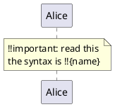

# Python in PlantUML diagrams

A diagram can contain Python code. The code runs while the diagram is
preprocessed and produces PlantUML text: loops, functions, classes and data
structures replace most of what the legacy preprocessor (`!$variable`, `!if`,
`!while`, `!procedure`, `%functions()`) is used for.

```plantuml
@startuml
!services = ["Auth", "Billing", "Catalog"]

!def color(name):
!    if name == "Auth":
!        return "#FFCCCC"
!    return "#CCE5FF"

actor User

!for s in services:
    participant "!{s}" as !{s} !{color(s)}

!for i, s in enumerate(services):
    User -> !{s} : request !{i}
@enduml
```

This document describes what is implemented today. It covers the syntax, the
way Python and the legacy preprocessor live together, the Python subset that is
accepted, the errors and the limits. The functions and modules available to the
Python code (`puml`, `color`, `math`, `json`, `time`, `datetime`, the builtins),
and the Python equivalent of each legacy `%function()`, are in
[`PYTHON_STDFUNCTIONS.md`](PYTHON_STDFUNCTIONS.md).

Contents:

1. [Overview](#1-overview)
2. [Writing Python in a diagram](#2-writing-python-in-a-diagram)
3. [Interpolation: `!{expr}`](#3-interpolation-expr)
4. [Functions that produce text](#4-functions-that-produce-text)
5. [Macros](#5-macros)
6. [Python line or directive?](#6-python-line-or-directive)
7. [Python and the legacy preprocessor](#7-python-and-the-legacy-preprocessor)
8. [Changes for existing diagrams](#8-changes-for-existing-diagrams)
9. [The Python subset](#9-the-python-subset)
10. [Differences from CPython](#10-differences-from-cpython)
11. [Errors](#11-errors)
12. [Limits](#12-limits)
13. [Not implemented](#13-not-implemented)
14. [For contributors](#14-for-contributors)

## 1. Overview

- The language is a **subset of Python 3**: a program that is accepted is valid
  Python 3 and gives the same result as in CPython, apart from the differences
  listed in [section 10](#10-differences-from-cpython). What is not supported is
  rejected with an explicit error, never silently changed.
- The interpreter is part of PlantUML (pure Java, no dependency, no Python
  installation needed).
- Python code has **no access to the machine**: no `open`, no `os`, no
  subprocess, no network. Files are read through `puml.read`, which follows the
  rules and the security profile of `!include`.
- Every diagram has its **own Python state**, shared by all its Python lines and
  by the files it includes, and thrown away afterwards.
- A run is **bounded**: an endless loop or an endless recursion stops with an
  error ([section 12](#12-limits)).
- A diagram that contains no Python pays nothing: the interpreter is created by
  the first Python line or the first `!{` of the diagram.

There are three ways to write Python, and they can be mixed freely:

| Form | Use |
|---|---|
| `!` line: `!x = 1`, `!for s in names:` | a statement, or a block that surrounds PlantUML text |
| `!python` ... `!endpy` block | a long piece of pure Python |
| `!{expr}` inside a text line | the value of an expression |

## 2. Writing Python in a diagram

### 2.1 Python lines

A line that starts with `!` followed by Python code is a Python line. The Python
code starts right after the `!`.

```plantuml
@startuml
!n = 3
!names = ["P" + str(i) for i in range(n)]
!names.append("Last")
title !{len(names)} participants
@enduml
```

The same `!` introduces the legacy directives (`!include`, `!theme`, `!$x = 1`,
`!if ... !endif`, ...). They keep their meaning: the rules that tell them apart
are in [section 6](#6-python-line-or-directive).

A Python comment (`# ...`) can be written inside a `!python` block or at the end
of a Python line. A line that is only `!# text` is not a Python line.

### 2.2 Blocks and text lines: the gutter rule

Python blocks are made by indentation, as in a `.py` file: there is no `end`
line. The `!` works as a **one-column gutter**:

- the Python code of a `!` line starts at column 1, and its indentation is
  counted from there (`!    return x` is indented by four spaces);
- a line **without** `!` is PlantUML text. When it is indented deeper than the
  line that opened the innermost Python block, it belongs to that block: it is
  emitted each time the block runs, with its `!{expr}` replaced;
- a text line is placed by its **column in the file**, as if it had a `!` in
  the first column. Under a `!for` written at the start of a line, a text line
  needs at least two spaces (four is the usual choice). When text lines and `!`
  lines follow each other inside the same block, the text is aligned with the
  code that follows the `!`, as in the example below;
- a line that is indented less closes the block, as in Python. A text line at
  column 0 is always at the top level;
- blank lines and PlantUML comment lines (`' ...`) inside a block are ignored;
- **tabs are not allowed** in the indentation of a block (it is an error): use
  spaces.

```plantuml
@startuml
!def stack(names):
!    for i, n in enumerate(names):
         participant !{n}
!        if i > 0:
             !{names[i - 1]} -> !{n}

!stack(["Web", "API", "DB"])
@enduml
```

Here the `for` is indented by 4 after the gutter; `participant !{n}` is deeper
than the `for`, so it belongs to the loop, and it is in the same column as the
`if` that follows it; the arrow line is deeper than the `if`, so it belongs to
the `if`. A text line whose column matches no open block is an indentation
error, as it would be in Python. A text line may start with an interpolation
(`!{a} -> !{b}`): it is still a text line.

### 2.3 The `!python` / `!endpy` block

Repeating `!` on every line is heavy for a long piece of code. Between a
`!python` line and an `!endpy` line, everything is Python, written from
column 0:

```plantuml
@startuml
!python
def color(name):
    # an ordinary Python comment
    if name == "Auth":
        return "#FFCCCC"
    return "#CCE5FF"
!endpy

!for s in ["Auth", "Billing"]:
    participant !{s} !{color(s)}
@enduml
```

- Inside the block nothing is a directive and nothing is PlantUML text: text is
  produced with `emit(...)` ([section 4](#4-functions-that-produce-text)). No
  `$variable` and no `%function()` is replaced in it.
- The `!python` and `!endpy` lines may be indented; that indentation is removed
  from every line of the block.
- A `!python` without `!endpy`, or an `!endpy` without `!python`, is an error
  reported on that line.
- Names defined in a block are visible to the `!` lines and to the `!{expr}`
  that follow, and the other way round: all the Python of a diagram shares one
  set of globals.

### 2.4 Data for the diagram: the YAML header

A diagram can start with a YAML header, between two `---` lines placed right
after `@startuml`. Python reads it as a dict, `puml.metadata`, so the data of a
diagram (a name, a version, a list of services) can be written as YAML instead
of Python:

```plantuml
@startuml
---
name: Ordering
owners: [alice, bob]
---
title !{puml.metadata["name"]}
!for o in puml.metadata["owners"]:
    actor !{o}
@enduml
```

The header is removed from the text of the diagram, and it is read only when
Python needs it: a diagram without Python pays nothing, and ignores an invalid
header. All the scalars are `str`. The supported YAML, the errors and the
details are in [`PYTHON_STDFUNCTIONS.md`](PYTHON_STDFUNCTIONS.md#43-the-yaml-header-pumlmetadata).
The other input of a diagram is `puml.args`, the `-Dname=value` of the command
line.

## 3. Interpolation: `!{expr}`

In a text line, `!{expr}` is replaced by `str(expr)`, where `expr` is any Python
expression:

```plantuml
@startuml
!user = {"name": "Alice", "roles": ["admin", "dev"]}
!def shout(s):
!    return s.upper() + "!"
title !{user["name"]} has !{len(user["roles"])} roles
Alice -> Bob : !{shout("hello")} !{1 + 1}
@enduml
```

- **Format and conversion**, as in a field of an f-string: `!{pi:.2f}`,
  `!{n:05d}`, `!{name:>8}`, `!{x!r}` (`repr`), `!{x!s}` (`str`),
  `!{name!r:>8}`. The format is the one of `format()`. The `!` and the `:` are
  looked for at the top level of the expression only, so `!{items[1:3]}`,
  `!{d["a:b"]}` and `!{a != b}` are plain expressions; a lambda must be put in
  parentheses, `!{(lambda x: x * 2)(3)}`. A nested format (`!{x:{width}}`) and
  the conversion `!a` are errors.
- **Escape**: `!!{` gives a literal `!{`.
- `${...}` has no meaning for PlantUML: it is plain text.
- Values print as Python prints them: `!{True}` gives `True`, `!{None}` gives
  `None`, `!{[1, "a"]}` gives `[1, 'a']`. Where PlantUML expects `true`, write
  `!{str(flag).lower()}`.
- `!{expr}` works in every text line: at the top level, in a block, in a note,
  in the body of a legacy `!procedure`. It is not evaluated inside a directive
  (`!include`, `!$x = ...`) nor inside Python code, where an expression is
  written directly.

**In a diagram without Python code** (no Python line and no `!python` block),
an expression that fails stays as it is written: `!{toto}` remains `!{toto}`,
while the valid expressions of the same line are replaced. A legacy diagram
whose text contains `!{` is therefore unchanged, unless what is between the
braces happens to be valid Python. As soon as the diagram contains Python code,
anywhere, a failing expression is an error.

## 4. Functions that produce text

The legacy preprocessor has *functions*, which return a value, and
*procedures*, which emit PlantUML lines. Python has only functions; a function
produces text in two ways.

**With `emit`.** `emit(text)` appends `text` to the generated diagram. It takes
one `str` (anything else is a `TypeError`); a string that holds several lines
gives several lines. `emit` is also available as `puml.emit`.

```plantuml
@startuml
!def service(name, color):
!    emit("participant " + name + " " + color)
!    emit(f"note right of {name} : {name} is up")

!service("Auth", "#FFCCCC")
!service("Billing", "#CCE5FF")
@enduml
```

**With text lines in its body.** By the gutter rule, a text line inside a `def`
is emitted when the function is called:

```plantuml
@startuml
!def service(name, color):
    participant !{name} !{color}
    note right of !{name} : !{name} is up

!service("Auth", "#FFCCCC")
!service("Billing", "#CCE5FF")
@enduml
```

Both forms can be mixed in one function, which can also loop, call other
functions and recurse. Compared with `!procedure`, the arguments are real Python
values (numbers, lists, dicts, booleans, objects), not text.

The same holds for the methods of a class: a text line in a method is emitted
when the method is called. A text line directly in the body of a class (outside
any method) is an error.

```plantuml
@startuml
!class Box:
!    def __init__(self, name):
!        self.name = name
!    def draw(self):
        rectangle !{self.name}

!for b in [Box("A"), Box("B")]:
!    b.draw()
@enduml
```

The text that Python produces is final: it is not read again by the legacy
preprocessor nor by Python. In particular `!include` and `!theme` cannot be
produced with `emit`; they are written as ordinary directives.

`print` does not produce text: what it writes is discarded. Use `emit`, or
`puml.log` to write on the standard error.

## 5. Macros

A macro is a Python function that the text of a diagram can call **by its
name**, without `!{...}`, the way a legacy `!define`, `!function` or
`!procedure` is called. It lets a library written in Python keep the calling
syntax its users already know.

```plantuml
@startuml
!python
PALETTE = {"web": "#FFCCCC", "api": "#FFE5CC", "db": "#CCE5FF"}

@macro
def color(name):
    return PALETTE.get(name.lower(), "#EEEEEE")

@macro("$box")
def box(alias, label, tags=""):
    stereotype = f" <<{tags}>>" if tags else ""
    emit(f'rectangle "{label}" as {alias}{stereotype} {color(alias)}')
!endpy

rectangle "Web" as web color(web)
$box(api, "API")
$box(db, "Database", $tags="v1")
web --> api
api --> db
@enduml
```

**Declaring a macro**

- `@macro` declares the function under its own name. `@macro("name")` gives the
  macro another name: an identifier, optionally preceded by `$` (`"$box"`,
  `"Person"`).
- `macro` is also available as `puml.macro`. On a `!` line the decorator is
  written `!@macro`, on the line before the `!def`.
- The function is returned unchanged: it stays callable from Python and from
  `!{...}`.
- A macro must be declared before the text lines that use it.
- A name can be declared only once (`ValueError`). A macro and a legacy
  `!define`, `!function` or `!procedure` of the same diagram cannot share a
  name, whichever comes first.

**Calling a macro**

- In a text line, the name of a macro followed **directly** by `(` is a call, up
  to the matching `)`. `color (P)` and `mycolor(P)` are not calls of `color`.
- The arguments are text, split on the commas that are outside double quotes and
  parentheses. A double-quoted argument is passed without its quotes, a bare one
  as written, trimmed. Every argument reaches the function as a `str`.
- `name=value` and `$name=value` are keyword arguments: `$tags="v1"` is passed
  as `tags="v1"`. A missing argument takes the default value of the `def`;
  too many arguments, or an unknown keyword, are a `TypeError` reported on the
  line.
- `!{...}` is replaced first, so a Python value can be passed: `color(!{name})`.
- The call is replaced by what the function emits (with `emit` or with the text
  lines of its body), followed by `str()` of what it returns unless that is
  `None`. A function that returns a value behaves like a legacy function
  (inline replacement); one that emits behaves like a procedure (the call line
  becomes several lines).
- The result is not searched again for macros. A macro that needs another one
  calls it as a Python function.

**Limits**

- A macro name is replaced wherever it is followed by `(` in a text line, also
  inside a double-quoted string and in a note: with a macro `Contact`, the text
  `Contact(s)` is a call. Choose names accordingly; a `$` name lowers the risk.
- Macros are called from text lines only (the text of the diagram, of a Python
  block, of a legacy `!procedure`), not from directives. Python code calls the
  function directly.
- There is no way to put a double quote inside a quoted argument.
- A diagram that declares no macro is not searched at all.

## 6. Python line or directive?

A line whose first non-blank character is `!` is classified by what follows.
The rules are applied in this order:

1. **`!python` and `!endpy`** delimit a Python block.
2. **`!{...`**: a line that starts with an interpolation is a text line
   (`!{a} -> !{b} : call`).
3. **Legacy assignments** are legacy: `!$x = 1` (with the `$`), `!x ?= 1`,
   `!local $x = 1`, `!global $x = 1`, and `!define` / `!definelong`.
4. **Python keywords** make a Python line: `def`, `class`, `for`, `try`,
   `except`, `elif`, `pass`, `lambda`, `del`, `raise`, `global`, `nonlocal`,
   `break`, `continue`; and a decorator line, `!@macro`.
5. **`!if`, `!while`, `!else`** exist in both languages. With a colon at the end
   of the line they are Python (`!if x == 1:`, `!else:`); without it they are
   legacy (`!if %true()`, `!else`).
6. **The legacy directives** keep their meaning: `!ifdef`, `!ifndef`, `!undef`,
   `!elseif`, `!endif`, `!endwhile`, `!foreach`, `!endfor`, `!function`,
   `!procedure`, `!endfunction`, `!endprocedure`, `!return`, `!include` and its
   variants, `!import`, `!startsub`, `!endsub`, `!includesub`, `!theme`, `!log`,
   `!assert`, `!dump_memory`, `!option`, `!pragma`, `!assume`, `!exit`.
7. **Anything else that looks like code** is Python: a `!` followed by a letter
   or `_`, a digit, `(` or `[`. So `!x = 1`, `!x == 1`, `!service("Auth")`,
   `!names.append(n)`, `!1 + 1`, `!(a, b) = c` are Python.
8. Every other line (`!"text"`, `!$x` alone, `!!text`) is a text line.

Consequences worth knowing:

- **A missing colon.** `!if x == 1` without the colon is read as a legacy `!if`.
  When the legacy preprocessor then fails on such a line, in a diagram that
  contains Python, the error message ends with
  `(looks like Python, is the ':' missing?)`.
- **`return`, `import` and `assert`.** `!    return x` inside a `!def` is Python,
  because it is an indented line of a block. At the start of a line, `!import`
  and `!assert` are always the legacy directives: the Python `import` and
  `assert` statements are written inside a `!python` block. (No `import` is
  needed for the provided modules, see `PYTHON_STDFUNCTIONS.md`.)
- **Names that are directive words.** Because of rule 6, a `!` line cannot
  start with a variable or a function named like a directive: `!end = 4`,
  `!log = 3`, `!theme = "x"`, `!final = 5` are not Python lines. The words are
  `python`, `endpy`, `define`, `definelong`, `enddefinelong`, `undef`, `ifdef`,
  `ifndef`, `if`, `elseif`, `else`, `endif`, `while`, `endwhile`, `foreach`,
  `endfor`, `function`, `procedure`, `unquoted`, `final`, `end`, `endfunction`,
  `endprocedure`, `return`, `include`, `includeurl`, `include_many`,
  `include_once`, `include_sprites`, `includedef`, `includesub`, `import`,
  `startsub`, `endsub`, `theme`, `log`, `dump_memory`, `option`, `assert`,
  `local`, `pragma`, `assume`, `exit`. Choose another name (`!stop = 4`), or
  write the statement in a `!python` block, where any name can be used.
- **A typo in a directive** (`!inclde foo.puml`) is read as Python, and gives a
  Python error instead of going into the diagram as text.
- **A text line that starts with `!` and a word** is read as Python too. Write
  it with the escape `!!` ([section 8](#8-changes-for-existing-diagrams)).
- **Blanks after the `!`** are indentation: `!    return x` continues a block,
  and `! x = 1` at the top level is an error (`unexpected indent`).
- **A call of a legacy function with `!`.** A line `!name(...)`, where `name` is
  a legacy function or procedure declared in the diagram, stays what it was
  before Python existed (the standard library uses this form). This only applies
  when the lines around it are not Python.

## 7. Python and the legacy preprocessor

The two can be used in the same diagram, and in the same file. The standard
library is written with the legacy directives, and a diagram that uses Python
can `!include` it as before.

- **Includes.** `!include`, `!includesub`, `!theme` and the others work as
  before. The Python lines of an included file run in the Python state of the
  diagram: a function defined in an included file can be called from the
  diagram. This is the way to share Python code between diagrams.
- **Two sets of variables.** Legacy variables (`!$x = 1`, used as `$x`) and
  Python variables (`!x = 1`, used as `!{x}`) are separate, even with the same
  name. Python code cannot read a legacy variable, and the legacy preprocessor
  cannot read a Python one.
- **Nothing legacy inside Python code.** In a Python line or block, `$name` and
  `%function()` are not replaced: `!y = "$x"` gives the string `$x`.
- **In a text line, both apply**: the legacy preprocessor replaces its variables
  and functions first, then `!{expr}` is replaced, then the macros are called.
  So `title $v !{w} %upper("x")` works. This is true for the text lines that
  are outside Python blocks; a text line inside a Python block is produced by
  Python, and only `!{expr}` and the macros apply to it.
- **Output of Python is final.** A line produced by Python is not preprocessed
  again: `emit("$x")` gives the text `$x`.
- **Legacy procedures.** The body of a legacy `!procedure` can contain `!{expr}`
  and macro calls. The arguments of the procedure (`$n`) are legacy variables,
  so they cannot be used inside a Python line of the body.
- **Legacy logic** (`!if`, `!while`, `!foreach`, `!function`, ...) keeps working
  in a diagram that contains Python.

## 8. Changes for existing diagrams

A diagram without Python is read as before, with the exceptions of this table.
They apply to every diagram.

| Text | Before | Now | To keep the old result |
|---|---|---|---|
| A text line that starts with `!` and a letter, `_`, a digit, `(` or `[`, for instance in a note: `!important`, `!123 items` | text | a Python line, usually an error | write `!!important` |
| A text line that starts with `!`, blanks, then such a character: `! spaced` | text | an indentation error | write `!! spaced` |
| A text line that starts with `!!` | text, as written | one `!` is removed | write `!!!double` |
| `!{expr}` in a text line, where `expr` is valid Python: `!{1+1}` | text | the value: `2` | write `!!{1+1}` |
| A line `!python` or `!endpy` | text | the Python block markers | |
| `!if`, `!ifdef` or `!ifndef` without `!endif`; `!while` without `!endwhile`; `!foreach` without `!endfor` | the rest of the text was skipped silently | an error on the line left open (`!if without !endif`, ...) | close the block |

**The escape `!!`.** A text line whose first non-blank characters are `!!` is a
text line from which one `!` is removed: `!!important` gives `!important`. It
works at the top level, in a note or any multi-line text, in a text line of a
Python block and in the body of a legacy `!procedure`. It does not apply inside
a `!python` block, which only holds Python code. `!!{` is the escape of an
interpolation: a line that starts with `!!{x}` gives `!{x}`.



## 9. The Python subset

Everything that is not listed as accepted is rejected with a syntax error that
names the construct.

### 9.1 Statements

- expression statements and assignments: chained (`a = b = 1`), unpacking
  (`a, b = b, a`), augmented (`+=`, ...). A target is a name, `a[i]`, `a[i:j]`,
  an attribute `a.x`, or a tuple or list of those;
- `if` / `elif` / `else`;
- `while` and `for ... in`, with `break`, `continue` and the `else` clause;
- `pass`;
- `def`, with positional and keyword parameters, default values, keyword-only
  parameters, `*args` and `**kwargs`; `return`;
- `class` ([9.4](#94-classes)) and decorators ([9.5](#95-decorators));
- `global`, `nonlocal`;
- `assert`;
- `del name`, `del a[i]`, `del a.x`;
- `try` / `except` / `else`, and `raise` (also a bare `raise` in an `except`);
- `import name`, `import name as alias` and `import a, b`, for the provided
  modules only (`puml`, `color`, `math`, `json`, `time`, `datetime`). Another
  name raises `ModuleNotFoundError`. In a diagram these modules are already
  available as globals, so no `import` is needed.

### 9.2 Expressions

`None`, `True`, `False`; integers (decimal, hexadecimal, octal, binary, with
underscores), floats and strings (single, double and triple quotes, escapes, raw
strings, f-strings); list, tuple and dict displays; list and dict
comprehensions; conditional expressions (`a if c else b`); `lambda`; `and`, `or`,
`not`;
comparisons, also chained; `in` and `not in`; `is` and `is not`; arithmetic and
bitwise operators; indexing and slicing; calls with keyword arguments and with
`*` and `**` unpacking; attribute access.

### 9.3 Not supported

`with`, `finally`, `yield` and generators, generator expressions
(`sum(x for x in y)`: write a list comprehension), `async` / `await`,
`from ... import`, `match`, the walrus operator `:=`, type annotations,
positional-only parameters (`/`), sets (`{a, b}`, `set()`, set comprehensions),
`bytes`, complex numbers, `...`, the `@` operator, starred expressions outside
calls and parameters (`[*a]`, `a, *b = c`), dictionary unpacking in a display
(`{**a}`), `raise ... from`, `except*`, `\N{...}` escapes, the `=` specifier of
f-strings (`f"{x=}"`).

There is no `exec` and no `eval`, and no user-written module: Python code is
shared between diagrams with `!include`.

### 9.4 Classes

Accepted:

- `class A:`, `class A(object):` and `class B(A):`, with **single
  inheritance**. The base is `object`, a class of the program or an exception
  class (`class MyError(ValueError):`), which gives user-defined exceptions;
- `__init__`, methods, bound methods (`m = obj.f`), `A.f(obj)`;
- instance attributes and class attributes;
- an explicit call of the base class: `Base.__init__(self, ...)`;
- private names (`self.__x`);
- classes nested in a class or defined in a function;
- `type(x)`, `isinstance`, `callable`, `__name__`, `__qualname__`, `__module__`;
- these special methods:
  - `__str__` and `__repr__`, used by `str`, `repr`, `!{x}`, f-strings,
    `format`, `%s`, and by the `repr` of a list, tuple or dict that holds the
    object. A class without `__str__` uses its `__repr__`;
  - `__lt__`, `__le__`, `__gt__`, `__ge__`, used by `<`, `<=`, `>`, `>=`, and by
    `sorted`, `list.sort`, `min` and `max` (which only need `__lt__`). A method
    may return `NotImplemented` to let the other operand answer.

```plantuml
@startuml
!python
class Task:
    def __init__(self, name, days):
        self.name = name
        self.days = days
    def __str__(self):
        return f"{self.name} ({self.days}d)"
    def __lt__(self, other):
        return self.days < other.days

tasks = [Task("Build", 5), Task("Design", 2), Task("Test", 3)]
!endpy

!for t in sorted(tasks):
    :!{t};
@enduml
```

Not supported (a syntax error unless stated):

- the other special methods: `__eq__`, `__hash__`, `__len__`, `__add__` and the
  other operators, `__getitem__`, `__iter__`, `__call__`, `__slots__`, ... As a
  consequence, `==`, `!=`, `in`, `list.index` and dict keys compare instances
  **by identity**: compare an attribute (`a.key == b.key`) to compare values;
- `super()`: call the base class explicitly, `Base.method(self, ...)`;
- multiple inheritance, `metaclass=`;
- `@staticmethod`, `@classmethod`, `@property`;
- statements other than `def`, `class`, assignments, expression statements
  (docstrings) and `pass` directly in the body of a class (`if`, `for`, `try`,
  ...);
- subclassing a builtin type other than `object` and the exception classes
  (`class L(list):` is a `TypeError` when it runs).

### 9.5 Decorators

A decorator is written on the line before a `def` or a `class`. It is a name, an
attribute, or a call of one of those: `@macro`, `@puml.macro`,
`@macro("$color")`, `@tools.mark`. Several decorators are applied from bottom to
top, as in Python. Other expressions (`@decorators[0]`, `@(lambda f: f)`) are
not supported.

## 10. Differences from CPython

- **Integers are 32-bit.** A result outside -2147483648..2147483647 raises
  `OverflowError` (`2 ** 31`, `1 << 31`, `int("3000000000")`); an integer
  literal outside that range is a syntax error. Use a float for larger numbers.
- **Limits** on the number of steps and on the call depth
  ([section 12](#12-limits)).
- **Error messages** are not always those of CPython; the exception types are.
- `map`, `filter`, `zip`, `enumerate` and `reversed` return lists, not lazy
  iterators. There is no `iter` and no `next`.
- The dict views (`d.keys()`, `d.values()`, `d.items()`) are live, but have no
  set operations.
- The `repr` of an instance has no address: `<__main__.A object>`.
- A list that contains itself raises `RecursionError` in `repr`.
- `sum` of floats is a plain left-to-right sum.
- A module is read-only: `math.pi = 3` raises `AttributeError`.
- For the ordering methods, the result of `<`, `<=`, `>`, `>=` is always a
  `bool`, and the rule of CPython that asks a subclass first is not applied.
- `time` and `datetime` work in UTC and in English only, with plain tuples; see
  `PYTHON_STDFUNCTIONS.md`.

## 11. Errors

An error stops the diagram and is shown like any preprocessor error, on the line
of the diagram that caused it, even when that line is inside a function defined
earlier or in an included file.

| Message | Meaning |
|---|---|
| `Python syntax error: <detail> (column C)` | the code is not valid, or uses something outside the subset |
| `Python error: <Type>: <text>` | an exception that the code did not catch, for instance `Python error: NameError: name 'x' is not defined` |
| `Python error: instruction limit exceeded` | the step limit was reached ([section 12](#12-limits)) |
| the text given to `puml.error` | `puml.error("message")` stops the diagram with that message |

`puml.error(msg)` raises a `RuntimeError`, so the code may catch it like any
exception. Exceptions are caught with `try` / `except`:

```plantuml
@startuml
!def ratio(a, b):
!    try:
!        return a / b
!    except ZeroDivisionError:
!        return 0
title !{ratio(1, 0)}
@enduml
```

## 12. Limits

| Limit | Value | When it is reached |
|---|---|---|
| Steps per diagram | 10 000 000 | `Python error: instruction limit exceeded`. It **cannot be caught** by `except`, so a `try` around an endless loop does not defeat it. |
| Call depth | 1000 | `RecursionError`, which can be caught |
| Nesting of the source (brackets, blocks) | 200 | a syntax error |

A step is counted for each iteration of a loop, for each call, and regularly
inside the long loops of the builtin functions (`sum`, `sorted`, ...): a diagram
can run a few million loop iterations. The counter covers all the Python of the
diagram, not each block.

Integers are limited to 32 bits ([section 10](#10-differences-from-cpython)).
Very large lists and strings raise `MemoryError`.

## 13. Not implemented

These were considered and are **not** available today:

- **Modules written in Python** shipped with PlantUML or provided by the user,
  and `!import name` as a Python line. `!import` is the legacy directive, and
  `import` only knows the modules listed in `PYTHON_STDFUNCTIONS.md`.
- **Driving PlantUML from a Python script** (rendering several diagrams, reading
  and writing files): Python only runs inside a diagram.
- **`print`** as a way to produce text or a message: its output is discarded.
- The rest of the class model: `__eq__` and `__hash__`, the arithmetic and
  container special methods, `super()`, `@staticmethod`, `@classmethod`,
  `@property`, `getattr` / `setattr` / `hasattr`.
- `finally`, `with`, generators and sets.
- Reading or writing a legacy variable from Python.
- Keyword arguments of `json.dumps` (`indent`, `sort_keys`, `separators`).
- Inline maps (`{a: 1}`), anchors, tags and several documents in the YAML
  header ([`puml.metadata`](PYTHON_STDFUNCTIONS.md#43-the-yaml-header-pumlmetadata)).
- Looking at the laid-out diagram (positions and sizes of the participants):
  not planned, it would freeze the internals of PlantUML into a public API.
- In the native (C) edition, the YAML header of a diagram is not removed from
  the text yet, so `puml.metadata` is for the other editions.

## 14. For contributors

- The interpreter is the package `sanskrit` (`src/main/java/sanskrit`: lexer,
  parser, resolver, code generator and a stack machine). It has no dependency on
  the rest of PlantUML.
- The integration is in `net.sourceforge.plantuml.tim`: `PythonChunks` (groups
  Python lines and text lines into chunks of code), `PythonRunner` (the
  interpreter of a diagram and the `puml` module), `PythonMacros`,
  `PythonColorModule`, `PythonHint`, and `TContext`, which calls them. The
  classification of the lines is in `net.sourceforge.plantuml.text`
  (`TLineType`, `PythonLine`).
- Tests of the language, compared with the output of CPython:
  `src/test/resources/python` and `src/test/resources/python-ast`, run by the
  test classes of `src/test/java/sanskrit`.
- Tests of Python in diagrams: `src/test/resources/vega/python`, run by
  `test.vega.VegaTest`, one directory per topic (`gutter`, `blocks`,
  `interpolation`, `classify`, `macro`, `classes`, `legacy`, `errors`, `puml`,
  `color`, `time`, `datetime`, `metadata`, `recipes`, ...). Each file states the
  expected preprocessed text, or the expected error and its line.
