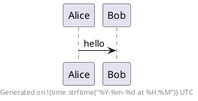

# Python in PlantUML: functions and modules

This is the reference of what Python code can call inside a diagram: the
builtin functions, the methods of the builtin types, and the modules `puml`,
`color`, `math`, `json`, `time` and `datetime`. The last part gives, for each
`%function()` of the legacy preprocessor, the way to write it in Python.

How to write Python in a diagram (the syntax, the supported subset of the
language, the errors and the limits) is described in
[`PYTHON_PREPROCESSOR.md`](PYTHON_PREPROCESSOR.md).

Contents:

1. [What is available without `import`](#1-what-is-available-without-import)
2. [Builtin functions and types](#2-builtin-functions-and-types)
3. [Methods of the builtin types](#3-methods-of-the-builtin-types)
4. [Module `puml`](#4-module-puml)
5. [Module `color`](#5-module-color)
6. [Module `math`](#6-module-math)
7. [Module `json`](#7-module-json)
8. [Module `time`](#8-module-time)
9. [Module `datetime`](#9-module-datetime)
10. [From `%function()` to Python](#10-from-function-to-python)
11. [Recipes](#11-recipes)

## 1. What is available without `import`

In a diagram, these names are ready to use:

| Name | What it is |
|---|---|
| `puml` | the link with PlantUML: produce text, report errors, read the environment |
| `emit`, `macro` | shortcuts for `puml.emit` and `puml.macro` |
| `color` | the colour functions of PlantUML |
| `math`, `json`, `time`, `datetime` | the Python modules of the same names, in part |
| the builtin functions, types and exceptions | [section 2](#2-builtin-functions-and-types) |

`import math` and the like are accepted inside a `!python` block, but they are
not needed. These six modules are the only ones: there is no other module of
the Python standard library (no `re`, `os`, `sys`, `random`, `itertools`, ...),
and a diagram cannot add a module of its own.

```plantuml
@startuml
title Rendered with PlantUML !{puml.version}
rectangle A !{color.darken("LightBlue", 20)}
note right of A : pi is !{math.pi:.4f}
@enduml
```

## 2. Builtin functions and types

**Functions**

`abs`, `all`, `any`, `bin`, `callable`, `chr`, `divmod`, `enumerate`, `filter`,
`format`, `hex`, `isinstance`, `len`, `map`, `max`, `min`, `oct`, `ord`, `pow`,
`print`, `repr`, `reversed`, `round`, `sorted`, `sum`, `zip`.

- `min` and `max` accept `key` and `default`; `sorted` accepts `key` and
  `reverse`; `enumerate` accepts `start`; `sum` accepts `start`.
- `map`, `filter`, `zip`, `enumerate` and `reversed` return a list.
- `print` accepts `sep`, `end` and `flush`, but **what it writes is discarded**:
  use `emit` to produce text and `puml.log` to write a message.

**Types**, usable as constructors and with `isinstance`

`object`, `bool`, `int`, `float`, `str`, `list`, `tuple`, `dict`, `range`, and
`type(x)`. `int(text, base)` is supported. Integers are 32-bit: a larger result
raises `OverflowError`.

**Constants**

`None`, `True`, `False`, `NotImplemented`.

**Exceptions**

```
BaseException
 └ Exception
    ├ ArithmeticError ─ ZeroDivisionError, OverflowError
    ├ LookupError ─ KeyError, IndexError
    ├ ValueError
    ├ TypeError
    ├ AssertionError
    ├ AttributeError
    ├ NameError ─ UnboundLocalError
    ├ RuntimeError ─ RecursionError, NotImplementedError
    ├ MemoryError
    └ ImportError ─ ModuleNotFoundError
```

`str(e)` and `e.args` work. A class of the diagram can derive from any of them.

**Not available**

`open`, `input`, `exec`, `eval`, `getattr`, `setattr`, `hasattr`, `dir`,
`vars`, `globals`, `locals`, `id`, `hash`, `iter`, `next`, `set`, `frozenset`,
`bytes`, `complex`, `slice`, `super`, `issubclass`, `staticmethod`,
`classmethod`, `property`.

## 3. Methods of the builtin types

| Type | Methods |
|---|---|
| `str` | `capitalize` `center` `count` `endswith` `find` `format` `index` `isalnum` `isalpha` `isdigit` `islower` `isspace` `isupper` `join` `ljust` `lower` `lstrip` `partition` `removeprefix` `removesuffix` `replace` `rfind` `rindex` `rjust` `rpartition` `rsplit` `rstrip` `split` `splitlines` `startswith` `strip` `swapcase` `title` `upper` `zfill` |
| `list` | `append` `clear` `copy` `count` `extend` `index` `insert` `pop` `remove` `reverse` `sort` |
| `dict` | `clear` `copy` `get` `items` `keys` `pop` `setdefault` `update` `values` |
| `tuple` | `count` `index` |

- `list.sort` accepts `key` and `reverse`; `str.split` and `str.rsplit` accept
  `sep` and `maxsplit`; `str.splitlines` accepts `keepends`.
- A `dict` keeps the order in which its keys were inserted.
- A string is a sequence of Unicode characters (code points).

**Formatting.** f-strings (`f"{name:>8} {ratio:.1%}"`, with `!r` and `!s`),
`str.format`, the `format` function and the `%` operator (`"%05.1f" % x`) are
supported with the usual conversions (`s r d i x X o f e g c %`), width,
precision and flags. The same format can be used in an interpolation:
`!{ratio:.1%}`.

There is no regular expression module: text is taken apart with the `str`
methods (`split`, `partition`, `find`, `startswith`, ...).

## 4. Module `puml`

### 4.1 Producing text and messages

| Call | Effect |
|---|---|
| `puml.emit(text)` | appends `text` to the diagram. `text` is a `str`; a string with several lines gives several lines. Also available as `emit`. |
| `puml.macro` | the decorator that declares a macro (`@macro`, `@macro("name")`), see `PYTHON_PREPROCESSOR.md`. Also available as `macro`. |
| `puml.error(text)` | stops the diagram with the message `text`, reported on the current line. It raises a `RuntimeError`, which the code may catch. |
| `puml.warning(line, ...)` | adds a warning banner above the diagram, with one line of text per argument. The same warning given twice is shown once. The text outputs (`-ttxt`) show no warning. |
| `puml.log(text)` | writes `[Log] text` on the standard error, as the `!log` directive does. |

All these arguments must be `str`: convert with `str(x)` or an f-string. An
object is emitted with `emit(str(obj))`, which uses its `__str__` method.

### 4.2 The environment

| Name | Value |
|---|---|
| `puml.version` | the version of PlantUML, a `str` (the value of `%version()`) |
| `puml.edition` | `"jar"`, `"js"` or `"c"`: the edition of PlantUML that is running |
| `puml.args` | a dict of the variables given on the command line with `-Dname=value`. Names and values are `str`. Empty when there is none. |
| `puml.metadata` | the YAML header of the diagram, as a dict ([4.3](#43-the-yaml-header-pumlmetadata)) |
| `puml.filename` | the name of the diagram file (the value of `%filename()`), `""` when unknown, for instance on the standard input |
| `puml.dirpath` | the directory of the diagram file (`%dirpath()`), or `""` |
| `puml.filedate` | the date of the diagram file (`%filedate()`), or `""` |
| `puml.xargs` | the first line of the diagram, `@startuml` included: `"@startuml foo bar"` (`%xargs()`) |
| `puml.theme()` | a dict of strings describing the current theme (`name`, `author`, `description`, ...), `{}` without theme. It is a function: it gives the theme known when it is called, so call it after the `!theme` line. |
| `puml.feature(name)` | a `bool`: whether this version of PlantUML has the feature (`"style"`, `"theme"`), as `%feature` |
| `puml.getenv(name)`, `puml.getenv(name, default)` | a `str`: a system property or an environment variable, as `%getenv`, under the same security profile. `""`, or `default`, when it is absent or may not be read. |
| `puml.file_exists(path)` | a `bool`, as `%file_exists`, under the same security profile |
| `puml.read(name)` | the text of a file, as a `str` ([4.4](#44-reading-a-file-pumlread)) |
| `puml.random()`, `puml.random(n)`, `puml.random(a, b)` | an `int`: `0` or `1`; from `0` to `n - 1`; from `a` to `b - 1`. The same numbers as `%random`. **Not reproducible**: a diagram that uses it differs from one run to the next. An empty range is a `ValueError`. |

```plantuml
@startuml
!env = puml.args.get("ENV", "dev")
title Deployment (!{env})
!if env == "prod":
    node "Load balancer" as lb
node "Server" as srv
@enduml
```

Run with `-DENV=prod` to get the load balancer.

### 4.3 The YAML header: `puml.metadata`

A diagram may start with a YAML header, between two `---` lines placed right
after the `@startuml` line. Python reads it as a dict:

```plantuml
@startuml
---
name: Ordering
version: 3.5
owners: [alice, bob]
---
title !{puml.metadata["name"]} v!{puml.metadata["version"]}
!for o in puml.metadata["owners"]:
    actor !{o}
@enduml
```

- Every scalar is a `str`, whatever it looks like: `version` above is `"3.5"`
  and `true` is `"true"`. Convert with `int(...)` or `float(...)` when needed.
- Maps become dicts and lists become lists; keys keep the order of the header.
- Without a header the dict is empty, so `puml.metadata.get("name", "?")` is
  always safe.
- Only the header of the diagram itself counts, not the header of an included
  file.
- Supported YAML: nested maps, lists of scalars and of maps, inline lists
  `[a, b]`, quoted scalars, block scalars (`|` and `>`), comments. Not
  supported: inline maps `{a: 1}`, a list inside a list, anchors, tags, several
  documents. A duplicate key or a wrong indentation is an error
  (`Invalid YAML header: ...`).
- The header and the `-D` arguments (`puml.args`) are independent.

### 4.4 Reading a file: `puml.read`

`puml.read(name)` returns the whole text of a file as a `str`. The file is
looked up exactly as `!include` does: relative to the folder of the current
file, in the standard library (`<lib/file>`), from a URL, and always under the
security profile of PlantUML.

```
!config = json.loads(puml.read("config.json"))
!for name in config["services"]:
    component !{name}
```

- The text is decoded with the charset of the diagram. Line ends are normalised:
  `\r\n` and `\r` become `\n`.
- A file that cannot be read (not found, a folder, refused by the security
  profile) raises a `RuntimeError` (`cannot read 'name'`).
- There is no other access to files: no `open`, and nothing can be written.

## 5. Module `color`

The colour functions of the legacy preprocessor, with the same results. A
colour is a `str`, written as anywhere in PlantUML: a name (`"red"`,
`"LightBlue"`) or `"#RRGGBB"`. An unknown colour raises
`ValueError: No such color`.

| Function | Result | Legacy |
|---|---|---|
| `color.darken(c, ratio)` | `c` darkened by `ratio` percent (an `int`), as `"#RRGGBB"` | `%darken` |
| `color.lighten(c, ratio)` | `c` lightened by `ratio` percent | `%lighten` |
| `color.reverse_color(c)` | the RGB complement of `c` | `%reverse_color` |
| `color.reverse_hsluv_color(c)` | the complement of `c` in the HSLuv space | `%reverse_hsluv_color` |
| `color.is_dark(c)`, `color.is_light(c)` | a `bool` | `%is_dark`, `%is_light` |
| `color.hsl_color(h, s, l)`, `color.hsl_color(h, s, l, a)` | the colour of hue `h` (0-360), saturation `s`, lightness `l` and opacity `a` (0-100), all `int` | `%hsl_color` |

```plantuml
@startuml
!def card(name, back):
!    front = "#FFFFFF" if color.is_dark(back) else "#000000"
     rectangle "<color:!{front}>!{name}" as !{name} !{back}

!card("Night", "MidnightBlue")
!card("Day", color.lighten("Gold", 30))
@enduml
```

## 6. Module `math`

Functions: `acos` `asin` `atan` `atan2` `ceil` `copysign` `cos` `cosh`
`degrees` `exp` `expm1` `fabs` `factorial` `floor` `fmod` `fsum` `gcd` `hypot`
`isclose` `isfinite` `isinf` `isnan` `log` `log10` `log1p` `log2` `pow`
`radians` `sin` `sinh` `sqrt` `tan` `tanh` `trunc`.

Constants: `pi`, `e`, `tau`, `inf`, `nan`.

## 7. Module `json`

| Function | Result |
|---|---|
| `json.loads(text)` | the Python value of a JSON text: dict, list, `str`, `int`, `float`, `bool`, `None`. An invalid text raises `ValueError`. |
| `json.dumps(value)` | the JSON text of a value, on one line, as CPython writes it by default: `", "` and `": "` as separators, non-ASCII characters escaped (`é`), keys in insertion order. |

Neither function takes keyword arguments (`indent`, `sort_keys`, `separators`
are not available), and there is no `load` / `dump`: a file is read with
`json.loads(puml.read(name))`. Integers are 32-bit: a larger integer in the JSON
text raises `OverflowError`.

```plantuml
@startuml
!data = json.loads('{"nodes": ["web", "api", "db"], "links": [[0, 1], [1, 2]]}')
!for n in data["nodes"]:
    component !{n}
!for a, b in data["links"]:
    !{data["nodes"][a]} --> !{data["nodes"][b]}
@enduml
```

## 8. Module `time`

The functions of Python's `time` module that make sense in a diagram, **in UTC
and in English**, so that a diagram gives the same text on every machine.

| Function | Result |
|---|---|
| `time.time()` | the number of seconds since 1970-01-01, a `float` |
| `time.gmtime()`, `time.gmtime(secs)` | a tuple of 9 integers: year, month, day, hour, minute, second, weekday (Monday is 0), day of the year (from 1), 0 |
| `time.localtime(...)` | the same as `gmtime`: there is no local time zone |
| `time.mktime(t)` | the inverse of `gmtime`: the seconds of a tuple, as a `float` |
| `time.strftime(format)`, `time.strftime(format, t)` | the text of a tuple (of the current time by default) |
| `time.asctime()`, `time.asctime(t)`, `time.ctime()`, `time.ctime(secs)` | a text such as `Thu Jan  1 00:00:00 1970` |

`time.timezone`, `time.altzone` and `time.daylight` are `0`, and `time.tzname`
is `("UTC", "UTC")`.

The directives of `strftime` are those of C: `%a %A %b %B %c %C %d %D %e %F %g
%G %h %H %I %j %m %M %n %p %r %R %S %t %T %u %U %V %w %W %x %X %y %Y %z %Z %%`.
Any other directive is a `ValueError`.



Differences from CPython:

- the tuples are plain tuples: write `t[0]`, not `t.tm_year`;
- there is no time zone: `%Z` gives `UTC` and `%z` gives `+0000`;
- the names of days and months are always English;
- the years go from 1 to 9999;
- there is no `strptime`, `sleep`, `monotonic`, `perf_counter`, `time_ns`.

A diagram that prints the current time is, of course, not the same from one run
to the next.

## 9. Module `datetime`

Two classes, `datetime.date` and `datetime.datetime` (a subclass of `date`), and
the constants `datetime.MINYEAR` and `datetime.MAXYEAR`. The objects have no
time zone and are read as UTC.

```
datetime.date(year, month, day)
datetime.datetime(year, month, day, hour=0, minute=0, second=0, microsecond=0)
```

| | `date` | `datetime` adds |
|---|---|---|
| Attributes | `year` `month` `day` | `hour` `minute` `second` `microsecond` `tzinfo` (always `None`) |
| Methods | `weekday()` `isoweekday()` `isocalendar()` `isoformat()` `strftime(format)` `ctime()` `timetuple()` `toordinal()` `replace(...)` | `timestamp()` `date()`, and the `sep` and `timespec` arguments of `isoformat` |
| Constructors | `date.today()` `date.fromordinal(n)` `date.fromtimestamp(secs)` `date.fromisoformat(text)` | `datetime.now()` `datetime.today()` `datetime.fromordinal(n)` `datetime.fromtimestamp(secs)` `datetime.fromisoformat(text)` |
| Constants | `date.min` `date.max` | `datetime.min` `datetime.max` |

- `str(d)` is the ISO text (`2026-11-08`, `2026-11-08 14:30:00`), so `!{d}`
  prints it; `repr(d)` is `datetime.date(2026, 11, 8)`.
- Two dates are compared with `==`, `!=`, `<`, `<=`, `>`, `>=`, by value, and can
  be the keys of a dict. A `date` and a `datetime` cannot be compared.
- `strftime` takes the directives of `time.strftime`, plus `%f` (microseconds).
  A date has no format of its own in `!{d:...}` or `format(d, ...)`: call
  `d.strftime(...)`.
- `fromisoformat` reads `YYYY-MM-DD`, and for a `datetime` an optional time
  `HH`, `HH:MM`, `HH:MM:SS` or `HH:MM:SS.ffffff` after a separator.
- The objects cannot be modified (`d.year = 2030` is an error): use `replace`.

**There is no `timedelta` and no `+` or `-` on dates.** A date is moved through
its ordinal (a number of days) or its timestamp (a number of seconds):

```plantuml
@startuml
!start = datetime.date(2026, 11, 9)
!def after(d, days):
!    return datetime.date.fromordinal(d.toordinal() + days)
!stop = after(start, 10)
title From !{start} to !{stop.strftime("%A %d %B")}: !{stop.toordinal() - start.toordinal()} days
Alice -> Bob : hello
@enduml
```

Also missing, compared with CPython: `datetime.time`, `timezone`, `strptime`,
`combine`, `utcnow`, `fromisocalendar`. `now()` and `today()` give the UTC time.
`isocalendar()` and `timetuple()` return plain tuples. `fromisoformat` does not
read a time zone offset (`+01:00`, `Z`).

## 10. From `%function()` to Python

The `%functions()` of the legacy preprocessor keep working in legacy code and
in the text lines that are outside Python blocks. They cannot be called from
Python code. This table gives the Python way for each of them.

### 10.1 Strings and numbers

| Legacy | Python | Differences |
|---|---|---|
| `%upper(s)`, `%lower(s)` | `s.upper()`, `s.lower()` | |
| `%strlen(s)` | `len(s)` | |
| `%substr(s, pos)`, `%substr(s, pos, len)` | `s[pos:]`, `s[pos:pos + len]` | |
| `%strpos(s, sub)` | `s.find(sub)` | both give `-1` when `sub` is absent |
| `%size(x)` | `len(x)` | `%size` of a number is `0`; `len` of a number is a `TypeError` |
| `%string(x)` | `str(x)` | |
| `%intval(s)` | `int(s)` | an invalid text is a `ValueError` |
| `%boolval(s)` | `s.lower() in ("true", "1")` | |
| `%chr(n)`, `%ord(c)` | `chr(n)`, `ord(c)` | Python raises on an invalid argument |
| `%dec2hex(n)` | `format(n, "x")` | for a negative number: `%dec2hex(-1)` is `ffffffff`, Python gives `-1` |
| `%hex2dec(s)` | `int(s, 16)` | an invalid text is a `ValueError` |
| `%mod(a, b)` | `a % b` | **not the same for negative numbers**: `%mod(-7, 3)` is `-1`, `-7 % 3` is `2` |
| `%splitstr(s, seps)` | `s.split(sep)` | **not the same**: in `%splitstr` every character of `seps` is a separator and empty parts are dropped. See the recipe in [section 11](#11-recipes). |
| `%splitstr_regex(s, regex)` | none | there is no regular expression in Python diagrams |
| `%eval(expr)` | the expression itself | |
| `%dollar()`, `%percent()` | `"$"`, `"%"` | not needed: Python code is not read by the legacy preprocessor |

### 10.2 Logic

| Legacy | Python |
|---|---|
| `%true()`, `%false()` | `True`, `False` |
| `%not(a)` | `not a` |
| `%and(a, b)`, `%or(a, b)` | `a and b`, `a or b` |
| `%xor(a, b)`, `%nxor(a, b)` | `a != b`, `a == b` (on booleans) |
| `%nand(a, b)`, `%nor(a, b)` | `not (a and b)`, `not (a or b)` |

A legacy boolean prints as `1` or `0`; a Python one prints as `True` or
`False`. Where PlantUML expects `true`, write `!{str(flag).lower()}`.

### 10.3 Colours

| Legacy | Python |
|---|---|
| `%darken(c, n)`, `%lighten(c, n)` | `color.darken(c, n)`, `color.lighten(c, n)` |
| `%reverse_color(c)`, `%reverse_hsluv_color(c)` | `color.reverse_color(c)`, `color.reverse_hsluv_color(c)` |
| `%is_dark(c)`, `%is_light(c)` | `color.is_dark(c)`, `color.is_light(c)` |
| `%hsl_color(h, s, l)`, `%hsl_color(h, s, l, a)` | `color.hsl_color(h, s, l)`, `color.hsl_color(h, s, l, a)` |

The results are identical.

### 10.4 JSON

| Legacy | Python | Differences |
|---|---|---|
| `%str2json(s)` | `json.loads(s)` | an invalid text is a `ValueError` |
| `%load_json(path)` | `json.loads(puml.read(path))` | a plain path is looked up from the folder of the diagram, as `!include` does. No charset argument and no default value: catch the `RuntimeError` instead. |
| `%get_json_type(x)` | `isinstance(x, dict)`, `isinstance(x, list)`, ... | |
| `%get_json_keys(x)` | `list(x.keys())` | |
| `%json_key_exists(x, k)` | `k in x` | |
| `%json_add`, `%json_set`, `%json_remove`, `%json_merge` | list and dict operations | see [section 11](#11-recipes) |

A JSON value printed in text is not written the same way: the legacy
preprocessor writes `["a","b"]`, `json.dumps` writes `["a", "b"]`, and
`!{value}` writes the Python form `['a', 'b']`.

### 10.5 Environment and files

| Legacy | Python |
|---|---|
| `%version()` | `puml.version` |
| `%feature(name)` | `puml.feature(name)` |
| `%getenv(name)` | `puml.getenv(name)` |
| `%file_exists(path)` | `puml.file_exists(path)` |
| `%filename()`, `%dirpath()`, `%filedate()` | `puml.filename`, `puml.dirpath`, `puml.filedate` |
| `%filename_no_extension()` | `puml.filename.rpartition(".")[0]` (when the name has an extension) |
| `%xargs()` | `puml.xargs` |
| `%get_current_theme()` | `puml.theme()` (a dict) |
| `%get_all_theme()`, `%get_all_stdlib()`, `%get_stdlib(name)` | none |

### 10.6 Date and random numbers

| Legacy | Python | Differences |
|---|---|---|
| `%now()` | `int(time.time())` | |
| `%date()` | `time.asctime()` | the layout differs: `Mon Nov 09 20:13:06 UTC 2026` for `%date()`, `Mon Nov  9 20:13:06 2026` for `time.asctime()` |
| `%date(format)`, `%date(format, secs)` | `time.strftime(format)`, `time.strftime(format, time.gmtime(secs))` | **the format is not the same**: `%date` uses the patterns of Java (`yyyy-MM-dd HH:mm`), `strftime` those of C (`%Y-%m-%d %H:%M`). The result is in UTC. |
| `%date(format, secs, zone)` | none | Python diagrams have no time zone |
| `%random()`, `%random(n)`, `%random(a, b)` | `puml.random()`, `puml.random(n)`, `puml.random(a, b)` | |

### 10.7 Special characters

`%newline()`, `%n()`, `%breakline()`, `%tab()`, `%left_align()`,
`%right_align()` and `%backslash()` give special characters that PlantUML
understands later. They have **no Python equivalent**:

- in a text line outside a Python block they can still be written, also next to
  an interpolation: `note over A : !{first}%newline()!{second}`;
- in text produced by Python, use the notation of PlantUML itself, for instance
  `\n` in a label: `emit("note over A : first\\nsecond")`.

A real newline in a string given to `emit` starts a new line of the diagram
source.

### 10.8 Variables, functions and procedures

These functions handle the variables and functions of the legacy preprocessor.
In Python the variables are Python variables and the functions are Python
functions, so they are not needed, and Python code has no access to the legacy
ones.

| Legacy | Python |
|---|---|
| `%call_user_func(name, ...)`, `%invoke_procedure(name, ...)`, `%retrieve_procedure(name)` | call the function; to choose a function by its name, keep them in a dict: `actions = {"bold": bold}` then `actions[name](x)` |
| `%function_exists(name)`, `%variable_exists(name)` | none: use a dict (`name in actions`), or catch `NameError` |
| `%get_variable_value(name)`, `%set_variable_value(name, value)` | none: use a dict (`values[name]`) |

## 11. Recipes

These short functions replace legacy functions that have no direct equivalent.
Put them in a `!python` block, or in a file that the diagrams `!include`.

**Reading a file.** `open(path).read()` in ordinary Python is
`puml.read(path)` here ([4.4](#44-reading-a-file-pumlread)).

**`%splitstr`.**

```python
def splitstr(s, seps):
    # every character of seps separates, and empty parts are dropped
    for c in seps[1:]:
        s = s.replace(c, seps[0])
    return [t for t in s.split(seps[0]) if t]
```

**The `%json_*` functions.** The legacy functions return a modified *copy* and
leave their argument alone, whereas `list.append` and `dict.update` change
their object: copy first when the original must be kept.

| Legacy | Python |
|---|---|
| `%json_add(list, x)` | `l + [x]` |
| `%json_add(obj, name, x)`, `%json_set(obj, name, x)` | `d2 = dict(d)` then `d2[name] = x` |
| `%json_set(list, i, x)` | `l2 = list(l)` then `l2[i] = x` |
| `%json_remove(obj, name)` | `d2 = dict(d)` then `d2.pop(name, None)` |
| `%json_remove(list, i)` | `l2 = list(l)` then `del l2[i]` |
| `%json_merge(list, list)` | `a + b` |
| `%json_merge(obj, obj)` | `d2 = dict(a)` then `d2.update(b)` |
| `%json_set(obj, obj)` (deep merge) | `deep_merge(a, b)`, below |
| a deep copy | `json.loads(json.dumps(x))` |

```python
def deep_merge(a, b):
    result = dict(a)
    for k in b:
        if k in result and isinstance(result[k], dict) and isinstance(b[k], dict):
            result[k] = deep_merge(result[k], b[k])
        else:
            result[k] = b[k]
    return result
```

`{**a, **b}` and `[*a, *b]` are not supported: use `dict(a)` with `update`, and
`a + b`.

**Choosing a function by its name.**

```plantuml
@startuml
!python
def bold(s):
    return "<b>" + s + "</b>"
def italic(s):
    return "<i>" + s + "</i>"
styles = {"bold": bold, "italic": italic}
!endpy

!for name in ["bold", "italic"]:
    Alice -> Bob : !{styles[name](name)}
@enduml
```
