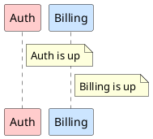

# PicoPy inside PlantUML: design sketch

Working document. Nothing described here is implemented yet: it is a set of
hypotheses about how PicoPy, the Python subset interpreter of this repository
(see `README.md` and `PYTHON.md`), will be used from PlantUML. Points that are
guesses rather than decisions are collected in section 5.

## 1. What we are trying to do

PlantUML ships in several editions that must behave identically: the regular
JAR, a JavaScript build and a native C build, the last two produced with
[TeaVM](https://teavm.org). We want Python inside PlantUML to:

- **drive PlantUML from Python** (build a model, call layout/render functions,
  query the result);
- **generate diagrams from Python code embedded in the diagram source**, partly
  replacing the text preprocessor (loops, functions, data structures).

Because the Java edition must run the same Python as the C edition, PicoPy is
implemented **in Java**: one interpreter, compiled to JVM bytecode, JavaScript
and C. Hence the constraints that drive every decision:

- no reflection, no threads, no file system, no `Class.forName`;
- nothing that TeaVM cannot compile;
- no uncatchable failures (a `StackOverflowError` crashes a TeaVM/C binary);
- the smallest possible surface: what is not needed is removed.

PicoPy accepts a **subset** of Python 3: every accepted program is valid
Python 3 and gives the same result in CPython, apart from the documented
deviations (`PYTHON.md`). Everything below uses only that subset: no `class`,
no `with`, no `finally`, no `from ... import`, no decorators.

### Sketch of the future syntax (not implemented yet)

Lines starting with `!` followed directly by Python code (`!def`, `!for`,
`!x = 1`, ...) are Python. `${expr}` interpolates a Python value into a
PlantUML line. The `!` is the same character that introduces the preprocessor
directives (`!include`, `!theme`, ...); the preprocessor tells the two apart by
the rules listed in "Python or directive?" below, not by a marker.

Python blocks are defined by indentation, so there is no `end` to write and no
prefix to repeat on every line of a block. A diagram is read as one virtual
Python file in which the `!` prefix is a **one-column gutter**:

- the Python code of a `!` line starts at column 1 and its indentation is
  counted from there;
- a line **without** `!` is PlantUML text. It belongs to the innermost open
  Python block if it is indented deeper than the line that opened the block,
  and it is emitted (with `${}` interpolation) each time the block runs;
- a line indented less than the block closes it, as in Python; a text line at
  column 0 is always at top level;
- blank lines are ignored; tabs are not allowed in the indentation.

```plantuml
@startuml
!services = ["Auth", "Billing", "Catalog", "Search"]

!def color(name):
!    if name == "Auth":
!        return "#FFCCCC"
!    return "#CCE5FF"

actor User

!for s in services:
    participant "${s}" as ${s} ${color(s)}

!for i, s in enumerate(services):
    User -> ${s} : request ${i}
@enduml
```

The text lines of the two loops are indented, so they belong to the loop above
them; the blank line and the next `!` line close it. Python's own indentation
rules apply after the `!`, so `if` and `return` are nested exactly as in a
`.py` file.

The prefix is heavy for a long block of pure Python, so a delimited form
exists too. A `!python` line opens a multi-line Python block and `!endpy` closes it
(indentation counted from column 0, no gutter), in the style of
`!procedure` / `!endprocedure`, while the `!` prefix stays for single lines and
for blocks that surround PlantUML text. The two notations can coexist:

```plantuml
@startuml
!services = ["Auth", "Billing", "Catalog", "Search"]

!python
def color(name):
    if name == "Auth":
        return "#FFCCCC"
    return "#CCE5FF"
!endpy


actor User

!for s in services:
    participant "${s}" as ${s} ${color(s)}
@enduml
```

### Procedures

In the current preprocessor a *function* returns a value, while a
*procedure* emits PlantUML lines:



Python has no such distinction and PicoPy will not add a keyword for it. Two
candidate replacements. Both are drafts.

**A. Plain function calling an `emit()` primitive.** Nothing new in the syntax;
the function body is ordinary Python, and `emit` appends a line to the generated
text.

```plantuml
@startuml
!def service(name, color):
!    emit("participant " + name + " " + color)
!    emit(f"note right of {name} : {name} is up")

!service("Auth", "#FFCCCC")
!service("Billing", "#CCE5FF")
@enduml
```

The same inside a `!python` block, which keeps long bodies readable:

```plantuml
@startuml
!python
def service(name, color):
    emit("participant " + name + " " + color)
    emit(f"note right of {name} : {name} is up")
!endpy

!service("Auth", "#FFCCCC")
!service("Billing", "#CCE5FF")
@enduml
```

**B. A `def` whose body contains text lines.** No new keyword: the gutter rule
above already makes PlantUML text lines valid statements inside any block, and
a text line in a function body emits when the function is called. A function
that contains text lines is, in practice, a procedure, and one without is a
function.

```plantuml
@startuml
!def service(name, color):
    participant ${name} ${color}
    note right of ${name} : ${name} is up

!service("Auth", "#FFCCCC")
!service("Billing", "#CCE5FF")
@enduml
```

A procedure may mix both kinds of lines, call other procedures and loop:

```plantuml
@startuml
!def stack(names):
!    for i, n in enumerate(names):
         participant ${n}
!        if i > 0:
             ${names[i - 1]} -> ${n}

!stack(["Web", "API", "DB"])
@enduml
```

Compared with `!procedure`: arguments are real Python values (numbers, lists,
dicts, booleans) rather than text, so no `$name` substitution rules and no
quoting problems; recursion is allowed, up to the call depth limit
(`Interp.setMaxDepth`), beyond which a catchable `RecursionError` is raised.

The APIs the two kinds of Python would see are sketched in section 2 below;
none of it is implemented.

### Order with the preprocessor

Hypothesis (carried over from the earlier design): the **reduced preprocessor
runs first, then text Python**.

- The preprocessor keeps the text assembly only: `!include`, `!includesub`,
  `!theme`, `!pragma`, `!startsub`. Its logic (variables, `!if`, `!while`,
  `!function`, `!procedure`, the `%` functions) is deprecated in favor of
  Python; see `PREPROCESSOR_FUNCTIONS.md` in the PlantUML repository for the
  fate of each function.
- Python lines (`!` followed by Python code) and the lines of a `!python` /
  `!endpy` block pass through the preprocessor untouched: they are not
  directives, and no `$variable` substitution or `%` handling happens inside a
  Python line or block. See "Python or directive?" below for how they are told
  apart from the legacy directives.
- Because `!include` is already flattened when Python starts, the Python code
  of included files is in the stream, and one set of globals per diagram is
  shared naturally.
- The text produced by Python is **not** sent back to the preprocessor, so
  `!include` and `!theme` are written outside Python, never through `emit`.
- A diagram without any Python line pays nothing: no interpreter instance, no
  builtin module loading, no PicoPy class loaded (the entry point sits behind a
  holder class). The only cost is the classification of the lines starting
  with `!`, which the preprocessor already looks at. The interpreter is created
  at the first Python line, not before.
- `${expr}` is interpolated only in a diagram that has Python lines.

Legacy diagrams keep the old preprocessor unchanged, frozen. The two worlds can
be mixed in one diagram, and even in one file: the standard library (C4 and
others) is written with the legacy directives, so a Python diagram must be able
to `!include` it. Legacy logic directives are therefore not an error in a
diagram that contains Python lines; they just keep their legacy meaning.

### Python or directive?

Since `!` has no marker after it, a line starting with `!` is classified by
what follows, in this order:

1. `!python` and `!endpy` open and close a Python block; inside it nothing is a
   directive.
2. A line whose first word is a legacy directive that has no Python
   counterpart (`!include`, `!includesub`, `!theme`, `!pragma`, `!startsub`,
   `!endsub`, `!define`, `!function`, `!procedure`, `!endfunction`, ...) is a
   directive. Legacy variables are written `!$x = 1`, with the `$`, which Python
   never does.
3. A line starting with `def`, `for`, `try`, `pass`, `lambda`, `del`, `raise`,
   `global`, `nonlocal`, `elif`, `except` or any other Python-only word is
   Python.
4. A few words exist in both languages, and the line is told by its shape:
   - `!if`, `!while`, `!else`: a Python block opener ends with a colon
     (`!if x == 1:`, `!else:`), a legacy one does not (`!if %x() == 1`,
     `!else`);
   - `!return`: Python inside a Python `def`, legacy inside a legacy
     `!function`, which the preprocessor always knows from the enclosing block;
   - `!import` and `!assert`: to be checked against real code, since they are
     rare.
5. Anything else (`!x = 1`, `!service("Auth")`, `!names.append(n)`) is Python.

The main risk is a typo: `!if x == 1` without the colon is read as legacy, and
the resulting error would be confusing. The error message should hint at
Python ("looks like Python, is the `:` missing?") when the legacy parse fails
on a line that parses as a Python block opener.

## 2. Two Python flavors

There would be **two different uses of Python in PlantUML**. They share the same
interpreter (this library) but are configured differently, they run
independently, and they never see each other's API.

| | **Text Python** (inside a diagram) | **Engine Python** (driving the engine) |
|---|---|---|
| Purpose | generate or transform PlantUML source text, replacing much of the preprocessor | run PlantUML as a library: parse, lay out, render, many diagrams per run |
| Where it lives | in the `.puml` file, on `!` lines and `!python` / `!endpy` blocks | in a standalone `.py` script given to the executable |
| Editions | all: JAR, JavaScript, C | **JAR and C only**, never in the browser |
| Lifetime | one fresh interpreter state per diagram, thrown away afterwards | long-lived, serves many diagrams |
| I/O | none; resources only through the finder, under PlantUML's security profile | decided by the host: files, console, exit code |
| Determinism | mandatory (same output on every edition) | not required |
| Limits | strict (call depth and instruction count) | looser |
| Errors | reported on the diagram line, like preprocessor errors | traceback on the console |
| Main API | `puml.*` | `plantuml.*` |

The two compose in one direction only: engine Python calls `plantuml.render`,
which starts a fresh text Python for each diagram it renders. Text Python can
never call `render`, so a diagram cannot start renders of its own, and the two
states never share anything except the data the engine passes in
(`args`). On a server, only the text flavor is exposed.

This library stays generic (a Python subset interpreter and its builtin
modules). The `puml` and `plantuml` modules belong to the PlantUML code base,
which hands a configured interpreter to PicoPy.

Everything in this section is a design sketch.

### 2.1 Text Python: the `puml` API

Values exchanged are plain Python values (strings, numbers, booleans, lists,
dicts). No Java objects are exposed. `puml` is available without an `import`
(`import puml` is accepted too, as for any builtin module).

Level 0, generate text (essential):

- `puml.emit(line)` appends a line to the generated source; `emit` may also
  exist as a global alias.
- `puml.quote(s)` quotes and escapes a string.
- `puml.id(s)` builds a valid PlantUML identifier from any string (accents,
  spaces, dashes).
- `puml.error(msg)` raises an error attached to the current diagram line.
  Plain Python exceptions also carry the right line number.

Level 1, read the environment:

- `puml.version`, `puml.edition` (`"jar"`, `"js"` or `"c"`).
- `puml.args`: the variables given on the command line, as a dict (and, for
  the engine, the `args` passed to `plantuml.render`).

Level 2, data:

- `json.loads` / `json.dumps` from a builtin `json` module (`%load_json` is a
  common use of the current preprocessor).
- `puml.read(name)` loads a text or JSON resource through the finder, with the
  same rules and security profile as `!include`. There is no direct disk access
  from text Python.
- Reuse of Python code across files goes through `!include` of a file that
  contains `!` lines: PicoPy rejects imports of user modules, and only builtin
  modules can be imported.

Other rules: one interpreter state per diagram, shared with its `!include`d
files; no clock and no `random` module, so a diagram renders the same on every
edition. Integers are 32-bit (a documented deviation from CPython), identical
on all editions. A runaway diagram is stopped by the instruction counter.

Not planned: introspecting the laid-out model (positions, sizes of
participants). It would freeze PlantUML's internals into a public API.

### 2.2 Engine Python: the `plantuml` API

The host provides files, rendering and arguments:

- `plantuml.render(source, **options)` returns the result (a string for SVG and
  text formats, bytes for PNG) or raises an exception with details. Keyword
  options: `format`, `theme`, `args` (passed to the text Python of that
  diagram).
- `plantuml.read(path)`, `plantuml.write(path, data)`,
  `plantuml.glob(pattern)`, `plantuml.list(dir)`, `plantuml.mtime(path)`
  (`None` when the file does not exist). `read` and `write` are shortcuts for
  whole files; they are not the only way to reach a file (see below).
- `plantuml.args`: command line arguments of the script.
- `plantuml.exit(code)` to exit with a status code, and `print` to the console.

The engine flavor also gets a small **`open`** builtin and a small **`os`**
module, both provided by the host. PicoPy has no file access of its own: the
host implements a minimal interface and installs them in the engine globals.
**Text Python never gets them**, so its sandbox does not change.

- `open(path, mode)`: modes `r`, `w`, `a`, text or binary. A file object has
  `read`, `readline`, `write`, `close`, and can be iterated line by line.
  PicoPy rejects `with`, so files are closed explicitly. Standard streams are
  `plantuml.stdin`, `plantuml.stdout` and `plantuml.stderr` (PicoPy has no
  `sys` module and rejects `print(..., file=...)`).
- `os`: `os.getenv`, `os.clock`, `os.time`, `os.exit`.
- Not provided at first: subprocesses, temporary files, `seek`.

Why not `plantuml.*` alone: standard input and output (`cat x.puml |
plantuml script.py`, or a script that writes a stream on stdout), reading a
large file line by line instead of loading it whole, and existing Python code
(parsers, helpers) that expects `open`. The file policy (working directory,
allowed paths, security profile) stays in one place, the host.

Examples (sketches; none of this exists yet).

**Batch rendering of a folder.** One startup instead of one JVM per file:

```python
for f in plantuml.glob("docs/**/*.puml"):
    out = f[:-len(".puml")] + ".svg"
    plantuml.write(out, plantuml.render(plantuml.read(f), format="svg"))
    print("ok", out)
```

**Incremental rendering**, only what changed:

```python
for f in plantuml.glob("docs/**/*.puml"):
    out = f[:-len(".puml")] + ".png"
    if plantuml.mtime(f) > (plantuml.mtime(out) or 0):
        plantuml.write(out, plantuml.render(plantuml.read(f), format="png"))
```

**One diagram, several variants:**

```python
src = plantuml.read("architecture.puml")
for theme in ["plain", "cerulean", "sketchy"]:
    plantuml.write("out/architecture-" + theme + ".svg",
                   plantuml.render(src, format="svg", theme=theme))
```

**Passing parameters to the text Python of a diagram.** The engine script
prepares values that the diagram's own `!` lines read from `puml.args`:

```python
envs = {"prod": ["web", "api", "db"], "staging": ["web", "api"]}
for name, services in envs.items():
    plantuml.write("out/" + name + ".svg",
                   plantuml.render(plantuml.read("deploy.puml"),
                                   format="svg",
                                   args={"env": name, "services": services}))
```

and in `deploy.puml`:

```plantuml
@startuml
!for s in puml.args["services"]:
    node "${s}"
@enduml
```

**Documentation pipeline.** Extract the diagram blocks of a Markdown file,
render them and replace each block by an image link. PicoPy has no regular
expressions, so the file is cut with string methods:

```python
md = plantuml.read("guide.md")
fence = "`" * 3
parts = md.split(fence + "plantuml\n")
out = [parts[0]]
for n in range(1, len(parts)):
    code, _, rest = parts[n].partition(fence)
    name = f"img/guide-{n}.svg"
    plantuml.write(name, plantuml.render(code, format="svg"))
    out.append(f"" + rest)
plantuml.write("guide.out.md", "".join(out))
```

**Regression tests:**

```python
failed = 0
for f in plantuml.glob("tests/*.puml"):
    svg = plantuml.render(plantuml.read(f), format="svg")
    ref = f[:-len(".puml")] + ".svg"
    if svg != plantuml.read(ref):
        failed += 1
        print("DIFF", f)
plantuml.exit(0 if failed == 0 else 1)
```

**A diagram built from the state of the file system.** Here the engine builds
the source text itself, which text Python would do with `emit`:

```python
lines = ["@startuml"]
for d in plantuml.list("src"):
    lines.append(f'package "{d}" {{\n}}')
lines.append("@enduml")
plantuml.write("structure.svg",
               plantuml.render("\n".join(lines), format="svg"))
```

**A project file.** A `plantuml.py` at the root of a project could list the
diagrams, their formats and a shared theme, and the engine script would build
everything, like a `Makefile` but in a language the user already knows.

Most of these are tasks people already do with shell scripts around PlantUML.
The gain would be one tool, one startup, and the same script on Windows
and Linux.

## 3. Differences from the earlier Lua sketch

This design first existed for Lua. What changes with Python:

- **Blocks**: indentation replaces `then` / `do` / `end`. Hence the gutter rule
  for `!` lines and the absence of an `end` line.
- **Indexing**: lists and `enumerate` start at 0, where Lua tables start at 1.
- **Data**: `dict` and `list` replace Lua tables; dicts keep insertion order,
  which helps determinism.
- **Strings**: f-strings and `str` methods replace `..`, `string.format` and
  `gsub`. There is no `re` module.
- **Calls**: options are keyword arguments (`render(src, format="svg")`)
  instead of an options table.
- **Imports**: only builtin modules; no user modules and no `require`.
- **Files**: no `io` library; a host-provided `open` instead, and no `with`.

## 4. Constraints inherited from PicoPy

- Only the Python subset of `PYTHON.md` is accepted. A diagram using a
  rejected feature (`class`, `with`, `finally`, decorators, generators, ...)
  gets a `PySyntaxError` reported on its line.
- 32-bit integers and the execution counter are intentional deviations from
  CPython; the execution limit cannot be caught by the script.
- Output must be identical on the JVM, JavaScript and C editions.

## 5. Hypotheses and open questions

- The **gutter rule** (virtual column counting, text lines as statements, a
  `def` containing text lines acting as a procedure) is a first proposal. A
  stricter alternative would require an explicit marker on text lines inside a
  block.
- Whether `${expr}` accepts a format spec (`${x:.2f}`) like an f-string.
- Whether `print` in text Python is an error, a log message, or an alias of
  `emit`. Leaning towards not an alias.
- Whether a mechanism for shipped Python modules is added (a resource-based
  `import`) or whether `!include` stays the only way to share code.
- Names of the engine entry points (`plantuml.render`, `plantuml.glob`, ...)
  and the exact set of `open` / `os` features.
- Whether `puml` and `plantuml` need an explicit `import` to stay coherent with
  CPython for tooling and editors.
- The classification rules of "Python or directive?", in particular the words
  that exist in both languages (`!if`, `!while`, `!else`, `!return`,
  `!import`, `!assert`), to be checked against the real stdlib and the
  existing preprocessor tests, and the wording of the error hint when the colon
  is forgotten.
- Whether the `!python` / `!endpy` block needs a way to mix in text lines (it does
  not today: inside it, everything is Python and output goes through `emit`).
