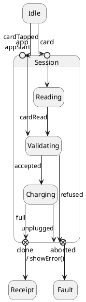
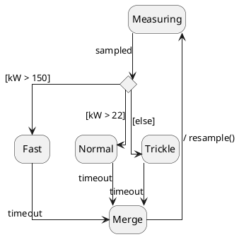
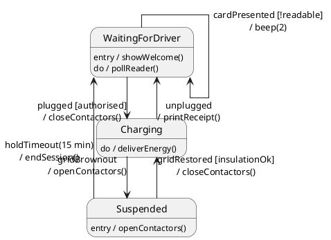

Title: State diagrams with `linetype ortho`: edges run along states, meet entry/exit points off-centre, and cross label text

Category: Bug
Tags: state-diagram, ortho, layout

----------------------------------------------------------------------
Body (paste everything below this line into the forum editor)
----------------------------------------------------------------------

### Problem

With `skinparam linetype ortho`, Graphviz's ortho router often leaves state diagram edges looking wrong at their ends. This is especially true with `skinparam stateDiagramEdgeLabelStyle node`:

1. **Edges don't leave or meet states at right angles.** They run along the side of a state, turn a few pixels away from it, or land on a rounded corner.
2. **Entry and exit points are met off-centre.** Several edges arrive side by side at the edge of the circle, each with its own arrowhead.
3. **Choice and junction points get crowded.** Edges come in close together, merging only just short of the point.
4. **Edges run through node-style label text.**

### Example 1: entry and exit points

`refused` and `unplugged` reach `aborted` side by side, off-centre, with two arrowheads.

### Example 2: choice and junction

The `Normal` and `Trickle` timeout edges come in side by side and meet only just above the junction. The `/ resample()` edge runs through its own label text.

### Example 3: stems at states and multi-line labels

The `cardPresented` self-loop, `gridRestored`, `holdTimeout` and `unplugged` edges all run through label text, and two arrowheads land on the rounded corner of `WaitingForDriver`.

### Proposed fix

Once Graphviz has routed the edges, adjust the ends of each ortho edge in a state diagram:

- An edge leaves and meets a state at a right angle, on a straight side, clear of the corners.
- An edge meets an entry or exit point on its centre line, at right angles to the frame, and edges into the same point join into one stem with one arrowhead. An edge from outside the state comes in from outside, turning round the point's label if it has to, and the label moves beside the edge.
- Edges into a choice or junction join into one stem, and edges out of one are spread over its points (top, bottom, left, right) instead of crowding one side.
- Edges are kept out of node-style label text.

Only diagrams that use `linetype ortho` change. Other line types, and diagrams without states or pseudo-states, come out exactly as before.

With the fix (left: current, right: fixed):

I have a PR ready and will link it here.
