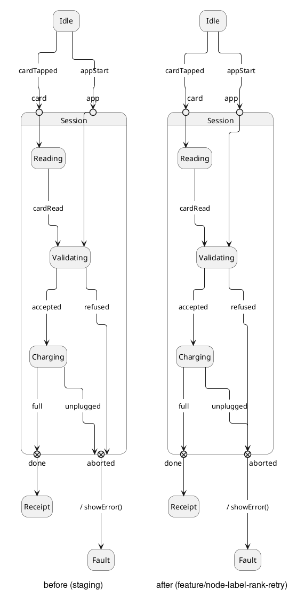
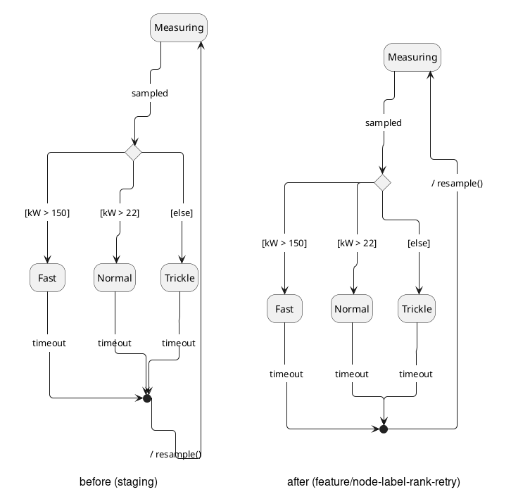
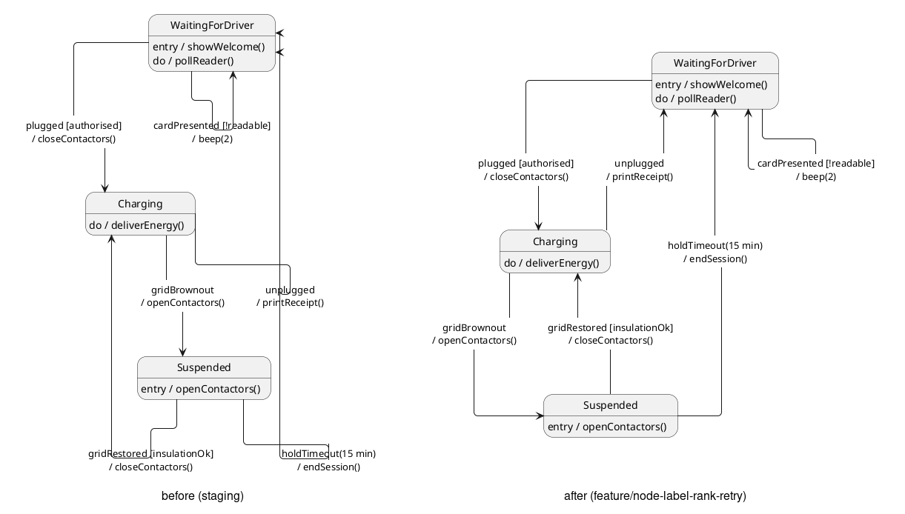
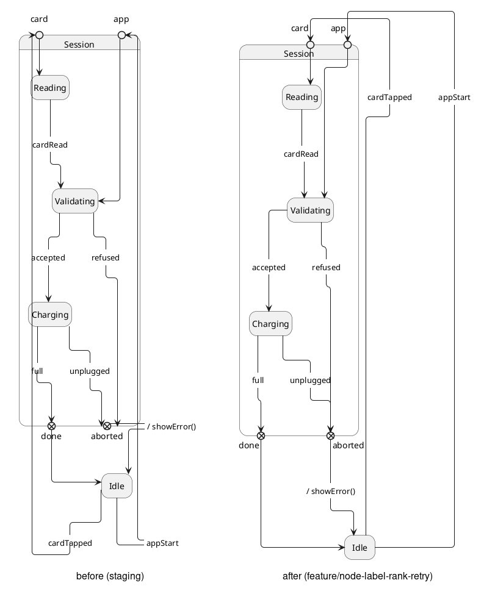

# State diagrams with `linetype ortho`: before and after

"Before" is `staging/component-node-style-edge-labels` (`8d3177fe2`). "After" is
`feature/node-label-rank-retry` (`01a5bcaff`), which contains two sets of changes
on top of staging:

- `feature/state-ortho-edge-stubs`: ortho edges meet states, pseudo-states, and
  entry and exit points at right angles and on centre, are spread over the points
  of a choice or junction, and stay clear of node-style label text.
- `feature/node-label-rank-retry`: a node-style label that Graphviz ranks outside
  the two nodes it joins is laid out again between them. An edge reaching an
  entry or exit point from outside its state meets the point on its centre line
  from outside, and the point's label moves beside the edge.

Every diagram uses `skinparam linetype ortho`,
`skinparam stateDiagramEdgeLabelStyle node` and `!pragma edge_corner_radius 5`.
The pragma rounds edge corners with a 5px radius and is already in upstream.
All images were rendered with Graphviz 14.1.2. Graphviz 2.42 is not used because
its ortho router can crash on larger state diagrams, before PlantUML does
anything with the edges.

## 1. Entry and exit points

- `app`: the edge into `Validating` now leaves from the bottom centre of the
  circle. Before, it left from the circle's left edge.
- `aborted`: the `refused` and `unplugged` edges now meet the point on its
  centre line, with one arrowhead. Before, they arrived side by side and off
  centre.
- `card`, `app`, `done` and `aborted`: the edges outside `Session` meet each
  point on its centre line, and each label moves beside its edge rather than
  under it.

## 2. Choice and junction

- The three `timeout` edges come together above the junction and arrive as one
  stem. Before, they crowded in from the left, the top and the top-left, partly
  through the `timeout` text.
- `/ resample()` now sits between the junction and `Measuring`, beside the
  diagram. Before, it sat below the junction, and its edge ran back up the whole
  height of the diagram.
- Edges leaving a state now leave its side at right angles, instead of running
  along the side or turning a few pixels away from it.

## 3. Stems at states and multi-line labels

- **Before:** the `cardPresented` self-loop, `gridRestored`, `holdTimeout` and
  `unplugged` edges all run through label text. Two arrowheads land on the
  rounded corner of `WaitingForDriver`.
- **After:** every edge keeps clear of label text and meets its state on a
  straight side. `holdTimeout`, `unplugged` and `gridRestored` go back up, and
  each label now sits between the two states it joins, so each of those edges is
  a short, direct run.

## 4. Labels on edges that go back up

`Idle` sits below `Session`, but its `cardTapped` and `appStart` edges go up to
the entry points at the top of `Session`.

- **Before:** both labels sit below `Idle`. Each edge drops from `Idle` to its
  label, then climbs back up past `Idle` and the whole of `Session`.
- **After:** both labels sit beside `Session`, between `Idle` and the entry
  points, so each edge climbs once. Each edge then turns over the top of the
  entry point's label and comes straight down into the point, so it meets the
  point the same way as an edge from above would. The two runs over the top
  are kept apart. They cross once, which can't be avoided, since the edges
  interleave. The `card`, `app` and `done` labels move beside their edges so
  that no edge runs through them.
